# PHLAME: Phase-Level And Microcontroller Evaluation


An open-source framework to train, quantize, deploy and measure CNN image classifiers on resource-constrained microcontrollers (specifically the **Arduino Portenta H7**), evaluated across a four-level MIL→SIL→PIL→HIL fidelity ladder.

---

## Table of Contents
- [Overview](#overview)
- [Requirements](#requirements)
- [Installation](#installation)
- [Reproduce the Paper's Results Without Hardware](#reproduce-the-papers-results-without-hardware)
- [The Fidelity Ladder](#the-fidelity-ladder)
- [Usage (Full Pipeline)](#usage-full-pipeline)
  - [1. Data Preparation](#1-data-preparation)
  - [2. Model Training](#2-model-training)
  - [3. Model Evaluation](#3-model-evaluation)
  - [4. INT8 Quantization](#4-int8-quantization)
  - [5. Embedded Deployment](#5-embedded-deployment)
  - [6. Processor-in-the-Loop (PIL) Evaluation](#6-processor-in-the-loop-pil-evaluation)
  - [7. Hardware-in-the-Loop (HIL) Evaluation](#7-hardware-in-the-loop-hil-evaluation)
- [Results](#results)
- [Results Format](#results-format)
- [Hardware Details](#hardware-details)
- [Documentation](#documentation)
- [Known Limitations](#known-limitations)
- [Data Availability](#data-availability)
- [License](#license)
- [Citation](#citation)
- [Support](#support)

---

## Overview

**PHLAME** (*Phase-Level And Microcontroller Evaluation*) is an open-source, reproducible software framework that covers the full cycle of training→INT8 quantization→deployment→phase-level measurement of CNN image classifiers on ARM Cortex-M microcontrollers. It organizes evaluation along a four-level fidelity ladder — **Model-in-the-Loop (MIL) → Software-in-the-Loop (SIL) → Processor-in-the-Loop (PIL) → Hardware-in-the-Loop (HIL)** — that makes the gap between desktop simulation and the physical device explicit and measurable at every step. Reuse beyond the framework's own application case is demonstrated on a standard TinyML benchmark (**Visual Wake Words**, one of the MLPerf Tiny tasks).

- **Fidelity-ladder evaluation:** Each level of realism — floating-point PC model, INT8-simulated PC model, real chip fed via serial, and real chip with a live camera in the loop — is a separately runnable, comparable artifact.
- **Per-phase latency:** On-device timing decomposed into pre-processing / inference / post-processing using the ARM Cortex-M7 DWT cycle counter.
- **Seven architectures, INT8 quantization:** `MobileNet`, `MobileNetV2`, `MobileNetV3Large`, `MobileNetV3Small` (ImageNet transfer learning, adapted to single-channel inputs), plus `ResNet8`, `ResNet18` and `SqueezeNet` trained from scratch, with full-integer quantization. Magnitude-based pruning is available as an optional step; no published result uses it.
- **Model identity on the board:** The HIL firmware reports an FNV-1a fingerprint of the model it carries, and the bench refuses to measure if it does not match the expected `.tflite`, so a stale `model.h` cannot silently produce HIL results.
- **Reproducibility:** A seeded, stratified `train`/`val`/`test` partition materialized on disk with CSV manifests, so all four levels evaluate the same held-out images. Every level writes a `metrics_*.json` with the SHA-256 of the evaluated model and a per-image table, so the ladder can be compared image by image (see [Results Format](#results-format)).

---

## Requirements

**Software.** Tested on Windows 11 with Python 3.13.14 and TensorFlow 2.21; other versions are not verified. Python dependencies are listed in `requirements.txt` (minimum versions) and `requirements-lock.txt` (exact versions).

**Toolchain.** Arduino CLI 1.5.0 + `arduino:mbed_portenta` core 4.5.0 +
`Chirale_TensorFlowLite` library 2.0.0 (the versions behind the published
results; the Camera/HM01B0 and SDRAM libraries ship inside the core). Install
them with `arduino-cli core install arduino:mbed_portenta@4.5.0` and
`arduino-cli lib install "Chirale_TensorFlowLite@2.0.0"`; see the non-Python
section of `requirements.txt`.

**Hardware.** It depends on the level:

| Level | Needs |
|---|---|
| Tables of the paper, MIL, SIL | A PC only |
| PIL | Arduino Portenta H7 |
| HIL | Arduino Portenta H7, Vision Shield (HM01B0 camera) and a monitor for the stimuli |

The firmware toolchain above is needed only for PIL and HIL. See [Hardware Details](#hardware-details).

---

## Installation

We recommend installing PHLAME in an isolated virtual environment:

```bash
git clone https://github.com/F4bian1012/phlame-tinyml.git
cd phlame-tinyml
python -m venv venv

# Linux / macOS
source venv/bin/activate
# Windows (PowerShell)
venv\Scripts\Activate.ps1

python -m pip install --upgrade pip
pip install -r requirements.txt
python -m unittest discover -s tests -v   # checks the installation and the results schema
```

> On Windows, if PowerShell blocks the activation script, run once:
> `Set-ExecutionPolicy -Scope CurrentUser RemoteSigned`

**Why two requirements files.** `requirements.txt` declares *minimum* compatible
versions (`>=`): it installs on other Python versions and operating systems, even with newer
releases, and is what the commands above use. `requirements-lock.txt` pins the
*exact* versions of the project virtual environment, the likely source of the published results (Python
3.13.14, TensorFlow 2.21.0, see its header): use `pip install -r requirements-lock.txt`
when you need to reproduce the reported numbers rather than just run the
framework. One file cannot do both: exact pins stop installing as soon as a
release disappears or is missing for another Python version, and minimums alone
cannot rebuild the exact environment. `scikit-learn` and `seaborn` are not optional:
the evaluation scripts need them to write `metrics_*.json` and the confusion
matrices. GPU training is only possible under WSL2 (`tensorflow[and-cuda]`, see the
note in `requirements.txt`); the serial benches stay on Windows, where the COM port is.
The firmware toolchain is described under [Requirements](#requirements).

---

## Reproduce the Paper's Results Without Hardware

The per-image results are in git, so every table of the paper can be rebuilt in about 10 seconds without a board, a dataset or trained models. This writes to a git-ignored folder, so `results/tables/` stays untouched for comparison:

```bash
python src/build_ladder_tables.py --output_dir results/smoke_test/tables
```

Try the preprocessing on the 8 public sample images:

```bash
python src/process_images.py --raw_path data/sample --path_processed data/processed/sample_gray
```

---

## The Fidelity Ladder

| Level | Model | Runs on | Input | Script | Images |
|---|---|---|---|---|---:|
| **MIL** | FP32 `.keras` | PC | Dataset file | `test_model.py` | 940 |
| **SIL** | INT8 `.tflite` | PC | Dataset file | `test_tflite_model.py` | 940 |
| **PIL** | INT8 `.tflite` | Cortex-M7 | Dataset file, over serial | `pil_benchmark.py` | 940 |
| **HIL** | INT8 `.tflite` | Cortex-M7 | Camera frame of the on-screen image | `hil_camera_benchmark.py` | 200 |

The project separates the Python environment (`src/`) from the embedded firmware (`deployment/`):

```mermaid
flowchart TD
    %% Blue = script, yellow = artifact, green = data, teal = hardware
    classDef data fill:#D5E8D4,stroke:#4E7F3A,stroke-width:2px,color:#000;
    classDef python fill:#4B8BBE,stroke:#1F4E79,stroke-width:2px,color:#fff;
    classDef artifact fill:#FFD43B,stroke:#9C7C00,stroke-width:2px,color:#000;
    classDef hardware fill:#00979D,stroke:#005C5F,stroke-width:2px,color:#fff;

    subgraph DATA["1 · Data preparation"]
        direction TB
        RAW[("data/raw")]:::data
        PROCESS["process_images.py<br/><small>to grayscale</small>"]:::python
        GRAY[("data/processed/<br/>grayscale")]:::data
        RESHAPE["reshape_images.py<br/><small>resize, --balance</small>"]:::python
        RESIZED[("data/processed/<br/>160x120")]:::data
        SPLIT["split_dataset.py<br/><small>stratified, seed 42</small>"]:::python
        SPLITS[("data/splits/<br/>train · val · test")]:::data
        RAW --> PROCESS --> GRAY --> RESHAPE --> RESIZED --> SPLIT --> SPLITS
    end

    subgraph TRAINING["2 · Training and quantization"]
        direction TB
        TRAIN["train_*.py<br/><small>reads train + val</small>"]:::python
        KERAS("models/checkpoints/<br/>{model}.keras"):::artifact
        CURVES("results/<br/>training_curves/"):::artifact
        PRUNE["prune_model.py<br/><small>optional, writes<br/>{model}_pruned.keras</small>"]:::python
        QUANT["quantize_int8_basic.py<br/><small>calibrates on train</small>"]:::python
        TFLITE("models/tflite/<br/>{model}_int8.tflite"):::artifact
        TRAIN --> KERAS
        TRAIN --> CURVES
        KERAS <-.-> PRUNE
        KERAS --> QUANT --> TFLITE
    end

    subgraph DEPLOY["3 · Embedded deployment, from the .tflite"]
        direction LR
        HEADER["tflite_to_c.py<br/><small>--target pil, hil, both</small>"]:::python
        MODEL_H("deployment/*/<br/>model.h"):::artifact
        FLASH["compile_upload_arduino.py<br/><small>--target pil or hil</small>"]:::python
        BOARD{{"Portenta H7<br/><small>pil_firmware or<br/>hil_camera_firmware</small>"}}:::hardware
        HEADER --> MODEL_H --> FLASH --> BOARD
    end

    subgraph LADDER["4 · Fidelity ladder, on data/splits/test"]
        direction TB
        subgraph R_MIL["MIL · float model on PC"]
            direction LR
            MIL["test_model.py<br/><small>reads the .keras</small>"]:::python
            MIL_OUT("results/mil/<br/><small>PNG · JSON · predictions CSV</small>"):::artifact
            MIL --> MIL_OUT
        end
        subgraph R_SIL["SIL · INT8 model on PC"]
            direction LR
            SIL["test_tflite_model.py<br/><small>reads the .tflite</small>"]:::python
            SIL_OUT("results/sil/<br/><small>PNG · JSON · predictions CSV</small>"):::artifact
            SIL --> SIL_OUT
        end
        subgraph R_PIL["PIL · real chip, image over serial"]
            direction LR
            PIL["pil_benchmark.py<br/><small>talks to the Portenta</small>"]:::python
            PIL_OUT("results/pil/<br/><small>PNG · JSON · predictions CSV<br/>+ latency CSV</small>"):::artifact
            PIL --> PIL_OUT
        end
        subgraph R_HIL["HIL · real chip and camera, hil_subset"]
            direction LR
            HIL["hil_camera_benchmark.py<br/><small>talks to the Portenta</small>"]:::python
            HIL_OUT("results/hil/<br/><small>PNG · JSON · latency CSV<br/>+ rig conditions JSON</small>"):::artifact
            SCREEN{{"Monitor<br/><small>shows the stimulus</small>"}}:::hardware
            CAM{{"HM01B0 camera<br/><small>on the Portenta</small>"}}:::hardware
            HIL --> HIL_OUT
            HIL --> SCREEN --> CAM
        end
        R_MIL --> R_SIL --> R_PIL --> R_HIL
    end

    subgraph LEGEND["Legend"]
        direction LR
        L1["script"]:::python ~~~ L2("artifact"):::artifact ~~~ L3[("data")]:::data ~~~ L4{{"hardware"}}:::hardware
    end

    DATA --> TRAINING
    TRAINING --> DEPLOY
    DEPLOY --> LADDER
    LADDER ~~~ LEGEND
```



---

## Usage (Full Pipeline)

Every step needs your own dataset in `data/raw/`; steps 5 to 7 also need the board. Extra options and details are in the [usage notes](docs/scripts.md#usage-notes).

### 1. Data Preparation
Place your raw image dataset inside `data/raw/` (organized by class subfolders):
```
data/raw/
├── Class1/
└── Class2/
```

**Supported formats.** `.jpg`, `.jpeg`, `.png` and `.bmp`, any resolution and colour
mode: `process_images.py` converts every image to 8-bit single-channel grayscale and
`reshape_images.py` resizes it to the target resolution (extensions are matched
case-insensitively, so `.JPG` or `.Png` also count). Each subfolder of `data/raw/` is one class, and
labels follow the alphabetical order of the folder names (`split_dataset.py` reuses
`models/class_names.txt` when training has already written it). Files with other
extensions (e.g. `.gif`, `.tif`, `.webp`, `.heic`) are skipped.

Then process (convert to grayscale) and resize them with recommended sizes: CAMERA_R160x120 (QQVGA), CAMERA_R320x240 (QVGA), CAMERA_R320x320.
```bash
python src/process_images.py --raw_path data/raw --path_processed data/processed/grayscale
python src/reshape_images.py --width 160 --height 120 --balance undersample
```

Finally, partition the resized dataset. This step is **required** before training, because it guarantees that every level evaluates exactly the same held-out images:
```bash
python src/split_dataset.py --input_dir data/processed/160x120 --output_dir data/splits --seed 42
```

### 2. Model Training
Train an architecture (e.g., MobileNetV2). Training reads `data/splits/train` and `data/splits/val`, and fails with instructions if the partition is missing.
```bash
python src/train_mobilenet.py --base_model MobileNetV2 --width 160 --height 120 --batch_size 32 --epochs 20 --learning_rate 0.0001
```
For ResNet or SqueezeNet, run `src/train_resnet.py` or `src/train_squeezenet.py`.

### 3. Model Evaluation
Evaluate the `.keras` model at the **MIL** level. Outputs go to `results/mil/`:
```bash
python src/test_model.py --width 160 --height 120 --model_path models/checkpoints/MobileNetV2+32+20+0.0001+160+120.keras
```

### 4. INT8 Quantization
Convert the model to integer-only TFLite. Calibration samples come from `data/splits/train` only, so the evaluation partition stays untouched:
```bash
python src/quantize_int8_basic.py --model_path models/checkpoints/{model_name}.keras --calib_samples 100 --calib_seed 42
```
Validate it at the **SIL** level. Outputs go to `results/sil/`:
```bash
python src/test_tflite_model.py --model_path models/tflite/{model_name}_int8.tflite
```

### 5. Embedded Deployment
Convert the `.tflite` into a C header (written into both firmware sketches by default), then compile and upload one firmware; the board runs one at a time:
```bash
python src/tflite_to_c.py models/tflite/{model_name}_int8.tflite
python src/compile_upload_arduino.py --target pil
```

### 6. Processor-in-the-Loop (PIL) Evaluation
The bench streams the held-out test partition over USB Serial. The real chip runs inference, but the camera is not part of the loop. Outputs go to `results/pil/`:
```bash
python src/pil_benchmark.py --model_path models/tflite/{model_name}_int8.tflite --width 160 --height 120 --port COM9 --baud 115200
```

### 7. Hardware-in-the-Loop (HIL) Evaluation
Flash the camera firmware with `python src/compile_upload_arduino.py --target hil`. The host displays each stimulus full-screen, the HM01B0 camera captures it, and the on-device prediction is matched with the known label. The bench aborts if the model fingerprint does not match or if a rig condition is missing. Outputs go to `results/hil/`:
```bash
python src/hil_camera_benchmark.py --port COM9 \
    --settle 1.0 --lux 10 --distance-cm 24 --ambient-temp 24 \
    --sil-model models/tflite/{model_name}_int8.tflite \
    --mil-model models/checkpoints/{model_name}.keras
```

---

## Results

### 1. Fidelity Ladder Across Seven Architectures (Primary Benchmark, 160×120)

Evaluated on the balanced binary partition (`data/splits/test`, n = 940 held-out images for MIL/SIL/PIL; n = 200 `hil_subset == 1` stimuli at 10 lux, 24 cm, 24 °C for HIL). All metrics are **F1-macro** (which equals weighted F1 and accuracy to within ≤ 0.002 on this 50/50 split); latencies are measured on-chip via the Cortex-M7 `DWT->CYCCNT` cycle counter at `SystemCoreClock = 400.0 MHz`:

| Architecture | `.tflite` (INT8) | Arena used | **MIL** (n=940) | **SIL** (n=940) | **PIL** (n=940 / n=200) | **HIL** (n=200) | HIL `INF` (ms) | HIL `TOTAL` (ms) |
|---|---:|---:|---:|---:|---:|---:|---:|---:|
| `MobileNet` (α=0.25) | 311.5 KiB | 177.2 KiB | 0.9202 | 0.9159 | 0.9170 / 0.9399 | 0.8736 | 236.49 | 241.66 |
| `MobileNetV2` (α=0.35) | 630.5 KiB | 348.1 KiB | 0.9478 | 0.9446 | 0.9468 / 0.9450 | 0.8785 | 396.00 | 401.17 |
| `MobileNetV3Small` (α=0.75) | 817.3 KiB | 220.5 KiB | 0.9479 | 0.9181 | 0.9266 / 0.9400 | 0.9200 | 478.35 | 483.64 |
| `SqueezeNet` | 808.2 KiB | 404.7 KiB | 0.9159 | 0.9159 | 0.9180 / 0.9099 | 0.8899 | 1126.24 | 1131.56 |
| `ResNet8` | 1249.2 KiB | 388.8 KiB | 0.9318 | 0.9308 | **0.9308 / 0.9600**† | 0.8632 | 2814.02 | 2819.17 |
| `MobileNetV3Large` (α=0.75) | 2180.8 KiB | — | 0.9489 | 0.9553 | *Flash OOM* | *Flash OOM* | — | — |
| `ResNet18` | 11057.3 KiB | — | 0.9393 | 0.9393 | *Flash OOM* | *Flash OOM* | — | — |

> †**Subset representativeness note (`ResNet8` PIL on n=940 vs. n=200):** Both PIL figures are reported explicitly because the fixed 200-image `hil_subset` happens to be slightly easier for `ResNet8` than the full 940-image test split (`0.9600` on n=200 vs. `0.9308` on n=940, a +0.0292 sampling offset). Computing the physical-frontend gap (PIL → HIL) always requires comparing paired predictions on the **exact same n=200 images** (`0.9600 → 0.8632`, Δ = −0.0968, exact McNemar p < 0.001, Holm-adjusted p < 0.001), rather than mixing n=940 with n=200.

---

### 2. Paired 2×3 Decomposition on the HIL Subset (n = 200, `hil_subset == 1`)

Cross-running the exact same 200 test stimuli as **digital files** (MIL₂₀₀, SIL₂₀₀, PIL₂₀₀) and as **HM01B0 camera-captured frames** (MIL\*₂₀₀, SIL\*₂₀₀, HIL₂₀₀) isolates where degradation enters the pipeline (F1-macro shown; exact McNemar p-values with Holm–Bonferroni adjustment across the 5 architectures in parentheses):

| Architecture | MIL₂₀₀ (FP32, file) | SIL₂₀₀ (INT8, file) | PIL₂₀₀ (Chip, file) | MIL\*₂₀₀ (FP32, frame) | SIL\*₂₀₀ (INT8, frame) | HIL₂₀₀ (Chip, frame) | SIL\*₂₀₀ = HIL₂₀₀ agreement | Physical gap Δ(PIL₂₀₀ → HIL₂₀₀) |
|---|---:|---:|---:|---:|---:|---:|---:|---:|
| `MobileNet` | 0.9449 | 0.9349 | 0.9399 | 0.8995 | 0.8736 | 0.8736 | **200 / 200 (100.0%)** | −0.0663 (p = 0.002, Holm 0.009) |
| `MobileNetV2` | 0.9450 | 0.9400 | 0.9450 | 0.9093 | 0.8733 | 0.8785 | **195 / 200 (97.5%)** | −0.0664 (p = 0.007, Holm 0.022) |
| `MobileNetV3Small` | 0.9500 | 0.9150 | 0.9400 | 0.9148 | 0.9100 | 0.9200 | **194 / 200 (97.0%)** | −0.0200 (n.s.) |
| `SqueezeNet` | 0.8949 | 0.8949 | 0.9099 | 0.8949 | 0.8899 | 0.8899 | **200 / 200 (100.0%)** | −0.0200 (n.s.) |
| `ResNet8` | 0.9600 | 0.9600 | 0.9600 | 0.8527 | 0.8527 | 0.8632 | **198 / 200 (99.0%)** | −0.0968 (p < 0.001, Holm < 0.001) |

- **On-chip execution fidelity (SIL ↔ PIL and SIL\* ↔ HIL):** Across all 10 paired comparisons (5 architectures × 2 input domains), moving from PC INT8 simulation to the physical Cortex-M7 chip never degrades F1-macro (Δ ≥ 0 in all 10 cases). F1 can hide changes that cancel out, so image-level agreement is the stricter check: SIL ↔ PIL on the 940 test files is 99.4%–99.6%, except `MobileNetV3Small` (95.96%, 38 images change), and SIL\* ↔ HIL on captured frames is 97.0%–100.0%.
- **Optical front end in FP32 (MIL₂₀₀ → MIL\*₂₀₀):** Replacing the file with the camera frame changes F1-macro by −0.1073 in `ResNet8` (Holm p < 0.001), −0.0454 in `MobileNet` (Holm p = 0.156), −0.0351 in `MobileNetV3Small` (Holm p = 0.156), −0.0357 in `MobileNetV2` (Holm p = 0.287) and 0.0000 in `SqueezeNet` (Holm p = 1.000). Only `ResNet8` is individually significant.
- **Physical gap on the chip (PIL₂₀₀ → HIL₂₀₀):** This is a different quantity, shown in the last column of the table: significant in `ResNet8`, `MobileNet` and `MobileNetV2`, and −0.0200 (not significant) in `MobileNetV3Small` and `SqueezeNet`.
- **Bench repeatability (`results/hil/rep1..rep4/`, `MobileNetV2`):** Across 3 fixed-seed (`seed=42`) sessions under identical physical conditions, the PIL → HIL gap on the fixed 200-image subset is −0.0561, −0.0563, and −0.0509 (repeatability sd = 0.0030, CV = 5.5%, pairwise image agreement 96.5%–97.5%; sd = 0.0065 across all 4 runs when including the `rep4` `seed=7` presentation-order control at −0.0664, with 189/200 stimuli or 94.5% receiving an identical prediction across all 4 sessions). Combining 200-image subset sampling variance with bench repeatability yields an overall `MobileNetV2` frontend gap of **−0.057 [−0.098, −0.017] (95% CI)**.

---

### 3. Reuse on a Standard TinyML Benchmark: Visual Wake Words (`MobileNetV2_VWW`)

To demonstrate dataset-agnostic pipeline reuse on a standard *MLPerf Tiny* task (`person` vs. `non_person` from MS-COCO `val2017`, 2,000 balanced images prepared via `src/download_vww_subset.py` after excluding 226 ambiguous images with `< 0.5%` person area or `iscrowd == 1`; `data/splits_vww/test` n = 300, `hil_subset == 1` n = 200 at 14 lux, 24 cm, 24 °C; linear classification head trained for 20 epochs over the frozen ImageNet `MobileNetV2` α = 0.35 backbone on 1,400 grayscale 160×120 images as a pipeline-reuse demonstration rather than a leaderboard-tuned VWW model):

| Scope | Level / Domain | Accuracy | F1-macro | Latency `INF` / `TOTAL` (ms) | Notes |
|---|---|---:|---:|---:|---|
| **Full test (n=300)** | **MIL** (FP32, PC) | 0.6900 | 0.6892 | — | `2,220.7 KiB` `.keras` |
| **Full test (n=300)** | **SIL** (INT8, PC) | 0.6767 | 0.6765 | — | `630.5 KiB` `.tflite` (3.52× smaller) |
| **Full test (n=300)** | **PIL** (INT8, Portenta H7) | 0.6867 | 0.6865 | 399.06 / 402.26 | `285/300` (95.0%) agreement with SIL |
| **Paired 2×3 (n=200)** | MIL₂₀₀ → SIL₂₀₀ → PIL₂₀₀ (file) | 0.7300 → 0.7150 → 0.7200 | 0.7290 → 0.7150 → 0.7196 | 399.06 / 402.26 | Δ(SIL₂₀₀ → PIL₂₀₀) = +0.0046 |
| **Paired 2×3 (n=200)** | MIL\*₂₀₀ → SIL\*₂₀₀ → HIL₂₀₀ (HM01B0) | 0.6750 → 0.6900 → 0.6800 | 0.6748 → 0.6892 → 0.6795 | 395.84 / 400.99 | **`196/200` (98.0%) SIL\* = HIL agreement** |

---

## Results Format

Every level writes a confusion-matrix PNG for visual inspection and standardized machine-readable files for cross-level comparison:

| Level | Metrics JSON | Per-image Table | Hardware Latency |
|---|---|---|---|
| MIL | `results/mil/metrics_{model}.json` | `predictions_{model}.csv` | — |
| SIL | `results/sil/metrics_{model}_int8.json` | `predictions_{model}_int8.csv` | — |
| PIL | `results/pil/metrics_{model}_int8.json` | `predictions_{model}_int8.csv` | `latency_metrics_{model}_int8.csv` |
| HIL | `results/hil/metrics_{model}_int8.json` | `hil_latencies_{model}_int8.csv` | same file |

- **Same `sha256` across SIL, PIL and HIL:** Verifies that the same `.tflite` file was evaluated on the host. MIL records the hash of the `.keras` file, so it never matches the other levels. Only HIL also verifies the model flashed on the board (FNV-1a fingerprint); PIL does not, so a stale `model.h` is detected only indirectly (per-architecture cycle signature, Table 7 attribution check).
- **`f1_weighted` vs `f1_macro`:** On balanced splits both values coincide; any divergence indicates that minority-class degradation is being obscured by majority-class accuracy.
- **`predictions_*.csv` (`;`-separated):** Columns: `Image;RelPath;TrueLabel;TrueClass;PredLabel;PredClass;Correct`. `RelPath` disambiguates files sharing identical names across class subdirectories. In PIL and HIL, empty cells differentiate between unlabelled stimuli and hardware dropouts. Joining on `RelPath` isolates the exact images that flip prediction across ladder rungs.

---

### Metrics JSON Top-Level Keys (`metrics_*.json`)

| Key | Description |
|---|---|
| `nivel` | Evaluation level in the fidelity ladder: `"MIL"`, `"SIL"`, `"PIL"`, or `"HIL"`. |
| `generado_utc` | ISO 8601 UTC timestamp when the evaluation run was completed. |
| `modelo` | Model identification, checksums, and on-chip verification. |
| `dataset` | Evaluated images: directories, sample counts, and class names. |
| `corrida` | PIL and HIL only: serial parameters and physical rig settings. |
| `metricas_globales` | Global accuracy, precision, recall, and F1. |
| `metricas_por_clase` | Per-class precision, recall, F1-score, and support, plus aggregates. |
| `matriz_confusion` | Confusion matrix with its labels and layout. |
| `conteo_predicciones` | PIL only: number of predictions per class index. |
| `latencia` | PIL and HIL only: per-phase cycle and microsecond statistics. |
| `validacion_cruzada` | HIL only: paired PC MIL/SIL evaluation on the captured frames. |
| `artefactos` | Relative paths to the companion output files. |

The `hil_conditions_*.json` schema and all nested keys are documented in [`docs/results_schema.md`](docs/results_schema.md). Check that document against every published JSON with:

```bash
python -m unittest discover -s tests -v
```

---

### Inspecting Results Programmatically

Because all levels adhere to this unified schema, the full fidelity ladder can be compared across levels, architectures, and latency domains with a few lines of Python:

```python
import glob, json

for f in sorted(glob.glob("results/*/metrics_*.json")):
    with open(f, encoding="utf-8") as fh:
        d = json.load(fh)
    level = d["nivel"]
    m_name = d["modelo"]["nombre"]
    g = d["metricas_globales"]
    sha = (d["modelo"]["sha256"] or "N/A")[:12]
    unresp = d.get("dataset", {}).get("n_sin_respuesta", 0)

    # Hardware latency & on-chip verification (PIL / HIL)
    lat_str = ""
    if "latencia" in d and "por_campo" in d["latencia"]:
        us_tot = d["latencia"]["por_campo"].get("US_TOTAL")
        if us_tot and us_tot.get("media") is not None:
            lat_str = f" | {us_tot['media']/1000.0:.2f} ms"

    verif_str = ""
    if level == "HIL":
        verified = d["modelo"].get("identidad_verificada")
        verif_str = f" [chip_verified={verified}]"

    print(f"{level:4} {m_name:40} acc={g['accuracy']:.4f} f1_macro={g['f1_macro']:.4f} "
          f"sha256={sha} drops={unresp}{lat_str}{verif_str}")
```

---

## Hardware Details

| Component        | Specification                                                        |
|------------------|---------------------------------------------------------------------|
| Board            | Arduino Portenta H7 (STM32H747XI, dual-core Cortex-M7 nominal up to 480 MHz; runs at `SystemCoreClock = 400.0 MHz`, 2.50 ns/cycle under `arduino:mbed_portenta`, DWT 32-bit overflow ~10.74 s) |
| External RAM     | 8 MiB SDRAM (required — tensor arena + image buffer live here)        |
| Camera (capture) | Portenta Vision Shield, HM01B0 monochrome sensor (160×120, 30 fps)   |
| Thermal control  | Active forced-air cooling (constant-speed fan over Portenta H7 + Vision Shield) |
| Flash            | 2 MiB internal, shared by firmware and `model.h`                      |
| Host link        | USB-C, 115200 baud serial                                            |

Sizes in this README use binary units (1 KiB = 1,024 bytes; 1 MiB = 1,024 KiB), like `results/tables/`.

**Flash budget (this is a hard limit).** The model is linked into the firmware as
a C array, so the quantized model and the firmware code share the same 2 MiB of
internal flash. Measured on the PIL firmware with `AllOpsResolver`:

| | Size |
|---|---|
| Firmware code (TFLite-Micro + all kernels, no model) | ~673 KiB |
| Internal flash (STM32H747, `0x08000000`–`0x081FFFFF`) | 2048 KiB |
| **Headroom left for `model.h`** | **~1375 KiB** |

Which of the framework's INT8 models fit, at 160×120:

| Model | `.tflite` | Binary | Fits |
|---|---|---|---|
| `MobileNet` | 311 KiB | 0.96 MiB | yes |
| `MobileNetV2` | 631 KiB | 1.27 MiB | yes |
| `SqueezeNet` | 808 KiB | 1.45 MiB | yes |
| `MobileNetV3Small` | 817 KiB | 1.46 MiB | yes |
| `ResNet8` | 1249 KiB | 1.88 MiB | yes, 126 KiB to spare |
| `MobileNetV3Large` | 2181 KiB | 2.79 MiB | **no** — 0.79 MiB over |
| `ResNet18` | 11057 KiB | 11.46 MiB | **no** — 9.46 MiB over |

`MobileNetV3Large` and `ResNet18` train and quantize fine, and are valid MIL/SIL
targets on the PC, but they cannot be deployed from internal flash: the `.tflite`
alone exceeds it (`MobileNetV3Large`) or exceeds it several times over (`ResNet18`).
Options are running the model from external memory (QSPI flash or SDRAM, not
implemented in PHLAME) or a narrower variant (lower width multiplier), which is a
different model. Unstructured pruning (`prune_model.py`) does not help because tensor
shapes are kept, and a lower input resolution does not either because these networks
end in global average pooling: it shrinks the arena, not the model. For a borderline
model whose `.tflite` does fit, swapping `AllOpsResolver` for a
`MicroMutableOpResolver` listing only the operators that model uses would free flash
(not implemented in PHLAME).

Memory configuration, upload troubleshooting, the serial protocol and porting to other boards are in [`docs/hardware.md`](docs/hardware.md).

---

## Documentation

| Document | Content |
|---|---|
| [`docs/scripts.md`](docs/scripts.md) | Detailed description, output artifacts and usage notes of every script |
| [`docs/results_schema.md`](docs/results_schema.md) | Every key of the `metrics_*.json` and `hil_conditions_*.json` files |
| [`docs/hardware.md`](docs/hardware.md) | Memory configuration, upload troubleshooting, serial protocol and porting |

### Scripts

All scripts live in `src/`. Detailed descriptions, output artifacts and usage notes are in [`docs/scripts.md`](docs/scripts.md).

| Stage | Script | Purpose |
|---|---|---|
| Data | `process_images.py` | Convert raw images to single-channel grayscale. |
| Data | `reshape_images.py` | Resize to the target resolution; optional seeded class balancing. |
| Data | `split_dataset.py` | Seeded, stratified `train`/`val`/`test` partition with manifests and the `hil_subset` flag. |
| Data | `download_vww_subset.py` | Rebuild the Visual Wake Words benchmark subset from MS-COCO. |
| Training | `train_mobilenet.py` | MobileNet family, transfer learning from ImageNet. |
| Training | `train_resnet.py` | `ResNet8` and `ResNet18`, trained from scratch. |
| Training | `train_squeezenet.py` | `SqueezeNet`, trained from scratch. |
| Optimization | `prune_model.py` | Optional unstructured magnitude pruning; not used in the published results. |
| Optimization | `quantize_int8_basic.py` | Full-INT8 `.tflite`, calibrated on the `train` partition only. |
| Evaluation | `test_model.py` | MIL level. |
| Evaluation | `test_tflite_model.py` | SIL level. |
| Evaluation | `pil_benchmark.py` | PIL level, image over serial. |
| Evaluation | `hil_camera_benchmark.py` | HIL level, camera in the loop. |
| Deployment | `tflite_to_c.py` | `.tflite` to the `model.h` C header. |
| Deployment | `compile_upload_arduino.py` | Compile and upload a firmware with `arduino-cli`. |
| Analysis | `build_ladder_tables.py` | Rebuild the eight statistical tables of the paper in `results/tables/`. |

### Repository Structure
```text
phlame-tinyml/
├── data/                  # Datasets (git-ignored); manifests and sample/ are tracked
├── deployment/            # Firmware source code: pil_firmware/, hil_camera_firmware/
├── docs/                  # scripts.md, hardware.md, results_schema.md
├── models/                # checkpoints/ (.keras), tflite/ (.tflite), class names
├── results/               # mil/, sil/, pil/, hil/, tables/, training_curves/
├── src/                   # Python source code (see Scripts)
├── tensorboard_logs/      # TensorBoard event logs from training
├── tests/                 # test_results_schema.py
├── CITATION.cff
├── LICENSE.txt
├── README.md
├── requirements.txt       # Minimum compatible versions and hardware setup
└── requirements-lock.txt  # Exact versions of the project environment
```

---

## Known Limitations

- **2 MiB internal flash ceiling with `AllOpsResolver`:** Linking all TFLite-Micro kernels (`~673 KiB`) leaves `~1,375 KiB` of internal flash for `model.h` on the STM32H747XI. Consequently, `MobileNetV3Large` (`2,181 KiB`) and `ResNet18` (`11,057 KiB`) serve as desktop MIL/SIL baselines: each `.tflite` alone exceeds the 2 MiB flash, so deploying them requires running from external memory (QSPI flash or SDRAM, not implemented in PHLAME) or a narrower variant, which is a different model. Unstructured pruning, a lower input resolution and `MicroMutableOpResolver` do not solve it.
- **External SDRAM requirement for large activation arenas:** Three of the five deployed architectures (`MobileNetV2` `348.1 KiB`, `ResNet8` `388.8 KiB`, and `SqueezeNet` `404.7 KiB`) exceed the `~288 KiB` of contiguous internal SRAM measured on the Arduino Nicla Vision, a board without external SDRAM, making the Portenta H7's 8 MiB external SDRAM mandatory for uniform multi-architecture benchmarking.
- **Single measured platform:** All PIL and HIL results come from one board: Arduino Portenta H7 (STM32H747XI Cortex-M7 at 400 MHz, 8 MiB external SDRAM) with the Vision Shield HM01B0 camera. The host benches and the serial protocols do not assume this board, and both firmwares compile for the Arduino Nicla Vision (same MCU, no external SDRAM), but they have not been run on it, and no results on other boards or MCU families are reported. On the Nicla Vision only MobileNet and MobileNetV3Small would fit their tensor arena in internal SRAM, and the HIL bench would need a driver for its GC2145 RGB camera (see [Portability](docs/hardware.md#portability-and-the-sdram-constraint)).
- **Presentation-order variance in the stimulus rig:** While fixed-seed HIL sessions (`seed=42`) exhibit sd = 0.0030 F1-macro across replicas on the fixed 200-image subset, permuting the stimulus presentation order (`rep4`, `seed=7`) shifts the measured gap (−0.0664 vs. the −0.0544 mean of the fixed-seed sessions, 4-run sd = 0.0065); accounting for both 200-image sampling variance and bench repeatability yields the conservative frontend interval of −0.057 [−0.098, −0.017] (95% CI).
- **Non-interchangeability of PIL and HIL inference cycle counts:** Across all evaluated models, `CYC_INF` in HIL is systematically 0.81%–2.77% lower than in PIL despite an identical `400.0 MHz` clock and SDRAM arena layout (cause not identified: arena and cache configuration are the same in both firmwares). PIL and HIL latency baselines should therefore be reported separately rather than mixed.
- **No on-chip model verification in PIL:** `pil_benchmark.py` hashes the `.tflite` passed with `--model_path` on the host and never compares it with the board, so its `sha256` does not prove which model was flashed. The FNV-1a fingerprint check exists only in the HIL bench; in PIL a stale `model.h` is detected only indirectly (per-architecture cycle signature, Table 7 attribution check).
- **FP32 firmware branch not validated:** Both firmwares divide the pixel by 255 when the model is floating point, while the INT8 branch and every published model use the raw pixel (0–255). All published results use INT8 models, so that branch never ran; do not deploy a floating-point `.tflite` without checking it.
- **Spanish end-of-inference markers:** The benches depend on strings printed by the firmware (see [Serial Protocol](docs/hardware.md#serial-protocol-pil-bench)).
- **Argmax class output over serial:** The firmware reports the predicted class index (`argmax`) rather than full per-class logit vectors to keep post-processing deterministic (`< 1 µs`) and compatible with arbitrary class counts.

---

## Data Availability

- **Partition Manifests & Per-Image Results (in Git):** Complete stratified partition manifests (`data/splits/{train,val,test}_manifest.csv`, `data/splits/split_report.json`, and `data/splits_vww/{train,val,test}_manifest.csv`) and all per-image prediction and latency tables (`results/{mil,sil,pil,hil}/`) are version-controlled directly in this repository, allowing full statistical and paired 2×3 reproduction without hardware (see [Reproduce the Paper's Results](#reproduce-the-papers-results-without-hardware)). The generated tables are in `results/tables/`.
- **Immediate Smoke-Test Sample (`data/sample/`):** A lightweight, personal-data-free 8-image sample (`data/sample/non_person/` and `data/sample/person/`, 4 `160×120` grayscale images per class from the held-out *Visual Wake Words* test split, individually licensed under **CC BY 2.0** with MS-COCO **CC BY 4.0** annotations; full provenance and SHA-256 checksums in `data/sample/ATTRIBUTION.md`) is tracked in git so users can immediately smoke-test data preprocessing right after cloning (see [Reproduce the Paper's Results](#reproduce-the-papers-results-without-hardware)), or evaluate a downloaded release model without overwriting `results/sil/`:
  ```bash
  python src/test_tflite_model.py --model_path models/tflite/MobileNetV2_VWW+32+20+0.0001+160+120_int8.tflite --data_dir data/sample --class_names_path models/class_names_vww.txt --output_dir results/smoke_test
  ```
- **Automated Visual Wake Words Benchmark (`src/download_vww_subset.py`):** The complete 2,000-image balanced *Visual Wake Words* dataset (`1,000 person` + `1,000 non_person` from MS-COCO `val2017`, `seed=42`, `selection_sha256: b3ab289abd4a`) can be rebuilt automatically in ~60 seconds via HTTP `Range` extraction:
  ```bash
  python src/download_vww_subset.py --per_class 1000 --seed 42
  ```
- **Trained Checkpoints (`.keras`), Quantized Models (`.tflite`), and Primary Dataset Privacy Policy:** Because binary weights (`*.keras`, `*.tflite`) exceed GitHub's recommended source tree size, all trained checkpoints and INT8 quantized models (7 primary architectures plus `MobileNetV2_VWW`) are published as release assets in the versioned **GitHub Release (`v1.0.0`)** and archived on **Zenodo** with a permanent DOI, where every `.keras` and `.tflite` file is verifiable against the `sha256` digest recorded in `results/*/metrics_*.json` (the `fnv1a` fingerprint is recorded only in the HIL files, `results/hil/`). Raw photographs from the primary vehicle benchmark are withheld from public redistribution because they contain identifiable vehicle license plates protected as personal data under Colombian data-protection law (**Law 1581 of 2012**); they are available from the author upon reasonable academic request subject to data-protection compliance, while all partition manifests, model weights, per-image predictions/latencies, and the 2,000-image VWW benchmark are openly accessible.

---

## License

Released under the [MIT License](LICENSE.txt).

---

## Citation

If you use this software, please cite it. The citation metadata is in [`CITATION.cff`](CITATION.cff); the permanent DOI will be added with the `v1.0.0` release.

```bibtex
@software{phlame_software_2026,
  title={PHLAME: A Phase-Level Hardware-in-the-Loop Framework for Reproducible Fidelity-Ladder Evaluation of TinyML Image Classifiers on ARM Cortex-M Microcontrollers},
  author={Villavisan, Jheyson Fabian},
  version={1.0.0},
  year={2026},
  url={https://github.com/F4bian1012/phlame-tinyml}
}
```

Please also cite the *SoftwareX* paper once it is published:

```bibtex
@article{phlame_2026,
  title={PHLAME: A Phase-Level Hardware-in-the-Loop Framework for Reproducible Fidelity-Ladder Evaluation of TinyML Image Classifiers on ARM Cortex-M Microcontrollers},
  author={Villavisan, Jheyson Fabian},
  journal={SoftwareX},
  year={2026},
  publisher={Elsevier}
}
```

Repository: [github.com/F4bian1012/phlame-tinyml](https://github.com/F4bian1012/phlame-tinyml)

---

## Support

Report bugs and ask questions through [GitHub Issues](https://github.com/F4bian1012/phlame-tinyml/issues), or write to [jfvillavisanb@itc.edu.co](mailto:jfvillavisanb@itc.edu.co).

---
*Created for the tiny edge. Maintained by [F4bian1012](https://github.com/F4bian1012).*
