# PHLAME


An open-source framework to train, quantize, deploy and measure CNN image classifiers on resource-constrained microcontrollers (the **Arduino Portenta H7** and the **Arduino Nicla Vision**), evaluated across a four-level MIL→SIL→PIL→HIL fidelity ladder.

---

## Table of Contents
- [Overview](#overview)
- [Requirements](#requirements)
- [Installation](#installation)
- [Reproduce the Published Results Without Hardware](#reproduce-the-published-results-without-hardware)
  - [Reproduce the Public Benchmark (COCO)](#reproduce-the-public-benchmark-coco)
- [The Fidelity Ladder](#the-fidelity-ladder)
- [Usage (Full Pipeline)](#usage-full-pipeline)
- [Results](#results)
- [Documentation](#documentation)
- [Known Limitations](#known-limitations)
- [Data Availability](#data-availability)
- [License](#license)
- [Citation](#citation)
- [Support](#support)

---

## Overview

**PHLAME** is an open-source, reproducible software framework that covers the full cycle of training→INT8 quantization→deployment→phase-level measurement of CNN image classifiers on ARM Cortex-M microcontrollers. It organizes evaluation along a four-level fidelity ladder — **Model-in-the-Loop (MIL) → Software-in-the-Loop (SIL) → Processor-in-the-Loop (PIL) → Hardware-in-the-Loop (HIL)** — that makes the gap between desktop simulation and the physical device explicit and measurable at every step. Its benchmark is public and can be rebuilt from a fresh clone: `person` / `non_person` on the 123,287 images of MS-COCO 2017, labelled with the **Visual Wake Words** rule (one of the MLPerf Tiny tasks), with the test images taken from a different COCO split than the training ones. That benchmark is measured at the four levels: MIL and SIL for seven models and, for the five that fit the chip, PIL on two boards and HIL (camera in the loop) on one, with three of the five also at HIL on the other. How PHLAME compares with MLPerf Tiny and with other benchmarks and tools, and what it does not do, is in [`docs/related_work.md`](docs/related_work.md).

- **Fidelity-ladder evaluation:** Each level of realism — floating-point PC model, INT8-simulated PC model, real chip fed via serial, and real chip with a live camera in the loop — is a separately runnable, comparable artifact.
- **Per-phase latency:** On-device timing decomposed into pre-processing / inference / post-processing using the ARM Cortex-M7 DWT cycle counter.
- **Seven architectures, INT8 quantization:** `MobileNet`, `MobileNetV2`, `MobileNetV3Large`, `MobileNetV3Small` (ImageNet transfer learning, adapted to single-channel inputs), plus `ResNet8`, `ResNet18` and `SqueezeNet` trained from scratch, with full-integer quantization. Magnitude-based pruning is available as an optional step; no published result uses it.
- **Model identity on the board:** Both firmwares report an FNV-1a fingerprint of the model they carry, and each bench refuses to measure if it does not match the expected `.tflite`, so a stale `model.h` cannot silently produce PIL or HIL results. The PIL results published so far predate that check in PIL (see [Known Limitations](#known-limitations)).
- **Reproducibility:** A seeded, stratified `train`/`val`/`test` partition materialized on disk with CSV manifests, so all four levels evaluate the same held-out images. Training takes a `--seed` and leaves a record of the run (seed, per-epoch history, software versions) next to the checkpoint. Every level writes a `metrics_*.json` with the SHA-256 of the evaluated model and a per-image table, so the ladder can be compared image by image (see [`docs/results_schema.md`](docs/results_schema.md)).

---

## Requirements

**Software.** Tested on Windows 11 with Python 3.13.14 and TensorFlow 2.21; other versions are not verified. Python dependencies are listed in `requirements.txt` (minimum versions) and `requirements-lock.txt` (exact versions).

**Toolchain.** Arduino CLI 1.5.0 + `arduino:mbed_portenta` core 4.5.0 +
`Chirale_TensorFlowLite` library 2.0.0 (the versions behind the published
results; the Camera/HM01B0 and SDRAM libraries ship inside the core). Install
them with `arduino-cli core install arduino:mbed_portenta@4.5.0` and
`arduino-cli lib install "Chirale_TensorFlowLite@2.0.0"`; see the non-Python
section of `requirements.txt`.

**Hardware.** It depends on the level:

| Level | Needs |
|---|---|
| Published tables, MIL, SIL | A PC only |
| PIL | Arduino Portenta H7 or Arduino Nicla Vision |
| HIL | Arduino Portenta H7, Vision Shield (HM01B0 camera) and a monitor for the stimuli |

The firmware toolchain above is needed only for PIL and HIL. The rig of the published results, the flash budget and the memory of each board are in [`docs/hardware.md`](docs/hardware.md); sizes in this README use binary units (1 KiB = 1,024 bytes; 1 MiB = 1,024 KiB), like `results/tables/`. The two sketches also build for the Arduino Nicla Vision (`arduino:mbed_nicla` core, 4.6.0 used): PIL has been measured on that board for five models and HIL for three; see [`docs/usage.md`](docs/usage.md#running-pil-and-hil-on-the-arduino-nicla-vision).

---

## Installation

We recommend installing PHLAME in an isolated virtual environment:

```bash
git clone https://github.com/F4bian1012/phlame-tinyml.git
cd phlame-tinyml
python -m venv venv

# Linux / macOS
source venv/bin/activate
# Windows (PowerShell)
venv\Scripts\Activate.ps1

python -m pip install --upgrade pip
pip install -r requirements.txt
python -m unittest discover -s tests -v   # runs the test suite: no board, dataset or model needed
```

The suite runs the scripts against simulated boards and invented data, recomputes the statistics of the published tables and checks every published result file against the documented schema; it trains and flashes nothing. A test whose package is missing is reported as skipped, not as failed, so `OK (skipped=N)` means that part of the installation was not exercised: with every package of `requirements.txt` installed, no test is skipped.

> On Windows, if PowerShell blocks the activation script, run once:
> `Set-ExecutionPolicy -Scope CurrentUser RemoteSigned`

**Two requirements files.** `requirements.txt` declares *minimum* compatible versions (`>=`) and is what the commands above use. `requirements-lock.txt` pins the *exact* versions of the project virtual environment, the likely source of the published results (Python 3.13.14, TensorFlow 2.21.0, see its header): use `pip install -r requirements-lock.txt` when you need to reproduce the reported numbers rather than just run the framework. `scikit-learn` and `seaborn` are not optional, and GPU training is only possible under WSL2 (see [The Two Requirements Files](docs/usage.md#the-two-requirements-files)).

---

## Reproduce the Published Results Without Hardware

The per-image results of every published run are in git, so the published tables can be rebuilt in seconds without a board, a dataset or trained models. The summary table of the COCO benchmark is rebuilt by `python src/build_benchmark_table.py --tag COCO --output_dir results/smoke_test/tables` (see [Reproduce the Public Benchmark (COCO)](#reproduce-the-public-benchmark-coco)), and its eight statistical tables, those of `results/tables/coco/`, by `build_ladder_tables.py`. This writes to a git-ignored folder, so `results/tables/` stays untouched:

```bash
python src/build_ladder_tables.py --output_dir results/smoke_test/tables/coco
python tests/tables_check.py results/tables/coco results/smoke_test/tables/coco
```

The second command says whether the rebuilt tables are the published ones, date and commit aside.

The tables of the Nicla Vision (`results/nicla/tables/coco/`) take `--board nicla --deployable MobileNetV2,MobileNet,MobileNetV3Small`. For the Visual Wake Words run (section 2): `--tag VWW --run_suffix +32+20+0.0001+160+120 --splits_dir data/splits_vww --archs MobileNetV2 --deployable MobileNetV2` and another `--output_dir`.

Try the preprocessing on the 8 public sample images:

```bash
python src/process_images.py --raw_path data/sample --path_processed data/processed/sample_gray
```

### Reproduce the Public Benchmark (COCO)

The benchmark needs no private data, and its PC levels need no board: the images come from MS-COCO 2017, the partition is published in `data/splits_coco/`, and the per-image results of every run are in `results/`. These are the three steps from a fresh clone; the full recipe, with the board levels and the training commands, is in [`docs/coco_benchmark.md`](docs/coco_benchmark.md#reproducing-the-benchmark).

**1. Rebuild the dataset** with the [seven commands of the recipe](docs/coco_benchmark.md#1-rebuild-the-dataset) (two COCO downloads, about 20 GB of disk). The last one ends with `same partition as the manifests already in data/splits_coco`: the rebuilt partition is the published one.

**2. Get the published models.** They are distributed with the release, which has not been published yet; until it is, they can be requested from the author (see [Data Availability](#data-availability)). `python src/verify_models.py --set coco` checks them against `models/checksums.sha256`.

**3. Run the PC levels and compare.** The runs write to a git-ignored folder, and `compare_results.py` checks them against the published files: same model file, same metrics, same confusion matrix and the same prediction for every image. For one model:
```bash
python src/mil_benchmark.py --width 160 --height 120 --model_path models/checkpoints/MobileNetV2_COCO+32+50+0.0003+160+120.keras --splits_dir data/splits_coco --output_dir results/smoke_test/mil
python src/sil_benchmark.py --model_path models/tflite/MobileNetV2_COCO+32+50+0.0003+160+120_int8.tflite --splits_dir data/splits_coco --kernels reference --output_dir results/smoke_test/sil
python src/compare_results.py results/smoke_test results
```
Checked from a fresh clone: the fourteen MIL and SIL runs came out identical to the published ones, image by image, in about half an hour.

---

## The Fidelity Ladder

| Level | Model | Runs on | Input | Script | Images |
|---|---|---|---|---|---:|
| **MIL** | FP32 `.keras` | PC | Dataset file | `mil_benchmark.py` | 5,000 |
| **SIL** | INT8 `.tflite` | PC | Dataset file | `sil_benchmark.py` | 5,000 |
| **PIL** | INT8 `.tflite` | Cortex-M7 | Dataset file, over serial | `pil_benchmark.py` | 5,000 |
| **HIL** | INT8 `.tflite` | Cortex-M7 | Camera frame of the on-screen image | `hil_benchmark.py` | 200 |

The image counts are those of the COCO benchmark: its 5,000 test images at MIL, SIL and PIL, and the 200 of them flagged for HIL. What has been measured at each level is under [Results](#results).

The project separates the Python environment (`src/`) from the embedded firmware (`deployment/`):

```mermaid
flowchart TD
    %% Blue = script, yellow = artifact, green = data, teal = hardware
    classDef data fill:#D5E8D4,stroke:#4E7F3A,stroke-width:2px,color:#000;
    classDef python fill:#4B8BBE,stroke:#1F4E79,stroke-width:2px,color:#fff;
    classDef artifact fill:#FFD43B,stroke:#9C7C00,stroke-width:2px,color:#000;
    classDef hardware fill:#00979D,stroke:#005C5F,stroke-width:2px,color:#fff;

    subgraph DATA["1 · Data preparation"]
        direction TB
        RAW[("data/raw")]:::data
        PROCESS["process_images.py<br/><small>to grayscale</small>"]:::python
        GRAY[("data/processed/<br/>grayscale")]:::data
        RESHAPE["reshape_images.py<br/><small>resize, --balance</small>"]:::python
        RESIZED[("data/processed/<br/>160x120")]:::data
        SPLIT["split_dataset.py<br/><small>stratified, seed 42</small>"]:::python
        SPLITS[("data/splits/<br/>train · val · test")]:::data
        RAW --> PROCESS --> GRAY --> RESHAPE --> RESIZED --> SPLIT --> SPLITS
    end

    subgraph TRAINING["2 · Training and quantization"]
        direction TB
        TRAIN["train_*.py<br/><small>reads train + val</small>"]:::python
        KERAS("models/checkpoints/<br/>{model}.keras"):::artifact
        CURVES("results/<br/>training_curves/"):::artifact
        PRUNE["prune_model.py<br/><small>optional, writes<br/>{model}_pruned.keras</small>"]:::python
        QUANT["quantize_int8_basic.py<br/><small>calibrates on train</small>"]:::python
        TFLITE("models/tflite/<br/>{model}_int8.tflite"):::artifact
        TRAIN --> KERAS
        TRAIN --> CURVES
        KERAS <-.-> PRUNE
        KERAS --> QUANT --> TFLITE
    end

    subgraph DEPLOY["3 · Embedded deployment, from the .tflite"]
        direction LR
        HEADER["tflite_to_c.py<br/><small>--target pil, hil, both</small>"]:::python
        MODEL_H("deployment/*/<br/>model.h"):::artifact
        FLASH["compile_upload_arduino.py<br/><small>--target pil or hil</small>"]:::python
        BOARD{{"Portenta H7<br/><small>pil_firmware or<br/>hil_firmware</small>"}}:::hardware
        HEADER --> MODEL_H --> FLASH --> BOARD
    end

    subgraph LADDER["4 · Fidelity ladder, on data/splits/test"]
        direction TB
        subgraph R_MIL["MIL · float model on PC"]
            direction LR
            MIL["mil_benchmark.py<br/><small>reads the .keras</small>"]:::python
            MIL_OUT("results/mil/<br/><small>PNG · JSON · predictions CSV</small>"):::artifact
            MIL --> MIL_OUT
        end
        subgraph R_SIL["SIL · INT8 model on PC"]
            direction LR
            SIL["sil_benchmark.py<br/><small>reads the .tflite</small>"]:::python
            SIL_OUT("results/sil/<br/><small>PNG · JSON · predictions CSV</small>"):::artifact
            SIL --> SIL_OUT
        end
        subgraph R_PIL["PIL · real chip, image over serial"]
            direction LR
            PIL["pil_benchmark.py<br/><small>talks to the Portenta</small>"]:::python
            PIL_OUT("results/pil/<br/><small>PNG · JSON · predictions CSV<br/>+ latency CSV</small>"):::artifact
            PIL --> PIL_OUT
        end
        subgraph R_HIL["HIL · real chip and camera, hil_subset"]
            direction LR
            HIL["hil_benchmark.py<br/><small>talks to the Portenta</small>"]:::python
            HIL_OUT("results/hil/<br/><small>PNG · JSON · latency CSV<br/>+ rig conditions JSON</small>"):::artifact
            SCREEN{{"Monitor<br/><small>shows the stimulus</small>"}}:::hardware
            CAM{{"HM01B0 camera<br/><small>on the Portenta</small>"}}:::hardware
            HIL --> HIL_OUT
            HIL --> SCREEN --> CAM
        end
        R_MIL --> R_SIL --> R_PIL --> R_HIL
    end

    subgraph LEGEND["Legend"]
        direction LR
        L1["script"]:::python ~~~ L2("artifact"):::artifact ~~~ L3[("data")]:::data ~~~ L4{{"hardware"}}:::hardware
    end

    DATA --> TRAINING
    TRAINING --> DEPLOY
    DEPLOY --> LADDER
    LADDER ~~~ LEGEND
```



---

## Usage (Full Pipeline)

Seven steps take a dataset of your own to a result at each level of the ladder. This is the sequence; the options of every step, what each script checks before it runs, and steps 6 and 7 on the Arduino Nicla Vision (`--board nicla`) are in [`docs/usage.md`](docs/usage.md). Steps 1 to 5 need a PC only, steps 6 and 7 the board. The published COCO benchmark has its own recipe with the exact commands: see [`docs/coco_benchmark.md`](docs/coco_benchmark.md#reproducing-the-benchmark).

No dataset at hand? The public Visual Wake Words subset can stand in for it. This downloads 2,000 images into `data/raw/person` and `data/raw/non_person` in about a minute, and every command below then works unchanged:
```bash
python src/download_vww_subset.py --per_class 1000 --seed 42 --output_dir data/raw
```

**1. Data preparation.** With one subfolder per class in `data/raw/`: convert the images to grayscale, resize them, and write the seeded `train`/`val`/`test` partition that every level evaluates ([details](docs/usage.md#1-data-preparation)).
```bash
python src/process_images.py --raw_path data/raw --path_processed data/processed/grayscale
python src/reshape_images.py --width 160 --height 120 --balance undersample
python src/split_dataset.py --input_dir data/processed/160x120 --output_dir data/splits --seed 42
```

**2. Model training.** Train an architecture on `train` and `val`. `--tag` names the run, and every later file of the model inherits the name ([details](docs/usage.md#2-model-training)).
```bash
python src/train_mobilenet.py --base_model MobileNetV2 --width 160 --height 120 --batch_size 32 --epochs 20 --learning_rate 0.0001 --tag demo
```

**3. MIL.** The floating-point `.keras` model runs on the PC over the test partition; the results go to `results/mil/` ([details](docs/usage.md#3-model-in-the-loop-mil-evaluation)).
```bash
python src/mil_benchmark.py --width 160 --height 120 --model_path models/checkpoints/MobileNetV2_demo+32+20+0.0001+160+120.keras
```

**4. INT8 quantization and SIL.** Convert the model to integer-only TFLite, calibrated on `train` only, and run it on the PC over the same test partition; the results go to `results/sil/` ([details](docs/usage.md#4-int8-quantization-and-software-in-the-loop-sil-evaluation)).
```bash
python src/quantize_int8_basic.py --model_path models/checkpoints/MobileNetV2_demo+32+20+0.0001+160+120.keras --calib_samples 100 --calib_seed 42
python src/sil_benchmark.py --model_path models/tflite/MobileNetV2_demo+32+20+0.0001+160+120_int8.tflite
```

**5. Model header.** Write the `.tflite` as a C header into both firmware sketches, so PIL and HIL run the same model ([details](docs/usage.md#5-model-header-for-the-firmware)).
```bash
python src/tflite_to_c.py models/tflite/MobileNetV2_demo+32+20+0.0001+160+120_int8.tflite
```

**6. PIL.** Flash the PIL firmware and run its bench: the test images go to the chip over USB serial, and the results to `results/pil/`. `--port` is the port `arduino-cli board list` shows once the firmware is running ([details](docs/usage.md#6-processor-in-the-loop-pil-evaluation)).
```bash
python src/compile_upload_arduino.py --target pil
python src/pil_benchmark.py --port COM9 --model_path models/tflite/MobileNetV2_demo+32+20+0.0001+160+120_int8.tflite --width 160 --height 120
```

**7. HIL.** Flash the HIL firmware and run its bench: the chip classifies frames from its own camera, which looks at the `hil_subset` of the test partition shown on a monitor; the results go to `results/hil/`. The three rig conditions are required ([details](docs/usage.md#7-hardware-in-the-loop-hil-evaluation)).
```bash
python src/compile_upload_arduino.py --target hil
python src/hil_benchmark.py --port COM9 --model_path models/tflite/MobileNetV2_demo+32+20+0.0001+160+120_int8.tflite --lux 10 --distance_cm 24 --ambient_temp 24
```

Both benches stop, with nothing written, unless the model on the board is the `.tflite` given with `--model_path`, and no script replaces an existing checkpoint, `.tflite` or result file unless `--overwrite` is given.

Every level writes into its own folder, `results/{mil,sil,pil,hil}/`, with the same file names; the table of these files, every key of the two JSON files and a snippet that prints the whole ladder from them are in [`docs/results_schema.md`](docs/results_schema.md).

---

## Results

### 1. Public Benchmark: COCO `person` / `non_person` (Four Levels on Two Boards)

Evaluated on `data/splits_coco/test`: all 5,000 images of COCO `val2017` (2,363 `person`, 2,637 `non_person`). The seven models were trained on all of `train2017` (100,544 images, 17,743 more for validation) at 160×120 grayscale with one recipe: 50 epochs, batch 32, a learning rate that starts at 3e-4 and is halved at 40% and at 60% of the epochs, light augmentation and seed 42. The MobileNets start from ImageNet with every layer trained; the ResNets and `SqueezeNet` start from random weights. Accuracy / macro-F1; the `=` columns count the test images that get the same prediction at two levels or on the two boards:

| Architecture | `.tflite` (INT8) | **MIL** | **SIL** | **PIL** Portenta H7 | **PIL** Nicla Vision | SIL = PIL | Portenta = Nicla |
|---|---:|---:|---:|---:|---:|---:|---:|
| `MobileNet` (α=0.25) | 310.8 KiB | 0.8478 / 0.8462 | 0.8438 / 0.8431 | 0.8428 / 0.8421 | 0.8428 / 0.8421 | 4,975 / 5,000 | 5,000 / 5,000 |
| `MobileNetV2` (α=0.35) | 629.5 KiB | 0.8592 / 0.8575 | 0.8590 / 0.8573 | 0.8592 / 0.8575 | 0.8592 / 0.8575 | 4,999 / 5,000 | 5,000 / 5,000 |
| `MobileNetV3Small` (α=0.75) | 816.2 KiB | 0.8388 / 0.8366 | 0.7856 / 0.7842 | 0.7800 / 0.7788 | 0.7800 / 0.7788 | 4,754 / 5,000 | 5,000 / 5,000 |
| `SqueezeNet` (batch norm) | 809.3 KiB | 0.8374 / 0.8359 | 0.8356 / 0.8340 | 0.8360 / 0.8344 | 0.8360 / 0.8344 | 4,996 / 5,000 | 5,000 / 5,000 |
| `ResNet8` | 1249.2 KiB | 0.8362 / 0.8340 | 0.8366 / 0.8344 | 0.8360 / 0.8337 | 0.8360 / 0.8337 | 4,993 / 5,000 | 5,000 / 5,000 |
| `MobileNetV3Large` (α=0.75) | 2179.5 KiB | 0.8816 / 0.8806 | 0.8658 / 0.8644 | *does not fit* | *does not fit* | — | — |
| `ResNet18` | 11057.3 KiB | 0.8524 / 0.8511 | 0.8548 / 0.8534 | *does not fit* | *does not fit* | — | — |

Inference latency on the chip (mean over the 5,000 images, Cortex-M7 `DWT->CYCCNT` cycle counter, both boards at 400 MHz) and multiply-accumulate operations of each model (`results/tables/macs_COCO.csv`):

| Architecture | MACs | Portenta H7 `INF` (ms) | Nicla Vision `INF` (ms) | Nicla vs Portenta | Cycles per MAC (Portenta / Nicla) |
|---|---:|---:|---:|---:|---:|
| `MobileNet` | 14,739,072 | 241.40 | 193.45 | −19.9% | 6.55 / 5.25 |
| `MobileNetV2` | 22,926,080 | 401.15 | 322.06 | −19.7% | 7.00 / 5.62 |
| `MobileNetV3Small` | 16,824,736 | 489.59 | 414.81 | −15.3% | 11.64 / 9.86 |
| `SqueezeNet` | 112,906,240 | 1153.63 | 987.00 | −14.4% | 4.09 / 3.50 |
| `ResNet8` | 275,845,632 | 2892.09 | 2561.31 | −11.4% | 4.19 / 3.71 |

Both tables are condensed from `results/tables/benchmark_COCO.md`, which `python src/build_benchmark_table.py --tag COCO` rebuilds from the result files.

With the camera in the loop (HIL), on the 200 test images flagged for it: macro-F1 at PIL and at HIL, their paired difference, and the images on which the chip and the PC give the same prediction for the captured frame:

| Board | Architecture | PIL (200) | **HIL** (200) | Δ PIL→HIL [95% CI] | p (Holm) | Chip = PC on the frame |
|---|---|---:|---:|---:|---:|---:|
| Portenta H7 | `MobileNet` | 0.8296 | 0.7447 | −0.0849 [−0.1491, −0.0246] | 0.046 | 200 / 200 |
| | `MobileNetV2` | 0.8390 | 0.7323 | −0.1067 [−0.1718, −0.0423] | 0.018 | 199 / 200 |
| | `MobileNetV3Small` | 0.7248 | 0.6374 | −0.0875 [−0.1748, 0.0017] | 0.279 | 183 / 200 |
| | `SqueezeNet` | 0.8234 | 0.7931 | −0.0303 [−0.0847, 0.0248] | 0.698 | 200 / 200 |
| | `ResNet8` | 0.8036 | 0.7677 | −0.0359 [−0.0999, 0.0256] | 0.698 | 200 / 200 |
| Nicla Vision | `MobileNet` | 0.8296 | 0.7747 | −0.0548 [−0.1131, 0.0008] | 0.269 | 199 / 200 |
| | `MobileNetV2` | 0.8390 | 0.8544 | 0.0154 [−0.0347, 0.0653] | 1.000 | 200 / 200 |
| | `MobileNetV3Small` | 0.7248 | 0.7379 | 0.0130 [−0.0548, 0.0798] | 1.000 | 179 / 200 |

From Table 1 of `results/tables/coco/` and of `results/nicla/tables/coco/` (`python src/build_ladder_tables.py`, with `--board nicla --deployable MobileNetV2,MobileNet,MobileNetV3Small` for the second; paired bootstrap interval, exact McNemar test with Holm correction per board), which also hold the decomposition, latency, repeatability and per-class tables; the last column compares `pred_label` and `sil_label` in the `latency_metrics_*.csv` files.

What the tables show, in short; [`docs/coco_benchmark.md`](docs/coco_benchmark.md#notes-on-the-results) develops each point with its figures:

- **What the camera costs depends on the camera, and the chip is not what loses it.** On the Portenta H7 the fall from PIL to HIL is 3 to 11 points, distinguishable from zero for `MobileNetV2` and `MobileNet`; on the Nicla Vision no model loses a distinguishable amount, and `MobileNetV2` scores 0.854 against 0.732 with the same file and microcontroller. On the captured frame the chip agrees with the PC on 199 or 200 of the 200 images (179 and 183 for `MobileNetV3Small`, the exception below): the loss is in the optical front end, not in the execution. Four more sessions of `MobileNetV2` on the Portenta H7 gave 0.716 to 0.733, and three on the Nicla Vision 0.835 to 0.869.
- **Two rigs.** Portenta H7: 22 cm, a wide lens, the geometry and focus checks of `calibrate_hil_rig.py` passed and the gray-scale and flat-field ones not (corners of the frame at about 13% of the brightness of the centre). Nicla Vision: 94 cm, the four checks passed before each session (corners at 61%). See [Known Limitations](#known-limitations).
- **The two boards give the same answers.** For each of the five models that fit, the Portenta H7 and the Nicla Vision give the same prediction for all 5,000 images.
- **SIL = PIL when the PC uses the same arithmetic.** With the reference kernels of TFLite at SIL (`sil_benchmark.py --kernels reference`), the PC and the chip agree on 4,975 to 4,999 of 5,000 images for `MobileNet`, `MobileNetV2`, `SqueezeNet` and `ResNet8`. The default interpreter of TFLite (XNNPACK delegate) differs from the chip in 27 to 80 images of the same files: most of what a SIL-to-PIL comparison shows with the default interpreter is the PC, not the chip.
- **`MobileNetV3Small` is the exception.** It loses five points at quantization (0.8388 → 0.7856), and the chip and the reference-kernel SIL agree on 4,754 of 5,000 images only. One of its squeeze-excite activations gets a degenerate scale at conversion; its agreement figures say more about that file than about the chip.
- **The Nicla Vision is faster.** With the same MCU, clock and model file it needs 11.4% to 19.9% fewer cycles per inference than the Portenta H7. Its tensor arena is in internal RAM and the Portenta's in external SDRAM, and that is the cause: with its arena moved to internal RAM the Portenta H7 runs `MobileNet` within 0.2% of the cycles of the Nicla Vision (`results/experiments/arena_internal/`).
- **Two models stop at SIL.** The INT8 files of `MobileNetV3Large` and `ResNet18` are larger than the flash left for a model (see [Known Limitations](#known-limitations)).
- **`SqueezeNet` is trained with batch normalisation** (`train_squeezenet.py --batch_norm`). Without it the network does not learn on COCO: with three learning rates it answers one class for every image (accuracy 0.500).
- **Test split and training data.** The training and validation images come from COCO `train2017` and the test images from `val2017`, so no file is on both sides. Different files can still show the same scene: 129 of the 5,000 test images (2.6%) show the same photo or scene as a train/val image, and removing them changes macro-F1 by at most 0.0021 in any run ([`docs/data_independence.md`](docs/data_independence.md#coco-main-benchmark)).
- **Where these numbers stand.** Published results on this task, trained on the same amount of data, report about 86% for a MobileNetV1 (α=0.25) at 96×96 in colour (the MLPerf Tiny reference model) and 88.75% for a MobileNetV2 at 160×160 in grayscale (MicroNets). The models here take 160×120 grayscale images and one recipe was used for the seven; no model was tuned on the test partition.

---

### 2. A Four-Level Run on Public Images: Visual Wake Words (`MobileNetV2_VWW`)

This smaller run predates the COCO benchmark of section 1: one model, a linear head trained on a frozen ImageNet `MobileNetV2`, on 2,000 balanced images of `val2017`, measured at the four levels on a Portenta H7. Its accuracy is 0.6867 at PIL on its 300 test images and goes from 0.7200 at PIL to 0.6800 at HIL on the 200 of its HIL subset. It shows the pipeline reused on another partition, not a tuned model, and its images belong to the COCO test split of section 1, so a `_VWW` model must not be evaluated there. Its table, its conditions and what limits its figures are in [`docs/coco_benchmark.md`](docs/coco_benchmark.md#the-earlier-visual-wake-words-run).

---

## Documentation

| Document | Content |
|---|---|
| [`docs/usage.md`](docs/usage.md) | The seven steps of the pipeline in detail: options, what each script checks, and the two board levels on the Arduino Nicla Vision |
| [`docs/coco_benchmark.md`](docs/coco_benchmark.md) | The COCO benchmark in full: the recipe to reproduce it and the notes on its results |
| [`docs/scripts.md`](docs/scripts.md) | Every script of `src/`: a one-line index, then the description, output artifacts and usage notes of each, and the layout of the repository |
| [`docs/results_schema.md`](docs/results_schema.md) | The files each level writes, every key of the `metrics_*.json` and `conditions_*.json` files, and a snippet that reads them |
| [`docs/hardware.md`](docs/hardware.md) | Hardware details, flash budget, boards and memory, upload troubleshooting, porting, HIL rig and serial protocol |
| [`docs/flash_budget_build.txt`](docs/flash_budget_build.txt) | Build record behind the flash budget of the two firmwares on the Portenta H7 |
| [`docs/data_independence.md`](docs/data_independence.md) | How the independence of a test split is checked, and what the check found on the COCO partition |
| [`docs/extending.md`](docs/extending.md) | How to add an architecture and how to add a board, and what has been tried of each |
| [`docs/related_work.md`](docs/related_work.md) | PHLAME next to MLPerf Tiny and other benchmarks and tools: what each measures, what PHLAME adds and what it does not do |
| [`CONTRIBUTING.md`](CONTRIBUTING.md) | How to report a problem, how to run the tests and the conventions the repository follows |
| [`CHANGELOG.md`](CHANGELOG.md) | What changed, grouped by what a user notices |

---

## Known Limitations

- **The HIL figures describe two rigs, on 200 images:** The rig of the Portenta H7 passes the geometry and focus checks of its calibrator and not the gray-scale and flat-field ones; that of the Nicla Vision passes the four. Their illuminance was read with a phone app, and the two boards were not measured at the same distance or light. The loss from PIL to HIL belongs to each camera, monitor and alignment as much as to the models.
- **One microcontroller, two boards:** PIL and HIL of the COCO benchmark were measured on an Arduino Portenta H7 with the Vision Shield and on an Arduino Nicla Vision (HIL of three models on the latter: with the arena that `SqueezeNet` or `ResNet8` needs, its HIL sketch does not start). Both boards carry the same STM32H747, so their agreement on every image at PIL is a consistency check, not evidence of portability to other microcontroller families, and no results on other MCU families are reported ([Boards and Memory](docs/hardware.md#boards-and-memory), [Portability](docs/hardware.md#portability)).
- **Published models are files, not recipes:** The COCO models were trained with a seed on a GPU, where the seed does not repeat a run exactly; the model of the Visual Wake Words run was trained before the training scripts had a seed. In both cases training again does not give the same weights, and the published numbers of the PC levels are reproduced from the published model files (see [Training](docs/coco_benchmark.md#training)).
- **Post-training quantization only:** The INT8 files come from post-training quantization calibrated on 100 training images. Much of the published work on person detection for microcontrollers uses quantization-aware training, which PHLAME does not implement, so its INT8 accuracy is not to be compared with those figures as if the method were the same.
- **`SqueezeNet` needs batch normalisation on COCO:** Without it the network does not learn there (constant output, accuracy 0.500, with three learning rates). `--kernel_initializer he_normal` is the other option for this case; what both gave in a pilot is in [`docs/scripts.md`](docs/scripts.md#2-model-training-ml-pipelines).
- **2 MiB of internal flash, shared with the firmware:** About 1,374 KiB are left for the model on the Portenta H7, so `MobileNetV3Large` (`2,179.5 KiB`) and `ResNet18` (`11,057.3 KiB`) stop at SIL. The budget, and what would and would not get around it, are under [Flash Budget](docs/hardware.md#flash-budget).
- **Internal RAM limits what runs without external SDRAM:** The Portenta H7 holds its 4 MiB arena in external SDRAM. The Arduino Nicla Vision has none (511 KiB of internal RAM for everything), so `ResNet8` and `SqueezeNet` need `--arena_kb 392` and `408` there, which leaves 43 KB and 27 KB of RAM for everything else (figures in [Boards and Memory](docs/hardware.md#boards-and-memory)).
- **The published PIL files predate the on-chip model verification in PIL:** Their `sha256` is that of the `.tflite` given to the bench on the host, not of the model on the board. A board running another model is ruled out for those of the COCO benchmark indirectly, by comparing each PIL run with the SIL run of every model of the benchmark ([details](docs/coco_benchmark.md#the-published-pil-files-and-the-model-on-the-board)); the Visual Wake Words run, with one model, has no such comparison. Runs measured from now on are checked directly, by the fingerprint the PIL firmware announces ([Serial Protocol](docs/hardware.md#serial-protocol-pil-bench)).
- **The Visual Wake Words run was measured before the single image loader:** It predates the loader and the reference kernels at SIL, so its SIL-to-PIL difference mixes the JPEG decoder and the PC kernels with the chip ([details](docs/coco_benchmark.md#the-earlier-visual-wake-words-run)).
- **PIL and HIL inference cycle counts are not interchangeable:** In every model measured at both levels on the Portenta H7, `CYC_INF` is lower in HIL than in PIL, by 1.30% to 2.69% in the COCO benchmark and by 0.81% in the Visual Wake Words run, with the same `400.0 MHz` clock and SDRAM arena layout; on the Nicla Vision, whose arena is in internal RAM, the two differ by at most 0.34%. The cause was not identified. Report the two latencies separately.
- **Session-to-session variation of the HIL gap is known from few runs:** Five sessions of one model on the Portenta H7, one of them with another presentation order, and four on the Nicla Vision (Table 4 of `results/tables/coco/` and of `results/nicla/tables/coco/`): they do not separate an effect of the order from the variation between sessions, which is about twice as large on the Nicla Vision, whose camera crept on its mount.
- **FP32 firmware branch not validated:** Both firmwares divide the pixel by 255 when the model is floating point, while the INT8 branch and every published model use the raw pixel (0–255). All published results use INT8 models, so that branch never ran; do not deploy a floating-point `.tflite` without checking it.
- **Text end-of-inference markers:** The benches find the end of each inference by a line of text printed by the firmware, so a port must keep that line (see [Serial Protocol](docs/hardware.md#serial-protocol-pil-bench)).
- **Argmax class output over serial:** The firmware reports the predicted class index (`argmax`) rather than full per-class logit vectors to keep post-processing short and compatible with arbitrary class counts (its measured times are under [Serial Protocol](docs/hardware.md#serial-protocol-pil-bench)).

---

## Data Availability

- **In this repository:** the partition manifests and reports (`data/splits_*/`), every per-image prediction and latency table (`results/{mil,sil,pil,hil}/`) and the generated tables (`results/tables/`). They are enough to rebuild the published tables without hardware (see [Reproduce the Published Results Without Hardware](#reproduce-the-published-results-without-hardware)).
- **Smoke-test sample (`data/sample/`):** eight `160×120` grayscale images (4 `person`, 4 `non_person`) from the held-out *Visual Wake Words* test split, with no personal data. Each photograph is under **CC BY 2.0** and the MS-COCO annotations under **CC BY 4.0**; provenance and SHA-256 checksums are in `data/sample/ATTRIBUTION.md`. The sample exercises the preprocessing right after cloning and, once a model file is in `models/` (see *Model files* below), evaluates it without touching `results/sil/`:
  ```bash
  python src/sil_benchmark.py --model_path models/tflite/MobileNetV2_VWW+32+20+0.0001+160+120_int8.tflite --data_dir data/sample --class_names_path models/class_names_vww.txt --output_dir results/smoke_test
  ```
- **COCO benchmark images (MS-COCO):** not redistributed, for the same reason as the Visual Wake Words images below. The 123,287 images of the public benchmark (all of `train2017` and all of `val2017`) are fetched from the MS-COCO servers; the partition they give is published in `data/splits_coco/`, with the selection hash of each download in `subset_report_train2017.json` and `subset_report_val2017.json`. The commands are in [`docs/coco_benchmark.md`](docs/coco_benchmark.md#1-rebuild-the-dataset).
- **Visual Wake Words images (MS-COCO):** not redistributed. Each photograph keeps the licence its author chose, so the images are fetched from the MS-COCO servers instead of being copied into this repository or its releases. The 2,000-image balanced subset (`1,000 person` + `1,000 non_person` from `val2017`, `seed=42`, `selection_sha256: b3ab289abd4a`) is rebuilt in about a minute:
  ```bash
  python src/download_vww_subset.py --per_class 1000 --seed 42
  ```
- **Model files (`.keras`, `.tflite`):** too large for the git tree, so they are not in it. They will be attached to the `v1.0.0` release as one archive per set of models (`phlame-models-<set>-v1.0.0.zip`). **That release has not been published yet**; until it is, the model files can be requested from the author. What is already here is [`models/checksums.sha256`](models/checksums.sha256): the SHA-256 of every model file behind a published result, the same digest each `metrics_*.json` records in `model.sha256` (the `fnv1a` fingerprint is recorded only in the HIL files). With the files in `models/`, check them with:
  ```bash
  python src/verify_models.py
  ```
  From the release on, `python src/verify_models.py --download v1.0.0` fetches the archives, unpacks them and checks them.

---

## License

The software is released under the [MIT License](LICENSE.txt).

Two parts of the repository carry other terms:

- **Firmware sketches** (`deployment/pil_firmware/pil_firmware.ino`, `deployment/hil_firmware/hil_firmware.ino`): they keep the copyright notice of the TensorFlow Lite Micro example code they were derived from, which is under the Apache License 2.0. A copy of that licence is in [`deployment/LICENSE-Apache-2.0.txt`](deployment/LICENSE-Apache-2.0.txt).
- **Sample images** (`data/sample/`): MS-COCO photographs under CC BY 2.0; see [`data/sample/ATTRIBUTION.md`](data/sample/ATTRIBUTION.md).

---

## Citation

If you use this software, please cite it. The citation metadata is in [`CITATION.cff`](CITATION.cff); GitHub shows it under *Cite this repository*.

PHLAME has no tagged release and no DOI yet: both come with `v1.0.0`, and this section will give the DOI from then on. Until then, cite the repository together with the commit you used:

```bibtex
@software{phlame_software_2026,
  title={PHLAME: A Phase-Level Hardware-in-the-Loop Framework for Reproducible Fidelity-Ladder Evaluation of TinyML Image Classifiers on ARM Cortex-M Microcontrollers},
  author={Villavisan, Jheyson Fabian},
  year={2026},
  url={https://github.com/F4bian1012/phlame-tinyml},
  note={Commit <hash of the commit you used>}
}
```

A journal article describing PHLAME is in preparation; its reference will be added here when it is published.

Repository: [github.com/F4bian1012/phlame-tinyml](https://github.com/F4bian1012/phlame-tinyml)

---

## Support

Report bugs and ask questions through [GitHub Issues](https://github.com/F4bian1012/phlame-tinyml/issues), or write to [jfvillavisanb@itc.edu.co](mailto:jfvillavisanb@itc.edu.co).

---
*Created for the tiny edge. Maintained by [F4bian1012](https://github.com/F4bian1012).*
