# PHLAME: Phase-Level And Microcontroller Evaluation


An open-source, highly structured MLOps framework — evaluated across a phase-level, four-tier Hardware-in-the-Loop fidelity ladder — designed to optimize and deploy Deep Learning and Computer Vision models on resource-constrained microcontrollers (specifically the **Arduino Portenta H7**).

---

## Table of Contents
- [Overview](#overview)
  - [Key Features](#key-features)
- [Architecture & MLOps Pipeline](#architecture--mlops-pipeline)
  - [Repository Structure](#repository-structure)
- [Serial Protocol (PIL Bench)](#serial-protocol-pil-bench)
- [Core Scripts Overview (`src/`)](#core-scripts-overview-src)
  - [1. Data Engineering](#1-data-engineering)
  - [2. Model Training (ML Pipelines)](#2-model-training-ml-pipelines)
  - [3. Model Optimization & Evaluation](#3-model-optimization--evaluation)
  - [4. Embedded Conversion & Deployment](#4-embedded-conversion--deployment)
  - [5. Camera-in-the-Loop HIL Evaluation](#5-camera-in-the-loop-hil-evaluation)
- [Results Format](#results-format)
- [Hardware Requirements](#hardware-requirements)
- [Quickstart & Usage](#quickstart--usage)
  - [1. Prerequisites & Installation](#1-prerequisites--installation)
  - [2. Data Preparation](#2-data-preparation)
  - [3. Model Training](#3-model-training)
  - [4. Model Evaluation](#4-model-evaluation)
  - [5. Optimization & INT8 Quantization](#5-optimization--int8-quantization)
  - [6. Embedded Deployment](#6-embedded-deployment)
  - [7. Processor-in-the-Loop (PIL) Evaluation](#7-processor-in-the-loop-pil-evaluation)
  - [8. Hardware-in-the-Loop (HIL) Evaluation — Camera-in-the-Loop](#8-hardware-in-the-loop-hil-evaluation--camera-in-the-loop)
- [Results](#results)
- [Data Availability](#data-availability)
- [Known Limitations](#known-limitations)
- [Citation](#citation)

---

## Overview

**PHLAME** (*Phase-Level And Microcontroller Evaluation*) is an open-source, reproducible software framework that covers the full cycle of training→INT8 quantization→deployment→phase-level measurement of CNN image classifiers on ARM Cortex-M microcontrollers. It organizes evaluation along a four-level fidelity ladder — **Model-in-the-Loop (MIL) → Software-in-the-Loop (SIL) → Processor-in-the-Loop (PIL) → Hardware-in-the-Loop (HIL)** — that makes the gap between desktop simulation and the physical device explicit and measurable at every step. Reuse beyond the framework's own application case is demonstrated on a standard TinyML benchmark (**Visual Wake Words**, one of the MLPerf Tiny tasks).

It bridges the gap between high-level Python model training and static, memory-constrained C++ embedded execution, enforcing strict data lifecycles, artifact management, and state-of-the-art compression pipelines (Pruning & Quantization) for deployment at the "Far Edge".

### Key Features
- **Fidelity-Ladder Evaluation (MIL→SIL→PIL→HIL):** Each level of realism — floating-point PC model, INT8-simulated PC model, real chip fed via serial, and real chip with a live camera in the loop — is a separately runnable, comparable artifact.
- **Per-Phase Latency Measurement:** On-device timing decomposed into pre-processing / inference / post-processing using the ARM Cortex-M7 DWT cycle counter.
- **Transfer Learning Support:** Automated pipelines for seven architectures — `MobileNet`, `MobileNetV2`, `MobileNetV3Large`, `MobileNetV3Small` (ImageNet transfer learning, adapted to single-channel inputs), plus `ResNet8`, `ResNet18` and `SqueezeNet` trained from scratch for tiny edge classification.
- **Model Compression:** Magnitude-based unstructured pruning (global or layer-wise) and Full Integer Quantization (INT8), which stores weights in a quarter of the FP32 size.
- **Hardware-in-the-Loop Integration:** Real-time serial streaming and camera-in-the-loop evaluation on the Portenta H7 Vision Shield. The HIL firmware reports an FNV-1a fingerprint of the model it carries, and the bench refuses to measure if it does not match the expected `.tflite` — a stale `model.h` cannot silently produce results.
- **Academic Reproducibility:** Optional seeded class balancing, then a seeded, stratified `train`/`val`/`test` partition materialized on disk with CSV manifests, so all four levels evaluate the same held-out images. Every level writes the same machine-readable outputs — a `metrics_*.json` carrying the SHA-256 of the evaluated model, and a per-image predictions table — so the ladder can be compared programmatically and image by image, not only through confusion-matrix plots (see [Results Format](#results-format)).

---

## Architecture & MLOps Pipeline

### Repository Structure
```text
phlame-tinyml/
├── data/                    # Local datasets (ignored in git)
│   ├── raw/                 # Raw unprocessed images
│   ├── processed/           # Grayscale, resized (optionally balanced) images
│   └── splits/              # Disjoint train/val/test partitions + manifests
├── deployment/              # C++ Firmware for edge deployment
│   ├── hil_camera_firmware/ # Portenta H7 Camera-in-the-Loop firmware
│   └── pil_firmware/        # Portenta H7 Processor-in-the-Loop firmware
├── models/                  # Generated Keras and TFLite models
│   ├── checkpoints/         # Trained .keras models
│   └── tflite/              # Quantized .tflite models
├── results/                 # One folder per fidelity level; files named after the model
│   ├── mil/                 # MIL (float, PC): matrix PNG + metrics JSON + predictions CSV
│   ├── sil/                 # SIL (INT8 simulated, PC): the same three artifacts
│   ├── pil/                 # PIL (real chip, serial): + per-image phase latencies
│   ├── hil/                 # HIL (camera in the loop): + rig conditions; repN/ = repeated runs
│   └── training_curves/     # Training/validation accuracy & loss plots
├── src/                     # Core Python MLOps scripts
│   ├── process_images.py    
│   ├── reshape_images.py    
│   ├── split_dataset.py     # Reproducible train/val/test partition
│   ├── train_*.py           # Training pipelines (MobileNet, ResNet, SqueezeNet)
│   ├── prune_model.py       
│   ├── quantize_int8_basic.py
│   ├── test_model.py        
│   ├── test_tflite_model.py 
│   ├── tflite_to_c.py       
│   ├── compile_upload_arduino.py
│   ├── pil_benchmark.py
│   └── hil_camera_benchmark.py
├── tensorboard_logs/        # Automated TF event logs (TensorBoard callback)
├── installed_packages.txt   # Pip freeze snapshot
├── requirements.txt         # Core dependencies & Hardware setup
└── README.md
```

The project rigorously separates Data Science environments (`src/`) from Embedded Engineering firmware (`deployment/`).

```mermaid
flowchart TD
    %% Blue = script, yellow = artifact, green = data, teal = hardware
    classDef data fill:#D5E8D4,stroke:#4E7F3A,stroke-width:2px,color:#000;
    classDef python fill:#4B8BBE,stroke:#1F4E79,stroke-width:2px,color:#fff;
    classDef artifact fill:#FFD43B,stroke:#9C7C00,stroke-width:2px,color:#000;
    classDef hardware fill:#00979D,stroke:#005C5F,stroke-width:2px,color:#fff;

    subgraph DATA["1 · Data preparation"]
        direction TB
        RAW[("data/raw")]:::data
        PROCESS["process_images.py<br/><small>to grayscale</small>"]:::python
        GRAY[("data/processed/<br/>grayscale")]:::data
        RESHAPE["reshape_images.py<br/><small>resize, --balance</small>"]:::python
        RESIZED[("data/processed/<br/>160x120")]:::data
        SPLIT["split_dataset.py<br/><small>stratified, seed 42</small>"]:::python
        SPLITS[("data/splits/<br/>train · val · test")]:::data
        RAW --> PROCESS --> GRAY --> RESHAPE --> RESIZED --> SPLIT --> SPLITS
    end

    subgraph TRAINING["2 · Training and quantization"]
        direction TB
        TRAIN["train_*.py<br/><small>reads train + val</small>"]:::python
        KERAS("models/checkpoints/<br/>{model}.keras"):::artifact
        CURVES("results/<br/>training_curves/"):::artifact
        PRUNE["prune_model.py<br/><small>optional, writes<br/>{model}_pruned.keras</small>"]:::python
        QUANT["quantize_int8_basic.py<br/><small>calibrates on train</small>"]:::python
        TFLITE("models/tflite/<br/>{model}_int8.tflite"):::artifact
        TRAIN --> KERAS
        TRAIN --> CURVES
        KERAS <-.-> PRUNE
        KERAS --> QUANT --> TFLITE
    end

    subgraph DEPLOY["3 · Embedded deployment, from the .tflite"]
        direction LR
        HEADER["tflite_to_c.py<br/><small>--target pil, hil, both</small>"]:::python
        MODEL_H("deployment/*/<br/>model.h"):::artifact
        FLASH["compile_upload_arduino.py<br/><small>--target pil or hil</small>"]:::python
        BOARD{{"Portenta H7<br/><small>pil_firmware or<br/>hil_camera_firmware</small>"}}:::hardware
        HEADER --> MODEL_H --> FLASH --> BOARD
    end

    subgraph LADDER["4 · Fidelity ladder, on data/splits/test"]
        direction TB
        subgraph R_MIL["MIL · float model on PC"]
            direction LR
            MIL["test_model.py<br/><small>reads the .keras</small>"]:::python
            MIL_OUT("results/mil/<br/><small>PNG · JSON · predictions CSV</small>"):::artifact
            MIL --> MIL_OUT
        end
        subgraph R_SIL["SIL · INT8 model on PC"]
            direction LR
            SIL["test_tflite_model.py<br/><small>reads the .tflite</small>"]:::python
            SIL_OUT("results/sil/<br/><small>PNG · JSON · predictions CSV</small>"):::artifact
            SIL --> SIL_OUT
        end
        subgraph R_PIL["PIL · real chip, image over serial"]
            direction LR
            PIL["pil_benchmark.py<br/><small>talks to the Portenta</small>"]:::python
            PIL_OUT("results/pil/<br/><small>PNG · JSON · predictions CSV<br/>+ latency CSV</small>"):::artifact
            PIL --> PIL_OUT
        end
        subgraph R_HIL["HIL · real chip and camera, hil_subset"]
            direction LR
            HIL["hil_camera_benchmark.py<br/><small>talks to the Portenta</small>"]:::python
            HIL_OUT("results/hil/<br/><small>PNG · JSON · latency CSV<br/>+ rig conditions JSON</small>"):::artifact
            SCREEN{{"Monitor<br/><small>shows the stimulus</small>"}}:::hardware
            CAM{{"HM01B0 camera<br/><small>on the Portenta</small>"}}:::hardware
            HIL --> HIL_OUT
            HIL --> SCREEN --> CAM
        end
        R_MIL --> R_SIL --> R_PIL --> R_HIL
    end

    subgraph LEGEND["Legend"]
        direction LR
        L1["script"]:::python ~~~ L2("artifact"):::artifact ~~~ L3[("data")]:::data ~~~ L4{{"hardware"}}:::hardware
    end

    DATA --> TRAINING
    TRAINING --> DEPLOY
    DEPLOY --> LADDER
    LADDER ~~~ LEGEND
```



---

## Serial Protocol (PIL Bench)

> This section describes the **Processor-in-the-Loop (PIL)** protocol used by `pil_benchmark.py` / `pil_firmware.ino` (image injected over serial). The camera-in-the-loop **HIL** bench (`hil_camera_benchmark.py` / `hil_camera_firmware.ino`, section 5 below) uses a lighter single-byte trigger protocol (`READY_HIL` handshake and `MODEL_FNV1A:<hex>` model fingerprint at boot, then `'T'` to capture+infer and `'F1'`/`'F0'` to toggle frame-dump) — see that firmware's header comments for details.

The PIL bench streams a full image from the host to the Portenta H7 over USB
Serial, runs on-device inference, and reads the predicted class back. The wire
format is a framed raw-byte protocol:

| Element        | Value            | Meaning                                        |
|----------------|------------------|------------------------------------------------|
| Start marker   | `#` (`0x23`)     | Begin of image packet                          |
| End marker     | `@` (`0x40`)     | End of image packet → triggers inference       |
| Escape byte    | `ESC` (`0x1B`)   | Next byte is real data, recovered as `b ^ 0x20`|
| Baud rate      | `115200`         | `Serial.begin(115200)`                         |

**Encoding rule.** Image pixels are sent raw between the markers. If a pixel byte
equals `#`, `@`, or `ESC`, the sender escapes it as `ESC` followed by
`byte ^ 0x20`, so control bytes never appear inside the payload. The firmware
reverses this on reception (`pil_benchmark.py` performs the escaping on the host
side).

**Input handling.** Received bytes (uint8, 0–255) are written into the model
input tensor. For an INT8 model the firmware reads the tensor's own
`params.scale` and `params.zero_point` — set by the TFLite converter — and
applies `q = round(pixel / scale) + zero_point`, saturated to `[-128, 127]`.
Nothing is hardcoded, so the same firmware is correct for any quantized model;
`scale ≈ 1.0, zero_point = -128` reduces to the familiar `pixel - 128`. For a
FP32 model each pixel is mapped as `float = pixel / 255.0`. If fewer bytes than
the tensor expects arrive, the remainder is padded with `zero_point` (the
quantized representation of a real 0), not with a raw 0.

> The value fed in is the **raw** pixel, because the shipped models are
> converted without a `Rescaling` layer. This must match the preprocessing of
> the representative dataset used at conversion time — if you retrain with
> `Rescaling(1./255)` or MobileNet's `preprocess_input`, adjust `real_value` in
> `loadImageToInputTensor()` accordingly.

**Response.** After `Invoke()`, the board prints the predicted class index as a
single integer line (argmax of the output tensor). Diagnostic banners and the
on-chip CPU temperature (`°C`, from STM32H7 factory calibration) are also printed
around each inference; `pil_benchmark.py` parses the integer class from the stream.

---

## Core Scripts Overview (`src/`)

The framework relies on a suite of production-ready scripts in `src/` to automate the complete MLOps workflow:

### 1. Data Engineering
*   **`process_images.py`**: Converts raw dataset images (JPEG, PNG, BMP) to single-channel grayscale, applying optimized compression parameters (JPEG Quality: 70, PNG Compression: 9) to prevent bloating storage.
*   **`reshape_images.py`**: Recursively searches for images and resizes them to the target resolution required by models (e.g. `160x120`, `320x320`), storing the structured dataset in `data/processed/{width}x{height}`. With `--balance undersample` it also balances the classes, randomly discarding images from the larger classes down to the size of the smallest (`--max_per_class N` adds a hard cap, `--seed` — default 42 — fixes which images are kept, and `--dry-run` prints the per-class counts without writing anything). Balancing lives here, before partitioning, because `split_dataset.py` is stratified on purpose: it preserves the class ratio, it does not correct it. Only undersampling is offered: duplicating images before the split would put identical copies in `train` and `test` and inflate every level's accuracy. Each run writes `reshape_report.json` (counts, discards, seed) next to the images, and with the default `--balance none` it warns when the classes are imbalanced.
*   **`split_dataset.py`**: Partitions the reshaped dataset into disjoint `train`/`val`/`test` splits (default 70/15/15, `--seed 42`), stratified per class. Writes the images plus `{train,val,test}_manifest.csv` and `split_report.json` (counts, class balance, integrity checks). `test_manifest.csv` carries a `hil_subset` column that marks a fixed, class-balanced subset of the test split (default 200 images, `--hil-subset`) for the physical HIL rig, which is far slower per image than the PC levels.

**Common Output Artifacts for Data Engineering:**
- **Grayscale Images**: `data/processed/grayscale/{class_name}/*.jpg` - The compressed, single-channel intermediate dataset.
- **Reshaped Datasets**: `data/processed/{width}x{height}/{class_name}/*.jpg` - The final model-ready dataset structured by resolution and class.
- **Reshape Report**: `data/processed/{width}x{height}/reshape_report.json` - Per-class counts before and after balancing, and the seed. Lives with the images under `data/processed/`, which is git-ignored.
- **Partition**: `data/splits/{train,val,test}/` (git-ignored) plus `data/splits/*_manifest.csv` and `split_report.json` (versioned, so the exact partition can be rebuilt).

### 2. Model Training (ML Pipelines)
*   **`train_mobilenet.py`**: Training pipeline for MobileNet classification architectures (`MobileNet`, `MobileNetV2`, `MobileNetV3Large`, `MobileNetV3Small`) utilizing Transfer Learning from ImageNet weights, adapted to single-channel (grayscale) inputs and custom number of classes. Supports data augmentation and generates `.keras` models.
*   **`train_resnet.py`**: Training pipeline for ResNet classification architectures (`ResNet8`, `ResNet18`) adapted for tiny edge classification.
*   **`train_squeezenet.py`**: Training pipeline for the ultra-lightweight `SqueezeNet` architecture, offering a balance between size and accuracy.

**Common Input for Training Scripts:** the `train` and `val` partitions produced by `split_dataset.py` (`--splits_dir`, default `data/splits`). The scripts no longer accept `--validation_split` — the partition is fixed on disk instead of resampled in memory, so the hyper-parameter no longer appears in the artifact names either (`{model}+{batch}+{epochs}+{lr}+{W}+{H}`). If the partition is missing, training stops and prints the `split_dataset.py` command to run.

**Common Output Artifacts for Training Scripts:**
- **Keras Model**: `models/checkpoints/{model_name}+{hyperparameters}.keras` - The trained FP32 model ready for evaluation or quantization.
- **Class Names**: `models/class_names.txt` - Ordered list of class labels derived from the dataset structure.
- **Training History Plot**: `results/training_curves/{model_name}_training_history+{hyperparameters}.png` - Matplotlib visualization of training/validation loss and accuracy.

### 3. Model Optimization & Evaluation
*   **`test_model.py`**: The **MIL** level. Evaluates Keras `.keras` models by generating core statistics (Accuracy, Precision, Recall, F1-Score) and exporting a detailed classification report alongside a saved Seaborn-based Confusion Matrix plot. Requires an explicit `--model_path`, reads the held-out `data/splits/test` partition (`--data_dir`), never the full dataset, so the reported accuracy excludes the images the model trained on, and writes its Confusion Matrix to `results/mil/` alongside the other levels' outputs. Next to the plot it writes `metrics_{model}.json` — global metrics including weighted *and* macro F1, the per-class report, the raw confusion matrix, and the SHA-256 and size of the evaluated `.keras` — and `predictions_{model}.csv`, one row per test image.
*   **`prune_model.py`**: Applies manual magnitude-based unstructured pruning (either globally or layer-wise) to sparsify weights in Conv2D and Dense layers. Calculates and outputs initial/final model sparsity.
*   **`quantize_int8_basic.py`**: Quantizes standard FP32 `.keras` models to full-INT8 `.tflite` format. Calibrates activation scales and zero-points with a representative dataset drawn **exclusively from `<splits_dir>/train`** (`--calib_samples`, default 100; `--calib_seed`, default 42, which fixes exactly which `.tflite` is produced). Calibrating on `test` would fit the activation ranges to the evaluation distribution and inflate the SIL/PIL/HIL accuracy; `val` is left out too, since early stopping already consumed it to select the model. Enforces strict INT8 input/output tensors for optimal MCU compatibility.
*   **`test_tflite_model.py`**: The **SIL** level. Validates full-INT8 `.tflite` quantized models sequentially. Simulates microcontroller execution constraints by performing manual input scaling/quantization and output dequantization dynamically, exporting a Seaborn-based Confusion Matrix. Reads `<splits_dir>/test` (`--splits_dir`, default `data/splits`) — the same partition MIL, PIL and HIL consume, and disjoint from the `train` split used to calibrate the quantization, so the MIL→SIL gap is attributable to quantization alone and not to a different sample of images. Writes its Confusion Matrix, `metrics_{model}.json` (same schema as MIL, hashing the `.tflite`) and `predictions_{model}.csv` to `results/sil/`, named after the model like the other levels.

**Common Output Artifacts for Optimization & Evaluation:**
- **Confusion Matrix (MIL)**: `results/mil/Matriz_{model_name}.png` - Visual evaluation of the floating-point model's predictions on the held-out test partition.
- **Pruned Model**: `models/checkpoints/{model_name}_pruned.keras` - The sparse representation of the model after magnitude pruning.
- **Quantized TFLite Model**: `models/tflite/{model_name}_int8.tflite` - The fully integer quantized, microcontroller-ready binary file.
- **Confusion Matrix (SIL)**: `results/sil/Matriz_{model_name}_int8.png` - Visual evaluation of the quantized model simulating MCU arithmetic constraints.
- **Metrics (MIL / SIL)**: `results/{mil,sil}/metrics_{model_name}[_int8].json` - Machine-readable metrics plus the model's SHA-256 (see [Results Format](#results-format)).
- **Per-Image Predictions (MIL / SIL)**: `results/{mil,sil}/predictions_{model_name}[_int8].csv` - True and predicted class for every test image.

### 4. Embedded Conversion & Deployment
*   **`tflite_to_c.py`**: Standardized converter utility that parses a `.tflite` binary file and outputs a C/C++ array header compatible with TFLite for Microcontrollers. Embeds a critical 16-byte alignment attribute (`DATA_ALIGN_ATTRIBUTE`) required for hardware accelerators and optimal execution on ARM Cortex-M7 (e.g., Arduino Portenta H7). Writes `model.h` into both firmware sketches by default (`--target pil|hil|both`), keeping the PIL and HIL benches on the same model; an explicit output path can still be passed as a second argument.
*   **`compile_upload_arduino.py`**: Automation utility that interacts directly with `arduino-cli` to compile and upload the firmware. `--target pil|hil` selects which of the two sketches to flash (the board runs one at a time). It handles core installations (`arduino:mbed_portenta`), auto-detects the connected board's COM port, and mitigates Windows path syntax issues natively.
*   **`pil_benchmark.py`**: The **PIL** level. It sends dataset images to the Arduino Portenta via a custom Serial protocol (with byte escaping). It reads predictions back in real-time, matching them with the true folder-based classes to generate extensive statistical metrics and a Seaborn-based Confusion Matrix plot comparing on-chip inference with ground-truth. Streams `<splits_dir>/test` by default (`--splits_dir`, default `data/splits`) — the same held-out partition MIL and SIL evaluate, so the SIL→PIL gap isolates the move to real silicon. Names its Confusion Matrix and latency CSV after the `--model_path` flashed on the board, matching `test_model.py`, so successive runs on different models accumulate instead of overwriting. Data is injected over the wire — the camera is not in the loop. It also writes `metrics_{model}.json` — the MIL/SIL schema plus the run configuration and a per-field latency summary (n, mean, median, std, min, max, p95) — and `predictions_{model}.csv`. The JSON is written even when there are no labels or scikit-learn is missing, because latency is what this level uniquely contributes. Its `sha256` identifies the `--model_path` file; the PIL bench does not load that file nor compare it against the board.

**Common Output Artifacts for Embedded Conversion & Deployment:**
- **C Model Header**: `deployment/{pil_firmware,hil_camera_firmware}/model.h` - 16-byte aligned C byte array (`g_model[]` and `g_model_len`) linked into the PIL and HIL firmware sketches.
- **Confusion Matrix (PIL)**: `results/pil/Matriz_{model_name}_int8.png` - Visual evaluation of on-chip inference against the held-out test partition.
- **Per-Phase Latencies (PIL)**: `results/pil/latency_metrics_{model_name}_int8.csv` - Per-image cycle counts (`CYC_*`), microsecond latencies (`US_*`), and MCU temperature.
- **Metrics (PIL)**: `results/pil/metrics_{model_name}_int8.json` - Machine-readable classification metrics, run metadata, and per-phase latency statistics (see [Results Format](#results-format)).
- **Per-Image Predictions (PIL)**: `results/pil/predictions_{model_name}_int8.csv` - True and on-chip predicted class for every test image.

---

### 5. Camera-in-the-Loop HIL Evaluation
*   **`hil_camera_benchmark.py`**: The **true Hardware-in-the-Loop (HIL)** bench. The host displays each dataset image on-screen as a controlled visual stimulus; the Portenta's own **HM01B0 camera** captures the physical scene and runs the full sensor→prediction pipeline on-device, so ground truth is known by construction (the label of the displayed stimulus). Stimuli come from `data/splits/test_manifest.csv`: by default the images flagged `hil_subset == 1` (200, balanced across classes), `--all-test` for the whole test split, or `--folder` to bypass the manifest. Before measuring, the bench compares the FNV-1a fingerprint that the firmware prints at boot with that of the expected `.tflite` (`--tflite`, or `--sil-model` if omitted) and aborts on a mismatch; it also aborts if `--lux`, `--distance-cm` or `--ambient-temp` are missing (`--allow-model-mismatch` and `--allow-missing-conditions` exist for debugging and smoke tests, and mark the run accordingly), and warns (`warn_condition_drift()`) if any physical condition differs from previous sessions in `results/hil/`. Records per-phase latency (`CAPTURE`/`PRE`/`INF`/`POST`/`TOTAL`, via DWT cycle counter) and rig conditions alongside predictions. Optionally recovers the exact captured frame (`--dump-frames`) to cross-run it through the **MIL** (`--mil-model`) and **SIL** (`--sil-model`) levels on the PC, decomposing the end-to-end gap into its quantization (MIL vs SIL), execution (SIL vs HIL), and physical-frontend (PIL vs HIL) components.
    - **Active thermal control (constant-speed fan):** The stimulus rig uses active forced-air cooling over the Portenta H7 + Vision Shield so the MCU operates in thermal steady state from the first stimulus to the last. Across the 200-inference sessions, end-to-end thermal drift is $0.1\text{–}0.3\ ^\circ\text{C}$ (first vs. last image), within-run temperature standard deviation is $0.59\ ^\circ\text{C}$ (matching the $1\ ^\circ\text{C}$ quantization step of the STM32H7 internal sensor), temperature–latency correlation is $|r| \le 0.10$ ($p \ge 0.17$), and temperature–accuracy Mann–Whitney is $p = 0.19$ ($n = 800$ inferences), ruling out thermal throttling or sensor warm-up drift.
    - Firmware companion: `deployment/hil_camera_firmware/hil_camera_firmware.ino` — a dedicated sketch, independent from the PIL firmware (`pil_firmware.ino`), which remains untouched as a serial-only fallback.
    - Repeated runs of the same model go to their own folder, e.g. `results/hil/rep1/` with `--model-tag MobileNetV2_rep1`, so a session never overwrites another.

**Common Output Artifacts for Camera-in-the-Loop HIL Evaluation:**
- **Confusion Matrix (HIL)**: `results/hil/HIL_Confusion_Matrix_{model_name}_int8.png` - Visual evaluation of the camera-in-the-loop inference compared with the displayed stimulus ground truth.
- **Metrics (HIL)**: `results/hil/metrics_{model_name}_int8.json` - Classification metrics (same schema as MIL/SIL/PIL), on-chip vs. file `FNV-1a` fingerprint verification, cross-validation summary, and per-phase latency statistics (see [Results Format](#results-format)).
- **Per-Phase Latencies & Cross-Run Predictions (HIL)**: `results/hil/hil_latencies_{model_name}_int8.csv` - One row per inference with `CAPTURE`/`PRE`/`INF`/`POST`/`TOTAL` latency (`CYC_*` and `US_*`), MCU temperature, stimulus ground truth, and paired HIL/SIL/MIL predictions on the same captured frame.
- **Rig Conditions (HIL)**: `results/hil/hil_conditions_{model_name}_int8.json` - Environmental protocol of the stimulus rig (illuminance in lux, camera-to-screen distance in cm, ambient temperature in °C, notes) and model identity.
- **Captured Camera Frames (optional, `--dump-frames`)**: `data/hil_frames/frame_{idx}_{class}_{image}.png` - Exact $160\times 120$ grayscale frames captured by the HM01B0 sensor and streamed back over serial for cross-level MIL/SIL evaluation.

---

## Results Format

Every level writes a confusion-matrix PNG for reading and two machine-readable files for comparing:

| Level | Metrics | Per-image table | Latency |
|---|---|---|---|
| MIL | `results/mil/metrics_{model}.json` | `predictions_{model}.csv` | — |
| SIL | `results/sil/metrics_{model}_int8.json` | `predictions_{model}_int8.csv` | — |
| PIL | `results/pil/metrics_{model}_int8.json` | `predictions_{model}_int8.csv` | `latency_metrics_{model}_int8.csv` |
| HIL | `results/hil/metrics_{model}_int8.json` | `hil_latencies_{model}_int8.csv` | same file |

**`metrics_*.json`** shares one schema across levels (keys in Spanish): `nivel`, `generado_utc`, `modelo` (`path`, `nombre`, `sha256`, `bytes`), `dataset`, `metricas_globales` (`accuracy`, `precision_weighted`, `recall_weighted`, `f1_weighted`, `f1_macro`), `metricas_por_clase`, `matriz_confusion` (rows = true label, columns = predicted), and `artefactos`. PIL and HIL add `corrida` and `latencia` (per-field n, mean, median, std, min, max and nearest-rank p95); HIL adds the on-chip fingerprint check and `validacion_cruzada`.

- **Same `sha256` across levels** means the same model file was evaluated — that is what makes a MIL→SIL→PIL gap attributable to the level and not to a retrained model with the same name.
- **`f1_weighted` vs `f1_macro`**: on a balanced test split they coincide; a gap between them measures how much the majority class is hiding a weak minority class.

**`predictions_*.csv`** (`;`-separated): `Image;RelPath;TrueLabel;TrueClass;PredLabel;PredClass;Correct`. `RelPath` disambiguates files with the same name in different class folders. In PIL an empty `PredLabel` means the board did not answer and an empty `TrueLabel` means the label was unknown — neither counts as a misclassification. Because MIL, SIL and PIL use the same test split and the same columns, the files can be joined on `RelPath` to find exactly which images change prediction from one level to the next.

```python
import glob, json
for f in sorted(glob.glob("results/*/metrics_*.json")):
    d = json.load(open(f, encoding="utf-8"))
    g = d["metricas_globales"]
    print(f'{d["nivel"]:4} {d["modelo"]["nombre"]:45} acc={g["accuracy"]:.4f} '
          f'f1_macro={g["f1_macro"]:.4f} sha256={d["modelo"]["sha256"][:12]}')
```

---

## Hardware Requirements

| Component        | Specification                                                        |
|------------------|---------------------------------------------------------------------|
| Board            | Arduino Portenta H7 (STM32H747XI, dual-core Cortex-M7 nominal up to 480 MHz; runs at `SystemCoreClock = 400.0 MHz`, 2.50 ns/cycle under `arduino:mbed_portenta`, DWT 32-bit overflow ~10.74 s) |
| External RAM     | 8 MB SDRAM (required — tensor arena + image buffer live here)        |
| Camera (capture) | Portenta Vision Shield, HM01B0 monochrome sensor (160×120, 30 fps)   |
| Thermal control  | Active forced-air cooling (constant-speed fan over Portenta H7 + Vision Shield) |
| Flash            | 2 MB internal — shared by firmware (~673 KB) and `model.h`           |
| Host link        | USB-C, 115200 baud serial                                            |

**Memory configuration (firmware).** The tensor arena is allocated in **SDRAM**,
not internal SRAM:

- `kTensorArenaSize = 4 * 1024 * 1024` (**4 MB**), 16-byte aligned.
- Image receive buffer: `IMAGE_BUFFER_SIZE = 400 * 1024` (400 KB), sized for up
  to 320×320 inputs.
- Op resolution uses `AllOpsResolver` (all TFLite-Micro ops registered) to avoid
  `AllocateTensors()` failures from missing operators, and to keep the firmware
  model-agnostic across the framework's supported architectures (MobileNetV2/V3,
  ResNet18, SqueezeNet) without per-model resolver maintenance — each architecture
  uses a different operator set (e.g. hard-swish/squeeze-excite in MobileNetV3,
  residual `Add` in ResNet18, `Concatenation` in SqueezeNet's fire modules), and
  `AllOpsResolver` avoids re-editing a fixed op list when switching models. This
  trades a larger firmware binary (all kernels linked, not just the ones the
  loaded model needs) for that flexibility — see the flash budget below.

**Flash budget (this is a hard limit).** The model is linked into the firmware as
a C array, so the quantized model and the firmware code share the same 2 MB of
internal flash. Measured on the PIL firmware with `AllOpsResolver`:

| | Size |
|---|---|
| Firmware code (TFLite-Micro + all kernels, no model) | ~673 KB |
| Internal flash (STM32H747, `0x08000000`–`0x081FFFFF`) | 2048 KB |
| **Headroom left for `model.h`** | **~1375 KB** |

Which of the framework's INT8 models fit, at 160×120:

| Model | `.tflite` | Binary | Fits |
|---|---|---|---|
| `MobileNet` | 311 KB | 0.96 MB | yes |
| `MobileNetV2` | 631 KB | 1.27 MB | yes |
| `SqueezeNet` | 808 KB | 1.45 MB | yes |
| `MobileNetV3Small` | 817 KB | 1.46 MB | yes |
| `ResNet8` | 1249 KB | 1.88 MB | yes, 126 KB to spare |
| `MobileNetV3Large` | 2181 KB | 2.79 MB | **no** — 0.79 MB over |
| `ResNet18` | 11057 KB | 11.46 MB | **no** — 9.46 MB over |

`MobileNetV3Large` and `ResNet18` train and quantize fine, and are valid MIL/SIL
targets on the PC, but they cannot be deployed to this board without pruning or a
smaller input resolution. To free room for a borderline model, swap
`AllOpsResolver` for a `MicroMutableOpResolver` listing only the operators that
model uses.

**Troubleshooting: `Last page at 0x08... is not writeable`.** `arduino-cli upload`
failing with `exit status 64` and this message means the binary overflowed the
2 MB flash — the address in the message is where the binary *would* have ended.
Subtract `0x08000000` to get its size. The usual cause is a stale `model.h` from a
larger model: regenerate it for the model you actually mean to deploy with
`python src/tflite_to_c.py models/tflite/{model_name}_int8.tflite`. The
`Invalid DFU suffix signature` warning that `dfu-util` prints alongside it is
unrelated and harmless.

**Toolchain.** Arduino CLI + `arduino:mbed_portenta` core + `Chirale_TensorFlowLite`
library (see `requirements.txt`).

**Hardware Portability & External SDRAM Constraint.** Both host benches (`pil_benchmark.py` and `hil_camera_benchmark.py`) and the wire protocols (`#...@` byte-escaped framing for PIL; `READY_HIL` / `MODEL_FNV1A:<hex>` / `'T'` / `'F1'` for HIL) are **100% board-agnostic** — they communicate over standard USB CDC serial and do not assume a specific MCU or camera peripheral. In the firmware sketches (`pil_firmware.ino` and `hil_camera_firmware.ino`), the Cortex-M7 DWT cycle counter (`DWT->CYCCNT` / `SystemCoreClock`), the `FNV-1a` model hash, and the TFLite-Micro `Invoke()` loop are portable across any ARM Cortex-M4/M7 target; only two hardware-abstraction blocks (~15 lines total) are board-specific:
1. **Arena & buffer allocation (`SDRAM.begin()` / `SDRAM.malloc()`):** Porting to a board without external SDRAM (such as the **Arduino Nicla Vision**, which shares the same STM32H747XI MCU but has no external SDRAM chip) replaces `SDRAM.malloc()` with a static `alignas(16) uint8_t tensor_arena[...]` in internal SRAM. Compilation tests against `arduino:mbed_nicla:nicla_vision` (`700 KB` PIL / `713 KB` HIL flash) leave at most **~288 KB** of contiguous internal SRAM for the tensor arena — sufficient for `MobileNet` (`177.2 KB` arena) and `MobileNetV3Small` (`220.5 KB` arena), but insufficient for `MobileNetV2` (`348.1 KB`), `ResNet8` (`388.8 KB`), or `SqueezeNet` (`404.7 KB`). The Portenta H7's **8 MB external SDRAM** is therefore required to evaluate all five deployable architectures under an identical 4 MB arena configuration.
2. **Camera sensor driver (`#include "himax.h"` / `HM01B0`):** Porting `hil_camera_firmware.ino` to another camera shield or onboard sensor (e.g., the `GC2145` RGB sensor on the Nicla Vision) only replaces the sensor initialization and frame-grab call (`cam.begin(...)` and `cam.grabFrame(...)` + RGB565-to-grayscale luminance conversion) before `CYC_PRE` begins.

---

## Quickstart & Usage

### 1. Prerequisites & Installation
Ensure you are using Python 3.10+ (the dependency set was verified on Python 3.13 with TensorFlow 2.21) and install the dependencies:
```bash
git clone https://github.com/F4bian1012/phlame-tinyml.git
cd phlame-tinyml
pip install -r requirements.txt
```

### 2. Data Preparation
Place your raw image dataset inside `data/raw/` (organized by class subfolders), 
```
data/raw/
├── Class1/
└── Class2/
```
then process (convert to grayscale) and resize them with recommended sizes: CAMERA_R160x120 (QQVGA), CAMERA_R320x240 (QVGA), CAMERA_R320x320. 
```bash
python src/process_images.py --raw_path data/raw --path_processed data/processed/grayscale
python src/reshape_images.py --width 160 --height 120 --balance undersample
```
*(`--balance undersample` trims every class to the size of the smallest; leave it out to keep the natural class ratio. Run it once with `--dry-run` to see how many images each class would lose — on the reference dataset it goes from 7,525 images (4,387 / 3,138) to 6,276 (3,138 / 3,138).)*

Finally, partition the resized dataset into disjoint `train`/`val`/`test` splits. This step is **required** before training: materializing the partition on disk is what guarantees that every level of the fidelity ladder evaluates exactly the same held-out images, instead of each stage re-sampling the full directory (which leaks training data into the reported accuracy):
```bash
python src/split_dataset.py --input_dir data/processed/160x120 --output_dir data/splits --seed 42
```
*(This also flags the `hil_subset` of the test split that section 8 uses — 200 images, half per class.)*

### 3. Model Training
Train a state-of-the-art vision architecture (e.g., MobileNetV2) using the command-line interface. Training reads `data/splits/train` and `data/splits/val`, and fails with instructions if the partition is missing. The script will dynamically generate checkpoints and TensorBoard logs.
```bash 
python src/train_mobilenet.py --base_model MobileNetV2 --width 160 --height 120 --batch_size 32 --epochs 20 --learning_rate 0.0001
```

*For ResNet or SqueezeNet, run `src/train_resnet.py` or `src/train_squeezenet.py` respectively. All three accept `--splits_dir` (default `data/splits`) to point at a different partition.*

### 4. Model Evaluation
Evaluate your `.keras` model, automatically generating a Confusion Matrix and extensive statistical metrics (F1-score, Precision, Recall). You can explicitly specify the model you want to evaluate using the `--model_path` argument:
```bash
python src/test_model.py --width 160 --height 120 --model_path models/checkpoints/MobileNetV2+32+20+0.0001+160+120.keras
```
*(`--model_path` is required — there is no default checkpoint. `--data_dir` defaults to `data/splits/test`. The Confusion Matrix, `metrics_{model}.json` and `predictions_{model}.csv` are written to `results/mil/`.)*

### 5. Optimization & INT8 Quantization
Convert the float32 Keras model into an ultra-lightweight integer-only TFLite model, strictly necessary for MCUs without a vector FPU. Calibration samples come from `data/splits/train` only, so the evaluation partition stays untouched:
```bash
python src/quantize_int8_basic.py --model_path models/checkpoints/{model_name}.keras --calib_samples 100 --calib_seed 42
```
*(`--calib_seed` fixes the shuffle of the calibration images, so the same checkpoint always yields a bit-identical `.tflite`. `--splits_dir` defaults to `data/splits`.)*

Validate the quantized model at the **SIL** level, against the held-out test partition:
```bash
python src/test_tflite_model.py --model_path models/tflite/{model_name}_int8.tflite
```
*(Reads `data/splits/test` by default; override the partition root with `--splits_dir` or a single directory with `--data_dir`. The input geometry is taken from the model's own input tensor, so `--width`/`--height` are corrected automatically if they disagree. Outputs go to `results/sil/`, with the same three artifacts as MIL. Always pass `--model_path` explicitly.)*

### 6. Embedded Deployment
Once the model is optimized, convert the `.tflite` file into a C-array header for the Arduino IDE. By default the header is written into **both** firmware sketches (`deployment/pil_firmware/model.h` and `deployment/hil_camera_firmware/model.h`), so the PIL and HIL benches always run the same model:
```bash
python src/tflite_to_c.py models/tflite/{model_name}_int8.tflite
```

*(Use `--target pil` or `--target hil` to generate only one of them. Arduino sketches are self-contained folders, so each one needs its own copy of `model.h`. The generated symbol is `g_model`, which is what both `.ino` sketches reference in `tflite::GetModel()` — override it with `--var_name` only if you also change the firmware.)*

Compile and upload the C++ firmware automatically to your Portenta H7 using our `arduino-cli` wrapper. Select which of the two firmwares to flash with `--target` — the board runs one at a time, so there is no "both" option:
```bash
python src/compile_upload_arduino.py --target pil
```
*(Use `--target hil` for the camera-in-the-loop firmware of section 8. The board's port is auto-detected via `arduino-cli board list`, so no port argument is needed; `--path_proyecto` still accepts an arbitrary sketch folder. Alternatively, you can open the project folder in the Arduino IDE and click Upload.)*

### 7. Processor-in-the-Loop (PIL) Evaluation
Once the firmware is running on your Portenta H7, you can evaluate the model's on-chip performance by injecting data over serial. The bench streams the held-out `data/splits/test` partition over USB Serial and compares the board's inferences with the real labels to generate metrics and a Confusion Matrix plot:
```bash
python src/pil_benchmark.py --model_path models/tflite/{model_name}_int8.tflite --width 160 --height 120 --port COM9 --baud 115200
```
*(This is Processor-in-the-Loop: the real chip runs inference, but the image is injected over the wire — the camera and physical scene are not part of the loop. `--model_path` is not loaded on the host: it names the run's artifacts after the model flashed on the board, the same convention `test_model.py` uses, so benchmarking a second model no longer overwrites the first one's results. Override the partition root with `--splits_dir`, or send an arbitrary folder with `--folder`; `--count N` sends a random subset. Note `--width`/`--height` default to 320×320, so pass them explicitly for a 160×120 model. The Confusion Matrix, `latency_metrics_{model}_int8.csv`, `metrics_{model}_int8.json` and `predictions_{model}_int8.csv` are written to `results/pil/`.)*

### 8. Hardware-in-the-Loop (HIL) Evaluation — Camera-in-the-Loop
Flash the camera-enabled sketch with `python src/compile_upload_arduino.py --target hil` (dedicated firmware, independent from the PIL one). Then run the camera-in-the-loop bench: the host displays each stimulus image full-screen, the Portenta's HM01B0 camera captures the physical scene, and the script matches the on-device prediction with the known stimulus label:
```bash
python src/hil_camera_benchmark.py --port COM9 \
    --settle 1.0 --lux 10 --distance-cm 24 --ambient-temp 24 \
    --sil-model models/tflite/{model_name}_int8.tflite \
    --mil-model models/checkpoints/{model_name}.keras
```
*(This is the true Hardware-in-the-Loop level: ground truth is known by construction from the displayed stimulus, and `--sil-model`/`--mil-model` enable cross-running the exact captured frame through the lower fidelity levels to decompose the gap. Stimuli default to the `hil_subset` of `data/splits/test_manifest.csv`; use `--all-test` for the whole test split. The bench aborts if the firmware's model fingerprint does not match the `.tflite` — `--tflite` sets it explicitly, otherwise `--sil-model` is used — or if any of `--lux`, `--distance-cm`, `--ambient-temp` is missing. `HIL_Confusion_Matrix_{model}_int8.png`, `metrics_{model}_int8.json`, `hil_latencies_{model}_int8.csv` and `hil_conditions_{model}_int8.json` are written to `results/hil/`, plus `data/hil_frames/` when `--dump-frames` is passed.)*

For repeated sessions with the same model, give each its own folder and tag:
```bash
python src/hil_camera_benchmark.py --port COM9 --settle 1.0 --lux 10 --distance-cm 24 --ambient-temp 24 \
    --sil-model models/tflite/{model_name}_int8.tflite \
    --output-dir results/hil/rep1 --model-tag {model_name}_rep1 --notes "replica 1"
```

---

## Results

### 1. Fidelity Ladder Across Seven Architectures (Primary Benchmark, $160\times 120$)

Evaluated on the balanced binary partition (`data/splits/test`, $n = 940$ held-out images for MIL/SIL/PIL; $n = 200$ `hil_subset == 1` stimuli at $10\text{ lux}$, $24\text{ cm}$, $24\ ^\circ\text{C}$ for HIL). All metrics are **F1-macro** (which equals weighted F1 and accuracy to within $\le 0.0005$ on this $50/50$ split); latencies are measured on-chip via the Cortex-M7 `DWT->CYCCNT` cycle counter at `SystemCoreClock = 400.0 MHz`:

| Architecture | `.tflite` (INT8) | Arena used | **MIL** ($n=940$) | **SIL** ($n=940$) | **PIL** ($n=940$ / $n=200$) | **HIL** ($n=200$) | HIL `INF` (ms) | HIL `TOTAL` (ms) |
|---|---:|---:|---:|---:|---:|---:|---:|---:|
| `MobileNet` ($\alpha=0.25$) | 311.5 KB | 177.2 KB | 0.9202 | 0.9159 | 0.9170 / 0.9399 | 0.8736 | 236.49 | 241.66 |
| `MobileNetV2` ($\alpha=0.35$) | 630.5 KB | 348.1 KB | 0.9478 | 0.9446 | 0.9468 / 0.9450 | 0.8785 | 396.00 | 401.17 |
| `MobileNetV3Small` ($\alpha=0.75$) | 817.3 KB | 220.5 KB | 0.9479 | 0.9181 | 0.9266 / 0.9400 | 0.9200 | 478.35 | 483.64 |
| `SqueezeNet` | 808.2 KB | 404.7 KB | 0.9159 | 0.9159 | 0.9180 / 0.9099 | 0.8899 | 1126.24 | 1131.56 |
| `ResNet8` | 1249.2 KB | 388.8 KB | 0.9318 | 0.9308 | **0.9308 / 0.9600**$^\dagger$ | 0.8632 | 2814.02 | 2819.17 |
| `MobileNetV3Large` ($\alpha=0.75$) | 2180.8 KB | — | 0.9489 | 0.9553 | *Flash OOM* | *Flash OOM* | — | — |
| `ResNet18` | 11057.3 KB | — | 0.9393 | 0.9393 | *Flash OOM* | *Flash OOM* | — | — |

> $^\dagger$**Subset representativeness note (`ResNet8` PIL on $n=940$ vs. $n=200$):** Both PIL figures are reported explicitly because the fixed 200-image `hil_subset` happens to be slightly easier for `ResNet8` than the full 940-image test split (`0.9600` on $n=200$ vs. `0.9308` on $n=940$, a $+0.0292$ sampling offset). Computing the physical-frontend gap ($\text{PIL} \to \text{HIL}$) always requires comparing paired predictions on the **exact same $n=200$ images** (`0.9600 → 0.8632`, $\Delta = -0.0968$, exact McNemar $p = 3.8 \times 10^{-6}$), rather than mixing $n=940$ with $n=200$.

---

### 2. Paired $2\times 3$ Decomposition on the HIL Subset ($n = 200$, `hil_subset == 1`)

Cross-running the exact same 200 test stimuli as **digital files** ($\text{MIL}_{200}, \text{SIL}_{200}, \text{PIL}_{200}$) and as **HM01B0 camera-captured frames** ($\text{MIL}^*_{200}, \text{SIL}^*_{200}, \text{HIL}_{200}$) isolates where degradation enters the pipeline (F1-macro shown):

| Architecture | $\text{MIL}_{200}$ (FP32, file) | $\text{SIL}_{200}$ (INT8, file) | $\text{PIL}_{200}$ (Chip, file) | $\text{MIL}^*_{200}$ (FP32, frame) | $\text{SIL}^*_{200}$ (INT8, frame) | $\text{HIL}_{200}$ (Chip, frame) | $\text{SIL}^*_{200} = \text{HIL}_{200}$ agreement | Physical gap $\Delta(\text{PIL}_{200}\to\text{HIL}_{200})$ |
|---|---:|---:|---:|---:|---:|---:|---:|---:|
| `MobileNet` | 0.9449 | 0.9349 | 0.9399 | 0.8995 | 0.8736 | 0.8736 | **200 / 200 (100.0%)** | $-0.0663$ ($p = 0.002$) |
| `MobileNetV2` | 0.9450 | 0.9400 | 0.9450 | 0.9093 | 0.8733 | 0.8785 | **195 / 200 (97.5%)** | $-0.0665$ ($p = 0.007$) |
| `MobileNetV3Small` | 0.9500 | 0.9150 | 0.9400 | 0.9148 | 0.9100 | 0.9200 | **194 / 200 (97.0%)** | $-0.0200$ (n.s.) |
| `SqueezeNet` | 0.8949 | 0.8949 | 0.9099 | 0.8949 | 0.8899 | 0.8899 | **200 / 200 (100.0%)** | $-0.0200$ (n.s.) |
| `ResNet8` | 0.9600 | 0.9600 | 0.9600 | 0.8527 | 0.8527 | 0.8632 | **198 / 200 (99.0%)** | $-0.0968$ ($p = 3.8\text{e-}6$) |

- **On-chip execution fidelity ($\text{SIL} \leftrightarrow \text{PIL}$ and $\text{SIL}^* \leftrightarrow \text{HIL}$):** Across all 10 paired comparisons (5 architectures $\times$ 2 input domains), moving from PC INT8 simulation to the physical Cortex-M7 chip never degrades F1-macro ($\Delta \ge 0$ in all 10 cases; $97.0\%\text{–}100.0\%$ image-level agreement on captured frames).
- **Optical-frontend dominance ($\text{MIL}_{200} \to \text{MIL}^*_{200}$):** The degradation enters through the screen–optics–HM01B0 capture path already in FP32 (`ResNet8` $-0.1073$, `MobileNet` $-0.0454$, `MobileNetV2` $-0.0357$, `MobileNetV3Small` $-0.0352$), while `SqueezeNet` and `MobileNetV3Small` remain resilient ($-0.0200$ total PIL$\to$HIL gap).
- **Bench repeatability (`results/hil/rep1..rep4/`, `MobileNetV2`):** Across 3 fixed-seed (`seed=42`) sessions under identical physical conditions, the PIL$\to$HIL gap is $-0.0561$, $-0.0563$, and $-0.0510$ ($\text{sd} = 0.0030$, $\text{CV} = 5.5\%$, pairwise image agreement $96.5\%\text{–}97.5\%$). Including the presentation-order control session (`rep4`, `seed=7`, gap $-0.0665$), the conservative 4-run estimate is **$-0.0575 \pm 0.0103$ ($\text{IC}_{95\%}$, $t_3$)**, with 189/200 stimuli ($94.5\%$) receiving an identical prediction across all 4 sessions.

---

### 3. Reuse on a Standard TinyML Benchmark: Visual Wake Words (`MobileNetV2_VWW`)

To demonstrate dataset-agnostic reuse on a standard *MLPerf Tiny* task (`person` vs. `non_person` from MS-COCO 2017, 2,000 balanced images prepared via `src/download_vww_subset.py`, `data/splits_vww/test` $n = 300$, `hil_subset == 1` $n = 200$ at $14\text{ lux}$, $24\text{ cm}$, $24\ ^\circ\text{C}$):

| Scope | Level / Domain | Accuracy | F1-macro | Latency `INF` / `TOTAL` (ms) | Notes |
|---|---|---:|---:|---:|---|
| **Full test ($n=300$)** | **MIL** (FP32, PC) | 0.6900 | 0.6892 | — | `2,220.7 KB` `.keras` |
| **Full test ($n=300$)** | **SIL** (INT8, PC) | 0.6767 | 0.6765 | — | `630.5 KB` `.tflite` ($3.52\times$ smaller) |
| **Full test ($n=300$)** | **PIL** (INT8, Portenta H7) | 0.6867 | 0.6865 | 399.06 / 402.26 | `285/300` ($95.0\%$) agreement with SIL |
| **Paired $2\times 3$ ($n=200$)** | $\text{MIL}_{200} \to \text{SIL}_{200} \to \text{PIL}_{200}$ (file) | 0.7300 $\to$ 0.7150 $\to$ 0.7200 | 0.7290 $\to$ 0.7150 $\to$ 0.7196 | 399.06 / 402.26 | $\Delta(\text{SIL}_{200}\to\text{PIL}_{200}) = +0.0046$ |
| **Paired $2\times 3$ ($n=200$)** | $\text{MIL}^*_{200} \to \text{SIL}^*_{200} \to \text{HIL}_{200}$ (HM01B0) | 0.6750 $\to$ 0.6900 $\to$ 0.6800 | 0.6748 $\to$ 0.6892 $\to$ 0.6795 | 395.84 / 400.99 | **`196/200` ($98.0\%$) $\text{SIL}^* = \text{HIL}$ agreement** |

---

## Data Availability

- **Partition Manifests & Per-Image Results (in Git):** Complete stratified partition manifests (`data/splits/{train,val,test}_manifest.csv`, `data/splits/split_report.json`, and `data/splits_vww/{train,val,test}_manifest.csv`) and all per-image prediction and latency tables (`results/{mil,sil,pil,hil}/`) are version-controlled directly in this repository, allowing full statistical and paired $2\times 3$ reproduction without hardware.
- **Immediate Smoke-Test Sample (`data/sample/`):** A lightweight 8-image sample (`data/sample/Class1/` and `data/sample/Class2/`, 4 images per class from the held-out test split) is tracked in git so users can immediately test `process_images.py`, `test_model.py`, `test_tflite_model.py`, or `pil_benchmark.py --folder data/sample` right after cloning.
- **Automated Visual Wake Words Benchmark (`src/download_vww_subset.py`):** The complete 2,000-image balanced *Visual Wake Words* dataset (`1,000 person` + `1,000 non_person` from MS-COCO `val2017`, `seed=42`, `selection_sha256: b3ab289abd4a`) can be rebuilt automatically in ~60 seconds via HTTP `Range` extraction:
  ```bash
  python src/download_vww_subset.py --per_class 1000 --seed 42
  ```
- **Trained Checkpoints (`.keras`), Quantized Models (`.tflite`), and Full Dataset Archive:** Because binary weights (`*.keras`, `*.tflite`) and full image directories exceed GitHub's recommended source tree size, they are published as release assets in the versioned **GitHub Release (`v1.0.0`)** and archived on **Zenodo** with a permanent DOI. Every `.keras` and `.tflite` file is verifiable against the `sha256` and `fnv1a` digests recorded in `results/*/metrics_*.json`.

---

## Known Limitations

- **2 MB internal flash ceiling with `AllOpsResolver`:** Linking all TFLite-Micro kernels (`~673 KB`) leaves `~1,375 KB` of internal flash for `model.h` on the STM32H747XI. Consequently, `MobileNetV3Large` (`2,181 KB`) and `ResNet18` (`11,057 KB`) serve as desktop MIL/SIL baselines and require either pruning, lower input resolution, or `MicroMutableOpResolver` / QSPI external flash XIP for on-chip deployment.
- **External SDRAM requirement for large activation arenas:** Three of the five deployed architectures (`MobileNetV2` `348.1 KB`, `ResNet8` `388.8 KB`, and `SqueezeNet` `404.7 KB`) exceed the `~288 KB` contiguous internal SRAM available on SDRAM-less Cortex-M7 boards such as the Arduino Nicla Vision, making the Portenta H7's 8 MB external SDRAM mandatory for uniform multi-architecture benchmarking.
- **Presentation-order variance in the stimulus rig:** While fixed-seed HIL sessions (`seed=42`) exhibit $\text{sd} = 0.0030$ F1-macro across replicas, permuting the stimulus presentation order (`rep4`, `seed=7`) shifts the measured gap by $2.33 / 200$ images ($-0.0665$ vs. $-0.0545$ mean); we therefore report the conservative 4-run interval ($-0.0575 \pm 0.0103$ $\text{IC}_{95\%}$) that incorporates order variability.
- **Non-interchangeability of PIL and HIL inference cycle counts:** Across all evaluated models, `CYC_INF` in HIL is systematically $0.81\%\text{–}2.77\%$ lower than in PIL despite an identical `400.0 MHz` clock and SDRAM arena layout (likely due to cache/bus state differences after `cam.grabFrame()` vs. UART reception). PIL and HIL latency baselines should therefore be reported separately rather than mixed.
- **Argmax class output over serial:** The firmware reports the predicted class index (`argmax`) rather than full per-class logit vectors to keep post-processing deterministic (`< 1 µs`) and compatible with arbitrary class counts.

---

## Citation

If you use this framework in your academic research, please cite our upcoming *SoftwareX* paper:

```bibtex
@article{phlame_2026,
  title={PHLAME: A Phase-Level Hardware-in-the-Loop Framework for Reproducible Fidelity-Ladder Evaluation of TinyML Image Classifiers on ARM Cortex-M Microcontrollers},
  author={Villavisan, Jheyson Fabian},
  journal={SoftwareX},
  year={2026},
  publisher={Elsevier}
}
```

Repository: [github.com/F4bian1012/phlame-tinyml](https://github.com/F4bian1012/phlame-tinyml)

---
*Created for the tiny edge. Maintained by [F4bian1012](https://github.com/F4bian1012).*
