# PHLAME: Phase-Level And Microcontroller Evaluation


An open-source framework to train, quantize, deploy and measure CNN image classifiers on resource-constrained microcontrollers (specifically the **Arduino Portenta H7**), evaluated across a four-level MIL→SIL→PIL→HIL fidelity ladder.

---

## Table of Contents
- [Overview](#overview)
- [Requirements](#requirements)
- [Installation](#installation)
- [Reproduce the Published Results Without Hardware](#reproduce-the-published-results-without-hardware)
  - [Reproduce the Public Benchmark (COCO)](#reproduce-the-public-benchmark-coco)
- [The Fidelity Ladder](#the-fidelity-ladder)
- [Usage (Full Pipeline)](#usage-full-pipeline)
- [Results](#results)
- [Results Format](#results-format)
- [Hardware Details](#hardware-details)
- [Documentation](#documentation)
- [Known Limitations](#known-limitations)
- [Data Availability](#data-availability)
- [License](#license)
- [Citation](#citation)
- [Support](#support)

---

## Overview

**PHLAME** (*Phase-Level And Microcontroller Evaluation*) is an open-source, reproducible software framework that covers the full cycle of training→INT8 quantization→deployment→phase-level measurement of CNN image classifiers on ARM Cortex-M microcontrollers. It organizes evaluation along a four-level fidelity ladder — **Model-in-the-Loop (MIL) → Software-in-the-Loop (SIL) → Processor-in-the-Loop (PIL) → Hardware-in-the-Loop (HIL)** — that makes the gap between desktop simulation and the physical device explicit and measurable at every step. Its benchmark is public and can be rebuilt from a fresh clone: `person` / `non_person` on the 123,287 images of MS-COCO 2017, labelled with the **Visual Wake Words** rule (one of the MLPerf Tiny tasks), with the test images taken from a different COCO split than the training ones. That benchmark is measured at MIL, SIL and PIL, the last on two boards. The results with the camera in the loop published so far come from a smaller run on public images (Visual Wake Words, one model) and from the application case the framework was developed on, a benchmark on private vehicle images that is kept outside the main results ([`docs/vehicle_benchmark.md`](docs/vehicle_benchmark.md)).

- **Fidelity-ladder evaluation:** Each level of realism — floating-point PC model, INT8-simulated PC model, real chip fed via serial, and real chip with a live camera in the loop — is a separately runnable, comparable artifact.
- **Per-phase latency:** On-device timing decomposed into pre-processing / inference / post-processing using the ARM Cortex-M7 DWT cycle counter.
- **Seven architectures, INT8 quantization:** `MobileNet`, `MobileNetV2`, `MobileNetV3Large`, `MobileNetV3Small` (ImageNet transfer learning, adapted to single-channel inputs), plus `ResNet8`, `ResNet18` and `SqueezeNet` trained from scratch, with full-integer quantization. Magnitude-based pruning is available as an optional step; no published result uses it.
- **Model identity on the board:** Both firmwares report an FNV-1a fingerprint of the model they carry, and each bench refuses to measure if it does not match the expected `.tflite`, so a stale `model.h` cannot silently produce PIL or HIL results. The PIL results published so far predate that check in PIL (see [Known Limitations](#known-limitations)).
- **Reproducibility:** A seeded, stratified `train`/`val`/`test` partition materialized on disk with CSV manifests, so all four levels evaluate the same held-out images. Training takes a `--seed` and leaves a record of the run (seed, per-epoch history, software versions) next to the checkpoint. Every level writes a `metrics_*.json` with the SHA-256 of the evaluated model and a per-image table, so the ladder can be compared image by image (see [Results Format](#results-format)).

---

## Requirements

**Software.** Tested on Windows 11 with Python 3.13.14 and TensorFlow 2.21; other versions are not verified. Python dependencies are listed in `requirements.txt` (minimum versions) and `requirements-lock.txt` (exact versions).

**Toolchain.** Arduino CLI 1.5.0 + `arduino:mbed_portenta` core 4.5.0 +
`Chirale_TensorFlowLite` library 2.0.0 (the versions behind the published
results; the Camera/HM01B0 and SDRAM libraries ship inside the core). Install
them with `arduino-cli core install arduino:mbed_portenta@4.5.0` and
`arduino-cli lib install "Chirale_TensorFlowLite@2.0.0"`; see the non-Python
section of `requirements.txt`.

**Hardware.** It depends on the level:

| Level | Needs |
|---|---|
| Published tables, MIL, SIL | A PC only |
| PIL | Arduino Portenta H7 or Arduino Nicla Vision |
| HIL | Arduino Portenta H7, Vision Shield (HM01B0 camera) and a monitor for the stimuli |

The firmware toolchain above is needed only for PIL and HIL. See [Hardware Details](#hardware-details). The two sketches also build for the Arduino Nicla Vision (`arduino:mbed_nicla` core, 4.6.0 used): PIL has been measured on that board and its HIL sketch has not been run; see [Running PIL and HIL on the Arduino Nicla Vision](docs/usage.md#running-pil-and-hil-on-the-arduino-nicla-vision).

---

## Installation

We recommend installing PHLAME in an isolated virtual environment:

```bash
git clone https://github.com/F4bian1012/phlame-tinyml.git
cd phlame-tinyml
python -m venv venv

# Linux / macOS
source venv/bin/activate
# Windows (PowerShell)
venv\Scripts\Activate.ps1

python -m pip install --upgrade pip
pip install -r requirements.txt
python -m unittest discover -s tests -v   # runs the test suite: no board, dataset or model needed
```

The suite runs the scripts against simulated boards and invented data, recomputes the statistics of the published tables and checks every published result file against the documented schema; it trains and flashes nothing. A test whose package is missing is reported as skipped, not as failed, so `OK (skipped=N)` means that part of the installation was not exercised: with every package of `requirements.txt` installed, no test is skipped.

> On Windows, if PowerShell blocks the activation script, run once:
> `Set-ExecutionPolicy -Scope CurrentUser RemoteSigned`

**Why two requirements files.** `requirements.txt` declares *minimum* compatible
versions (`>=`): it installs on other Python versions and operating systems, even with newer
releases, and is what the commands above use. `requirements-lock.txt` pins the
*exact* versions of the project virtual environment, the likely source of the published results (Python
3.13.14, TensorFlow 2.21.0, see its header): use `pip install -r requirements-lock.txt`
when you need to reproduce the reported numbers rather than just run the
framework. One file cannot do both: exact pins stop installing as soon as a
release disappears or is missing for another Python version, and minimums alone
cannot rebuild the exact environment. `scikit-learn` and `seaborn` are not optional:
the evaluation scripts need them to write `metrics_*.json` and the confusion
matrices. GPU training is only possible under WSL2 (`tensorflow[and-cuda]`, see the
note in `requirements.txt`); the serial benches stay on Windows, where the COM port is.
The firmware toolchain is described under [Requirements](#requirements).

---

## Reproduce the Published Results Without Hardware

The per-image results of every published run are in git, so the published tables can be rebuilt in seconds without a board, a dataset or trained models. There are two sets. The table of the COCO benchmark is rebuilt by `python src/build_benchmark_table.py --tag COCO --output_dir results/smoke_test/tables` (see [Reproduce the Public Benchmark (COCO)](#reproduce-the-public-benchmark-coco)). The eight statistical tables in `results/tables/` are those of the vehicle application case ([`docs/vehicle_benchmark.md`](docs/vehicle_benchmark.md)), which `build_ladder_tables.py` builds when it is given no benchmark, in about 10 seconds. This writes to a git-ignored folder, so `results/tables/` stays untouched for comparison:

```bash
python src/build_ladder_tables.py --output_dir results/smoke_test/tables
python tests/tables_check.py results/tables results/smoke_test/tables
```

The second command says whether the rebuilt tables are the published ones; it leaves out the date and the commit of the run, which change every time.

The same script rebuilds the ladder of the Visual Wake Words run ([Results](#results), section 2): add `--tag VWW --archs MobileNetV2 --deployable MobileNetV2 --splits_dir data/splits_vww` and another `--output_dir`.

Try the preprocessing on the 8 public sample images:

```bash
python src/process_images.py --raw_path data/sample --path_processed data/processed/sample_gray
```

### Reproduce the Public Benchmark (COCO)

The reference benchmark needs no private data, and its PC levels need no board: the images come from MS-COCO 2017, the partition is published in `data/splits_coco/`, and the per-image results of every run are in `results/`. From a fresh clone:

**1. Rebuild the dataset.** All 118,287 images of COCO `train2017` feed `train` and `val` (100,544 and 17,743), and all 5,000 images of `val2017` are the test partition, so no file is on both sides of the evaluation. That is the amount of data the published results on this task are trained with. The labels follow the rule of the original Visual Wake Words script: `person` when a person annotation covers more than 0.5% of the image, and no image is left out. The two downloads take about 20 GB of disk and the later steps about 9 GB more; the partition itself, 160×120 grayscale images stored as lossless PNG, is 1.9 GB of them. As measured here: 33 minutes to download `train2017`, one and a half to three minutes for `val2017`, and about 23 minutes to prepare the images.
```bash
python src/download_vww_subset.py --coco_split train2017 --full_split --output_dir data/raw_coco_train
python src/download_vww_subset.py --coco_split val2017 --full_split --output_dir data/raw_coco_test
python src/process_images.py --raw_path data/raw_coco_train --path_processed data/processed/coco_train_gray
python src/process_images.py --raw_path data/raw_coco_test --path_processed data/processed/coco_test_gray
python src/reshape_images.py --width 160 --height 120 --format png --input_dir data/processed/coco_train_gray --output_dir data/processed/coco_train_160x120
python src/reshape_images.py --width 160 --height 120 --format png --input_dir data/processed/coco_test_gray --output_dir data/processed/coco_test_160x120
python src/split_dataset.py --input_dir data/processed/coco_train_160x120 --test_input_dir data/processed/coco_test_160x120 --train 0.85 --val 0.15 --test 0 --output_dir data/splits_coco --force
```
Each download prints, when it ends, the selection hash stored in `data/splits_coco/subset_report_train2017.json` and `subset_report_val2017.json` (`d12ce39deb42` and `a0ed2d0b8236`); with `--dry_run` it gives the image counts without downloading anything. The last command ends with `same partition as the manifests already in data/splits_coco`, and `git status` shows no change: the rebuilt partition is the published one. Checked from a fresh clone, the rebuilt image files were also identical, byte for byte, to those the published runs were measured on.

**2. Get the published models.** The seven `.keras` checkpoints and their `_int8.tflite` files, named `{arch}_COCO+32+50+0.0003+160+120`, are distributed with the release, which has not been published yet; until it is, they can be requested from the author (see [Data Availability](#data-availability)). Place them in `models/checkpoints/` and `models/tflite/`, each with its `.classes.txt` file when it comes with one (it holds the label order; without it the benches take the class names from the folders of the test partition and say so); `python src/verify_models.py --set coco` checks them against `models/checksums.sha256`, which holds the digest recorded in every result file.

**3. Run the PC levels and compare.** The runs write to a git-ignored folder, and `compare_results.py` checks them against the published files: same model file, same metrics, same confusion matrix and the same prediction for every image. The published SIL runs use the reference kernels of TFLite (see the notes under the [results table](#1-public-benchmark-coco-person--non_person-mil-sil-and-pil-on-two-boards)):
```bash
python src/mil_benchmark.py --width 160 --height 120 --model_path models/checkpoints/MobileNetV2_COCO+32+50+0.0003+160+120.keras --splits_dir data/splits_coco --output_dir results/smoke_test/mil
python src/sil_benchmark.py --model_path models/tflite/MobileNetV2_COCO+32+50+0.0003+160+120_int8.tflite --splits_dir data/splits_coco --kernels reference --output_dir results/smoke_test/sil
python src/compare_results.py results/smoke_test results
python src/build_benchmark_table.py --tag COCO --output_dir results/smoke_test/tables
```
The last command rebuilds the table of this benchmark (`results/tables/benchmark_COCO.md` and `.csv`) from the published result files alone; `git diff --no-index --ignore-cr-at-eol results/tables/benchmark_COCO.csv results/smoke_test/tables/benchmark_COCO.csv` prints nothing when the rebuilt table is the published one. Checked from a fresh clone: the fourteen MIL and SIL runs came out identical to the published ones, image by image, in about half an hour.

**Board levels.** PIL and HIL use the commands of steps 5 to 7 of [Usage](#usage-full-pipeline) with `--splits_dir data/splits_coco`, on either board. The published PIL files of these models are protected against replacement, so add `--output_dir` (or `--overwrite`). A PIL run of the 5,000 images takes from 65 minutes (`MobileNet` on the Nicla Vision) to almost 5 hours (`ResNet8` on the Portenta H7). HIL has not been measured on this benchmark yet (see [Results](#results)).

**Training.** To train the models instead of downloading them, this is the command of the published `MobileNetV2` (the options are explained in step 2 of [Usage](docs/usage.md#2-model-training)); use a tag of your own instead of `COCO`, so that your runs do not take the names of the published ones (the scripts refuse to replace their files):
```bash
python src/train_mobilenet.py --base_model MobileNetV2 --trainable_backbone --width 160 --height 120 --batch_size 32 --epochs 50 --learning_rate 0.0003 --lr_schedule stepped --augmentation light --seed 42 --splits_dir data/splits_coco --tag COCO
```
The other six differ only in the script and its first options: `train_mobilenet.py --base_model MobileNet`, `MobileNetV3Small` or `MobileNetV3Large` with `--trainable_backbone`; `train_resnet.py --base_model ResNet8` or `ResNet18`; and `train_squeezenet.py --batch_norm`. Each run writes its recipe, per-epoch history and software versions to `{model}.training.json` next to the checkpoint. The seven trainings took 5.4 hours on one GPU (RTX 2080 SUPER). The seed repeats a run exactly on a CPU but not on a GPU, so training again gives other weights and slightly other numbers: the published numbers are reproduced with the published model files.

---

## The Fidelity Ladder

| Level | Model | Runs on | Input | Script | Images |
|---|---|---|---|---|---:|
| **MIL** | FP32 `.keras` | PC | Dataset file | `mil_benchmark.py` | 5,000 |
| **SIL** | INT8 `.tflite` | PC | Dataset file | `sil_benchmark.py` | 5,000 |
| **PIL** | INT8 `.tflite` | Cortex-M7 | Dataset file, over serial | `pil_benchmark.py` | 5,000 |
| **HIL** | INT8 `.tflite` | Cortex-M7 | Camera frame of the on-screen image | `hil_benchmark.py` | 200 |

The image counts are those of the COCO benchmark: its 5,000 test images at MIL, SIL and PIL, and 200 of them flagged for HIL, which has not been measured on it yet.

The project separates the Python environment (`src/`) from the embedded firmware (`deployment/`):

```mermaid
flowchart TD
    %% Blue = script, yellow = artifact, green = data, teal = hardware
    classDef data fill:#D5E8D4,stroke:#4E7F3A,stroke-width:2px,color:#000;
    classDef python fill:#4B8BBE,stroke:#1F4E79,stroke-width:2px,color:#fff;
    classDef artifact fill:#FFD43B,stroke:#9C7C00,stroke-width:2px,color:#000;
    classDef hardware fill:#00979D,stroke:#005C5F,stroke-width:2px,color:#fff;

    subgraph DATA["1 · Data preparation"]
        direction TB
        RAW[("data/raw")]:::data
        PROCESS["process_images.py<br/><small>to grayscale</small>"]:::python
        GRAY[("data/processed/<br/>grayscale")]:::data
        RESHAPE["reshape_images.py<br/><small>resize, --balance</small>"]:::python
        RESIZED[("data/processed/<br/>160x120")]:::data
        SPLIT["split_dataset.py<br/><small>stratified, seed 42</small>"]:::python
        SPLITS[("data/splits/<br/>train · val · test")]:::data
        RAW --> PROCESS --> GRAY --> RESHAPE --> RESIZED --> SPLIT --> SPLITS
    end

    subgraph TRAINING["2 · Training and quantization"]
        direction TB
        TRAIN["train_*.py<br/><small>reads train + val</small>"]:::python
        KERAS("models/checkpoints/<br/>{model}.keras"):::artifact
        CURVES("results/<br/>training_curves/"):::artifact
        PRUNE["prune_model.py<br/><small>optional, writes<br/>{model}_pruned.keras</small>"]:::python
        QUANT["quantize_int8_basic.py<br/><small>calibrates on train</small>"]:::python
        TFLITE("models/tflite/<br/>{model}_int8.tflite"):::artifact
        TRAIN --> KERAS
        TRAIN --> CURVES
        KERAS <-.-> PRUNE
        KERAS --> QUANT --> TFLITE
    end

    subgraph DEPLOY["3 · Embedded deployment, from the .tflite"]
        direction LR
        HEADER["tflite_to_c.py<br/><small>--target pil, hil, both</small>"]:::python
        MODEL_H("deployment/*/<br/>model.h"):::artifact
        FLASH["compile_upload_arduino.py<br/><small>--target pil or hil</small>"]:::python
        BOARD{{"Portenta H7<br/><small>pil_firmware or<br/>hil_firmware</small>"}}:::hardware
        HEADER --> MODEL_H --> FLASH --> BOARD
    end

    subgraph LADDER["4 · Fidelity ladder, on data/splits/test"]
        direction TB
        subgraph R_MIL["MIL · float model on PC"]
            direction LR
            MIL["mil_benchmark.py<br/><small>reads the .keras</small>"]:::python
            MIL_OUT("results/mil/<br/><small>PNG · JSON · predictions CSV</small>"):::artifact
            MIL --> MIL_OUT
        end
        subgraph R_SIL["SIL · INT8 model on PC"]
            direction LR
            SIL["sil_benchmark.py<br/><small>reads the .tflite</small>"]:::python
            SIL_OUT("results/sil/<br/><small>PNG · JSON · predictions CSV</small>"):::artifact
            SIL --> SIL_OUT
        end
        subgraph R_PIL["PIL · real chip, image over serial"]
            direction LR
            PIL["pil_benchmark.py<br/><small>talks to the Portenta</small>"]:::python
            PIL_OUT("results/pil/<br/><small>PNG · JSON · predictions CSV<br/>+ latency CSV</small>"):::artifact
            PIL --> PIL_OUT
        end
        subgraph R_HIL["HIL · real chip and camera, hil_subset"]
            direction LR
            HIL["hil_benchmark.py<br/><small>talks to the Portenta</small>"]:::python
            HIL_OUT("results/hil/<br/><small>PNG · JSON · latency CSV<br/>+ rig conditions JSON</small>"):::artifact
            SCREEN{{"Monitor<br/><small>shows the stimulus</small>"}}:::hardware
            CAM{{"HM01B0 camera<br/><small>on the Portenta</small>"}}:::hardware
            HIL --> HIL_OUT
            HIL --> SCREEN --> CAM
        end
        R_MIL --> R_SIL --> R_PIL --> R_HIL
    end

    subgraph LEGEND["Legend"]
        direction LR
        L1["script"]:::python ~~~ L2("artifact"):::artifact ~~~ L3[("data")]:::data ~~~ L4{{"hardware"}}:::hardware
    end

    DATA --> TRAINING
    TRAINING --> DEPLOY
    DEPLOY --> LADDER
    LADDER ~~~ LEGEND
```



---

## Usage (Full Pipeline)

Seven steps take a dataset of your own to a result at each level of the ladder. This is the sequence; the options of every step, what each script checks before it runs, and steps 6 and 7 on the Arduino Nicla Vision (`--board nicla`) are in [`docs/usage.md`](docs/usage.md). Steps 1 to 5 need a PC only, steps 6 and 7 the board. The published COCO benchmark has its own recipe with the exact commands: see [Reproduce the Public Benchmark (COCO)](#reproduce-the-public-benchmark-coco).

No dataset at hand? The public Visual Wake Words subset can stand in for it. This downloads 2,000 images into `data/raw/person` and `data/raw/non_person` in about a minute, and every command below then works unchanged:
```bash
python src/download_vww_subset.py --per_class 1000 --seed 42 --output_dir data/raw
```

**1. Data preparation.** With one subfolder per class in `data/raw/`: convert the images to grayscale, resize them, and write the seeded `train`/`val`/`test` partition that every level evaluates ([details](docs/usage.md#1-data-preparation)).
```bash
python src/process_images.py --raw_path data/raw --path_processed data/processed/grayscale
python src/reshape_images.py --width 160 --height 120 --balance undersample
python src/split_dataset.py --input_dir data/processed/160x120 --output_dir data/splits --seed 42
```

**2. Model training.** Train an architecture on `train` and `val`. `--tag` names the run, and every later file of the model inherits the name ([details](docs/usage.md#2-model-training)).
```bash
python src/train_mobilenet.py --base_model MobileNetV2 --width 160 --height 120 --batch_size 32 --epochs 20 --learning_rate 0.0001 --tag demo
```

**3. MIL.** The floating-point `.keras` model runs on the PC over the test partition; the results go to `results/mil/` ([details](docs/usage.md#3-model-in-the-loop-mil-evaluation)).
```bash
python src/mil_benchmark.py --width 160 --height 120 --model_path models/checkpoints/MobileNetV2_demo+32+20+0.0001+160+120.keras
```

**4. INT8 quantization and SIL.** Convert the model to integer-only TFLite, calibrated on `train` only, and run it on the PC over the same test partition; the results go to `results/sil/` ([details](docs/usage.md#4-int8-quantization-and-software-in-the-loop-sil-evaluation)).
```bash
python src/quantize_int8_basic.py --model_path models/checkpoints/MobileNetV2_demo+32+20+0.0001+160+120.keras --calib_samples 100 --calib_seed 42
python src/sil_benchmark.py --model_path models/tflite/MobileNetV2_demo+32+20+0.0001+160+120_int8.tflite
```

**5. Model header.** Write the `.tflite` as a C header into both firmware sketches, so PIL and HIL run the same model ([details](docs/usage.md#5-model-header-for-the-firmware)).
```bash
python src/tflite_to_c.py models/tflite/MobileNetV2_demo+32+20+0.0001+160+120_int8.tflite
```

**6. PIL.** Flash the PIL firmware and run its bench: the test images go to the chip over USB serial, and the results to `results/pil/`. `--port` is the port `arduino-cli board list` shows once the firmware is running ([details](docs/usage.md#6-processor-in-the-loop-pil-evaluation)).
```bash
python src/compile_upload_arduino.py --target pil
python src/pil_benchmark.py --port COM9 --model_path models/tflite/MobileNetV2_demo+32+20+0.0001+160+120_int8.tflite --width 160 --height 120
```

**7. HIL.** Flash the HIL firmware and run its bench: the chip classifies frames from its own camera, which looks at the `hil_subset` of the test partition shown on a monitor; the results go to `results/hil/`. The three rig conditions are required ([details](docs/usage.md#7-hardware-in-the-loop-hil-evaluation)).
```bash
python src/compile_upload_arduino.py --target hil
python src/hil_benchmark.py --port COM9 --model_path models/tflite/MobileNetV2_demo+32+20+0.0001+160+120_int8.tflite --lux 10 --distance_cm 24 --ambient_temp 24
```

Both benches stop, with nothing written, unless the model on the board is the `.tflite` given with `--model_path`, and no script replaces an existing checkpoint, `.tflite` or result file unless `--overwrite` is given.

---

## Results

### 1. Public Benchmark: COCO `person` / `non_person` (MIL, SIL and PIL on Two Boards)

Evaluated on `data/splits_coco/test`: all 5,000 images of COCO `val2017` (2,363 `person`, 2,637 `non_person`). The seven models were trained on all of `train2017` (100,544 images, 17,743 more for validation) at 160×120 grayscale with one recipe: 50 epochs, batch 32, a learning rate that starts at 3e-4 and is halved at 40% and at 60% of the epochs, light augmentation and seed 42. The MobileNets start from ImageNet with every layer trained; the ResNets and `SqueezeNet` start from random weights. Accuracy / macro-F1; the `=` columns count the test images that get the same prediction at two levels or on the two boards:

| Architecture | `.tflite` (INT8) | **MIL** | **SIL** | **PIL** Portenta H7 | **PIL** Nicla Vision | SIL = PIL | Portenta = Nicla |
|---|---:|---:|---:|---:|---:|---:|---:|
| `MobileNet` (α=0.25) | 310.8 KiB | 0.8478 / 0.8462 | 0.8438 / 0.8431 | 0.8428 / 0.8421 | 0.8428 / 0.8421 | 4,975 / 5,000 | 5,000 / 5,000 |
| `MobileNetV2` (α=0.35) | 629.5 KiB | 0.8592 / 0.8575 | 0.8590 / 0.8573 | 0.8592 / 0.8575 | 0.8592 / 0.8575 | 4,999 / 5,000 | 5,000 / 5,000 |
| `MobileNetV3Small` (α=0.75) | 816.2 KiB | 0.8388 / 0.8366 | 0.7856 / 0.7842 | 0.7800 / 0.7788 | 0.7800 / 0.7788 | 4,754 / 5,000 | 5,000 / 5,000 |
| `SqueezeNet` (batch norm) | 809.3 KiB | 0.8374 / 0.8359 | 0.8356 / 0.8340 | 0.8360 / 0.8344 | 0.8360 / 0.8344 | 4,996 / 5,000 | 5,000 / 5,000 |
| `ResNet8` | 1249.2 KiB | 0.8362 / 0.8340 | 0.8366 / 0.8344 | 0.8360 / 0.8337 | 0.8360 / 0.8337 | 4,993 / 5,000 | 5,000 / 5,000 |
| `MobileNetV3Large` (α=0.75) | 2179.5 KiB | 0.8816 / 0.8806 | 0.8658 / 0.8644 | *does not fit* | *does not fit* | — | — |
| `ResNet18` | 11057.3 KiB | 0.8524 / 0.8511 | 0.8548 / 0.8534 | *does not fit* | *does not fit* | — | — |

Inference latency on the chip (mean over the 5,000 images, Cortex-M7 `DWT->CYCCNT` cycle counter, both boards at 400 MHz) and multiply-accumulate operations of each model (`results/tables/macs_COCO.csv`):

| Architecture | MACs | Portenta H7 `INF` (ms) | Nicla Vision `INF` (ms) | Nicla vs Portenta | Cycles per MAC (Portenta / Nicla) |
|---|---:|---:|---:|---:|---:|
| `MobileNet` | 14,739,072 | 241.40 | 193.45 | −19.9% | 6.55 / 5.25 |
| `MobileNetV2` | 22,926,080 | 401.15 | 322.06 | −19.7% | 7.00 / 5.62 |
| `MobileNetV3Small` | 16,824,736 | 489.59 | 414.81 | −15.3% | 11.64 / 9.86 |
| `SqueezeNet` | 112,906,240 | 1153.63 | 987.00 | −14.4% | 4.09 / 3.50 |
| `ResNet8` | 275,845,632 | 2892.09 | 2561.31 | −11.4% | 4.19 / 3.71 |

Both tables are condensed from `results/tables/benchmark_COCO.md`, which `python src/build_benchmark_table.py --tag COCO` rebuilds from the result files.

- **Three levels, two boards.** HIL has not been measured on this partition, so the only four-level comparisons with a paired decomposition are, for now, the run of section 2 and the application case of section 3. The 200-image HIL subset is already flagged in `data/splits_coco/test_manifest.csv`.
- **The two boards give the same answers.** For each of the five models that fit, the Portenta H7 and the Nicla Vision give the same prediction for all 5,000 images. Every run answered the 5,000 images without a dropped serial link.
- **SIL = PIL when the PC uses the same arithmetic.** MIL, SIL and the PIL bench read each image through one loader, and the partition is lossless PNG, so the three levels receive the same bytes. The SIL column uses the reference kernels of TFLite (`sil_benchmark.py --kernels reference`), the ones TFLite-Micro is derived from. With them the PC and the chip agree on 4,999 of 5,000 images for `MobileNetV2` (the one that differs is an exact tie at the output), 4,996 for `SqueezeNet`, 4,993 for `ResNet8` and 4,975 for `MobileNet`. The default interpreter of TFLite (XNNPACK delegate), which every earlier result of this repository was measured with, differs from the chip in 27 to 80 images of the same files, and the built-in kernels without the delegate in 9 to 53: most of what a SIL-to-PIL comparison shows with the default interpreter is the PC, not the chip. The runs with the other kernels are in `results/sil_kernels/`, and the second table of `benchmark_COCO.md` compares them. On the chip, the convolutions, fully connected layers, additions, multiplications, pooling and softmax run the CMSIS-NN kernels of the library, whose headers describe them as bit-accurate with TensorFlow Lite Micro (see [Boards and Memory](docs/hardware.md#boards-and-memory)); these figures are a check of that on real hardware.
- **`MobileNetV3Small` is the exception.** It loses five points at quantization (0.8388 → 0.7856), the chip and the reference-kernel SIL agree on 4,754 of 5,000 images only, and its predictions depend on the kernels (324 images differ between the built-in and the reference kernels). One of its squeeze-excite activations is zero for all 3,000 images sampled from the three splits (it is nearly so in the ImageNet weights already) and gets a degenerate scale of 7.8e-9 at conversion. The default interpreter of the PC refuses the file for that reason; the reference kernels and both boards run it. Its agreement figures say more about that file than about the chip.
- **The Nicla Vision is faster.** With the same MCU, clock and model file it needs 11.4% to 19.9% fewer cycles per inference than the Portenta H7. Its tensor arena is in internal RAM and the Portenta's in external SDRAM, which is the likely cause; it has not been isolated. `SqueezeNet` and `ResNet8` need a larger arena than the default on the Nicla Vision (`--arena_kb 408` and `392`), which leaves 27 KB and 43 KB of its RAM for everything else; both ran the 5,000 images.
- **Two models stop at SIL.** The INT8 files of `MobileNetV3Large` (2,179.5 KiB) and `ResNet18` (11,057.3 KiB) are larger than the flash left for a model (about 1,374 KiB on the Portenta H7, see [Hardware Details](#hardware-details)).
- **`SqueezeNet` is trained with batch normalisation** (`train_squeezenet.py --batch_norm`). The network as trained for the vehicle benchmark does not learn on COCO: with three learning rates it answers one class for every image (accuracy 0.500). The batch-normalisation layers are folded into the convolutions at conversion, so the INT8 file has the same operators and is 1,200 bytes larger.
- **Test split and training data.** The training and validation images come from COCO `train2017` and the test images from `val2017`, so no file is on both sides. Different files can still show the same scene: after looking at every pair flagged by `src/find_near_duplicates.py`, 129 of the 5,000 test images (2.6%) show the same photo or scene as a train/val image (one of them in the `hil_subset`), and removing them changes macro-F1 by at most 0.0021 in any run. Method, per-run figures and limits are in [`docs/data_independence.md`](docs/data_independence.md).
- **Where these numbers stand.** Published results on this task, trained on the same amount of data, report about 86% for a MobileNetV1 (α=0.25) at 96×96 in colour (the MLPerf Tiny reference model) and 88.75% for a MobileNetV2 at 160×160 in grayscale (MicroNets). The models here take 160×120 grayscale images and one recipe was used for the seven; no model was tuned on the test partition.

---

### 2. A Four-Level Run on Public Images: Visual Wake Words (`MobileNetV2_VWW`)

This smaller run predates the COCO benchmark of section 1 and is, so far, the only one on public images measured with the camera in the loop. Its 2,000 images were drawn from `val2017`, which is the COCO test split of section 1 (all 2,000 are among those 5,000 test images, 1,400 of them in the training split of this run, and 53 carry another label there because the two partitions use different labelling rules), so a `_VWW` model must not be evaluated on the COCO test. To demonstrate dataset-agnostic pipeline reuse on a standard *MLPerf Tiny* task (`person` vs. `non_person` from MS-COCO `val2017`, 2,000 balanced images prepared via `src/download_vww_subset.py` after excluding 226 ambiguous images with `< 0.5%` person area or `iscrowd == 1`; `data/splits_vww/test` n = 300, `hil_subset == 1` n = 200 at 14 lux, 24 cm, 24 °C; linear classification head trained for 20 epochs over the frozen ImageNet `MobileNetV2` α = 0.35 backbone on 1,400 grayscale 160×120 images as a pipeline-reuse demonstration rather than a leaderboard-tuned VWW model):

| Scope | Level / Domain | Accuracy | F1-macro | Latency `INF` / `TOTAL` (ms) | Notes |
|---|---|---:|---:|---:|---|
| **Full test (n=300)** | **MIL** (FP32, PC) | 0.6900 | 0.6892 | — | `2,220.7 KiB` `.keras` |
| **Full test (n=300)** | **SIL** (INT8, PC) | 0.6767 | 0.6765 | — | `630.5 KiB` `.tflite` (3.52× smaller) |
| **Full test (n=300)** | **PIL** (INT8, Portenta H7) | 0.6867 | 0.6865 | 399.06 / 402.26 | `285/300` (95.0%) agreement with SIL |
| **Paired 2×3 (n=200)** | MIL₂₀₀ → SIL₂₀₀ → PIL₂₀₀ (file) | 0.7300 → 0.7150 → 0.7200 | 0.7290 → 0.7150 → 0.7196 | 399.06 / 402.26 | Δ(SIL₂₀₀ → PIL₂₀₀) = +0.0046 |
| **Paired 2×3 (n=200)** | MIL\*₂₀₀ → SIL\*₂₀₀ → HIL₂₀₀ (HM01B0) | 0.6750 → 0.6900 → 0.6800 | 0.6748 → 0.6892 → 0.6795 | 395.84 / 400.99 | **`196/200` (98.0%) SIL\* = HIL agreement** |

---

### 3. Application Case on Private Images: the Vehicle Benchmark

The framework was developed on a benchmark of vehicle photographs: five architectures measured at the four levels on one Portenta H7, four repeated HIL sessions and the eight statistical tables of `results/tables/`. It is not part of the results above, for three reasons: its images are private and cannot be redistributed, 726 of its 940 test images are near-duplicates of a train/val image, and it was measured before the single image loader, with the default TFLite interpreter at SIL and without the model fingerprint at PIL. Its results, its paired 2×3 decomposition, its repeatability sessions and its limitations are in [`docs/vehicle_benchmark.md`](docs/vehicle_benchmark.md). Its per-image result files stay in the repository, so its tables can be rebuilt (see [Reproduce the Published Results Without Hardware](#reproduce-the-published-results-without-hardware)).

---

## Results Format

Every level writes into its own folder, `results/{mil,sil,pil,hil}/`, with the same file names. `{model}` is the model name, which ends in `_int8` from SIL onwards:

| File | Content | MIL | SIL | PIL | HIL |
|---|---|:-:|:-:|:-:|:-:|
| `confusion_matrix_{model}.png` | Confusion matrix, for visual inspection | ✓ | ✓ | ✓ | ✓ |
| `metrics_{model}.json` | Global and per-class metrics, model hash, run settings | ✓ | ✓ | ✓ | ✓ |
| `predictions_{model}.csv` | True and predicted class of every test image | ✓ | ✓ | ✓ | — |
| `latency_metrics_{model}.csv` | Per-image latency by phase, measured on the chip | — | — | ✓ | ✓ |
| `conditions_{model}.json` | Rig conditions and the model fingerprint reported by the board | — | — | — | ✓ |

In HIL the per-image predictions are columns of `latency_metrics_{model}.csv`, next to the latencies of the same capture.

- **Same `sha256` across SIL, PIL and HIL:** Verifies that the same `.tflite` file was evaluated on the host. MIL records the hash of the `.keras` file, so it never matches the other levels. Whether the board ran that file is a separate check: the firmware announces the FNV-1a fingerprint of the model it carries and the bench stops unless it is that of the `.tflite` (`model.identity_verified`). Every published HIL file has that check. The published PIL files were measured before the PIL firmware announced the fingerprint, and a board running another model is ruled out for them indirectly (see [Known Limitations](#known-limitations)).
- **`f1_weighted` vs `f1_macro`:** On balanced splits both values coincide; any divergence indicates that minority-class degradation is being obscured by majority-class accuracy.
- **`predictions_*.csv` (`;`-separated):** Columns: `Image;RelPath;TrueLabel;TrueClass;PredLabel;PredClass;Correct`. `RelPath` disambiguates files sharing identical names across class subdirectories. In PIL and HIL, empty cells differentiate between unlabelled stimuli and hardware dropouts. Joining on `RelPath` isolates the exact images that flip prediction across ladder rungs.

---

### Metrics JSON Top-Level Keys (`metrics_*.json`)

| Key | Description |
|---|---|
| `level` | Evaluation level in the fidelity ladder: `"MIL"`, `"SIL"`, `"PIL"`, or `"HIL"`. |
| `generated_utc` | ISO 8601 UTC timestamp when the evaluation run was completed. |
| `model` | Model identification, checksums, and on-chip verification. |
| `dataset` | Evaluated images: directories, sample counts, and class names. |
| `run` | PIL and HIL only: serial parameters and physical rig settings. |
| `global_metrics` | Global accuracy, precision, recall, and F1. |
| `per_class_metrics` | Per-class precision, recall, F1-score, and support, plus aggregates. |
| `confusion_matrix` | Confusion matrix with its labels and layout. |
| `prediction_counts` | PIL only: number of predictions per class index. |
| `latency` | PIL and HIL only: per-phase cycle and microsecond statistics. |
| `cross_validation` | HIL only: paired PC MIL/SIL evaluation on the captured frames. |
| `artifacts` | Relative paths to the companion output files. |
| `software` | Versions of Python, the operating system and the packages that produced the file (runs from November 2026 on). |

The `conditions_*.json` schema and all nested keys are documented in [`docs/results_schema.md`](docs/results_schema.md). Check that document against every published JSON with:

```bash
python -m unittest discover -s tests -v
```

---

### Inspecting Results Programmatically

Because all levels adhere to this unified schema, the full fidelity ladder can be compared across levels, architectures, and latency domains with a few lines of Python:

```python
import glob, json

for f in sorted(glob.glob("results/*/metrics_*.json")):
    with open(f, encoding="utf-8") as fh:
        d = json.load(fh)
    level = d["level"]
    m_name = d["model"]["name"]
    g = d["global_metrics"]
    sha = (d["model"]["sha256"] or "N/A")[:12]
    unresp = d.get("dataset", {}).get("n_unanswered", 0)

    # Hardware latency & on-chip verification (PIL / HIL)
    lat_str = ""
    if "latency" in d and "per_field" in d["latency"]:
        us_tot = d["latency"]["per_field"].get("US_TOTAL")
        if us_tot and us_tot.get("mean") is not None:
            lat_str = f" | {us_tot['mean']/1000.0:.2f} ms"

    verif_str = ""
    if level == "HIL":
        verified = d["model"].get("identity_verified")
        verif_str = f" [chip_verified={verified}]"

    print(f"{level:4} {m_name:40} acc={g['accuracy']:.4f} f1_macro={g['f1_macro']:.4f} "
          f"sha256={sha} drops={unresp}{lat_str}{verif_str}")
```

---

## Hardware Details

| Component        | Specification                                                        |
|------------------|---------------------------------------------------------------------|
| Board            | Arduino Portenta H7 (STM32H747XI, dual-core Cortex-M7 nominal up to 480 MHz; runs at `SystemCoreClock = 400.0 MHz`, 2.50 ns/cycle under `arduino:mbed_portenta`, DWT 32-bit overflow ~10.74 s) |
| External RAM     | 8 MiB SDRAM (required — tensor arena + image buffer live here)        |
| Camera (capture) | Portenta Vision Shield, HM01B0 monochrome sensor (160×120, 30 fps)   |
| Thermal control  | Active forced-air cooling (constant-speed fan over Portenta H7 + Vision Shield) |
| Flash            | 2 MiB internal, shared by firmware and `model.h`                      |
| Host link        | USB-C, 115200 baud serial                                            |

Sizes in this README use binary units (1 KiB = 1,024 bytes; 1 MiB = 1,024 KiB), like `results/tables/`.

**Flash budget (this is a hard limit).** The model is linked into the firmware as
a C array, so the quantized model and the firmware code share the same 2 MiB of
internal flash. Measured on a build of the PIL firmware with `AllOpsResolver`
([`docs/flash_budget_build.txt`](docs/flash_budget_build.txt) records the build):

| | Size |
|---|---|
| Internal flash (STM32H747, `0x08000000`–`0x081FFFFF`) | 2048 KiB |
| Bootloader region (the application starts at `0x08040000`) | 256 KiB |
| Firmware code (TFLite-Micro + all kernels, no model) | ~418 KiB |
| **Headroom left for `model.h`** | **~1374 KiB** |

The HIL firmware carries 14 KiB more code, which leaves ~1360 KiB.

Which of the INT8 models of the COCO benchmark fit, at 160×120. "Flash used" counts the bootloader region,
the PIL firmware code and the model. The build measured carries the `MobileNetV2` of the repository's `model.h`
(1,335,488 bytes in all, 645,640 of them the model); each row is that budget plus the `.tflite` of the model:

| Model | `.tflite` | Flash used | Fits |
|---|---|---|---|
| `MobileNet` | 311 KiB | 0.96 MiB | yes |
| `MobileNetV2` | 630 KiB | 1.27 MiB | yes |
| `SqueezeNet` | 809 KiB | 1.45 MiB | yes |
| `MobileNetV3Small` | 816 KiB | 1.45 MiB | yes |
| `ResNet8` | 1249 KiB | 1.88 MiB | yes, 125 KiB to spare |
| `MobileNetV3Large` | 2180 KiB | 2.79 MiB | **no** — 0.79 MiB over |
| `ResNet18` | 11057 KiB | 11.46 MiB | **no** — 9.46 MiB over |

`MobileNetV3Large` and `ResNet18` train and quantize fine, and are valid MIL/SIL
targets on the PC, but they cannot be deployed from internal flash: the `.tflite`
alone exceeds it (`MobileNetV3Large`) or exceeds it several times over (`ResNet18`).
Options are running the model from external memory (QSPI flash or SDRAM, not
implemented in PHLAME) or a narrower variant (lower width multiplier), which is a
different model. Unstructured pruning (`prune_model.py`) does not help because tensor
shapes are kept, and a lower input resolution does not either because these networks
end in global average pooling: it shrinks the arena, not the model. For a borderline
model whose `.tflite` does fit, swapping `AllOpsResolver` for a
`MicroMutableOpResolver` listing only the operators that model uses would free flash
(not implemented in PHLAME).

Memory configuration, upload troubleshooting, the serial protocol and porting to other boards are in [`docs/hardware.md`](docs/hardware.md).

---

## Documentation

| Document | Content |
|---|---|
| [`docs/usage.md`](docs/usage.md) | The seven steps of the pipeline in detail: options, what each script checks, and the two board levels on the Arduino Nicla Vision |
| [`docs/scripts.md`](docs/scripts.md) | Detailed description, output artifacts and usage notes of every script |
| [`docs/results_schema.md`](docs/results_schema.md) | Every key of the `metrics_*.json` and `conditions_*.json` files |
| [`docs/hardware.md`](docs/hardware.md) | Boards and memory, upload troubleshooting, serial protocol and porting |
| [`docs/flash_budget_build.txt`](docs/flash_budget_build.txt) | Build record behind the flash budget of the two firmwares on the Portenta H7 |
| [`docs/data_independence.md`](docs/data_independence.md) | How the independence of a test split is checked, and what the check found on each published partition |
| [`docs/extending.md`](docs/extending.md) | How to add an architecture and how to add a board, and what has been tried of each |
| [`docs/vehicle_benchmark.md`](docs/vehicle_benchmark.md) | The application case the framework was developed on: a four-level benchmark on private vehicle images, kept outside the main results, with its caveats |
| [`CONTRIBUTING.md`](CONTRIBUTING.md) | How to report a problem, how to run the tests and the conventions the repository follows |
| [`CHANGELOG.md`](CHANGELOG.md) | What changed, grouped by what a user notices |

### Scripts

All scripts live in `src/`. Detailed descriptions, output artifacts and usage notes are in [`docs/scripts.md`](docs/scripts.md).

| Stage | Script | Purpose |
|---|---|---|
| Data | `process_images.py` | Convert raw images to single-channel grayscale. |
| Data | `reshape_images.py` | Resize to the target resolution; optional seeded class balancing. |
| Data | `split_dataset.py` | Seeded, stratified `train`/`val`/`test` partition with manifests and the `hil_subset` flag; the test images can come from a separate source. |
| Data | `download_vww_subset.py` | Download a seeded `person` / `non_person` subset of MS-COCO (`train2017` or `val2017`), labelled with the Visual Wake Words rule. |
| Training | `train_mobilenet.py` | MobileNet family, transfer learning from ImageNet (frozen backbone, or every layer with `--trainable_backbone`). |
| Training | `train_resnet.py` | `ResNet8` and `ResNet18`, trained from scratch. |
| Training | `train_squeezenet.py` | `SqueezeNet`, trained from scratch; `--kernel_initializer he_normal` and `--batch_norm` for when it does not start to learn. |
| Optimization | `prune_model.py` | Optional unstructured magnitude pruning; not used in the published results. |
| Optimization | `quantize_int8_basic.py` | Full-INT8 `.tflite`, calibrated on the `train` partition only. |
| Evaluation | `mil_benchmark.py` | MIL level. |
| Evaluation | `sil_benchmark.py` | SIL level. |
| Evaluation | `pil_benchmark.py` | PIL level, image over serial. |
| Evaluation | `hil_benchmark.py` | HIL level, camera in the loop. |
| Evaluation | `calibrate_hil_rig.py` | Check the HIL rig (camera against monitor) before a session. |
| Deployment | `tflite_to_c.py` | `.tflite` to the `model.h` C header. |
| Deployment | `compile_upload_arduino.py` | Compile and upload a firmware with `arduino-cli` (`--board portenta` or `nicla`). |
| Analysis | `build_ladder_tables.py` | Build the eight statistical tables of a benchmark that has the four levels (`--tag`, `--run_suffix`, `--splits_dir`); with no option, those of the vehicle application case in `results/tables/`. |
| Analysis | `build_benchmark_table.py` | Rebuild the summary table of a benchmark measured up to PIL (MIL, SIL, PIL on each board) from the result files. |
| Analysis | `compare_results.py` | Check a reproduced run against the published result, image by image. |
| Analysis | `count_macs.py` | Count the multiply-accumulate operations (MACs) of `.tflite` models, per operator type and in total. |
| Analysis | `find_near_duplicates.py` | Look for test images that are copies or near-copies of train/val images. |
| Analysis | `independence_report.py` | Recompute the published results without the test images shared with train/val. |
| Models | `verify_models.py` | Check the model files against `models/checksums.sha256`, or fetch them from a release. |
| Shared | `artifacts.py` | Helper module, not run directly: run names (`--tag`), overwrite protection and the per-model label order. |
| Shared | `cli.py` | Helper module, not run directly: lets every option be written with `_` or `-`. |
| Shared | `images.py` | Helper module, not run directly: the one image loader of training, calibration, MIL, SIL and the PIL bench. |
| Shared | `evaluation.py` | Helper module, not run directly: the metrics, the confusion matrix and the three result files of the two PC levels (MIL and SIL). |
| Shared | `train_common.py` | Helper module, not run directly: in-memory data and recipe options of the three training scripts. |
| Shared | `boards.py` | Helper module, not run directly: what changes with the board (`--board`) and the serial text the two board benches wait for. |

### Repository Structure
```text
phlame-tinyml/
├── data/                  # Datasets (git-ignored); manifests and sample/ are tracked
├── deployment/            # Firmware source code: pil_firmware/, hil_firmware/
├── docs/                  # usage.md, scripts.md, hardware.md, results_schema.md, data_independence.md, extending.md, vehicle_benchmark.md
├── models/                # checkpoints/ (.keras), tflite/ (.tflite), class names, checksums.sha256
├── results/               # mil/, sil/, pil/, hil/, tables/, training_curves/
├── src/                   # Python source code (see Scripts)
├── tensorboard_logs/      # TensorBoard event logs from training
├── tests/                 # test_results_schema.py, test_own_dataset.py, test_cli.py, test_boards.py, test_release.py, test_compare_results.py, test_near_duplicates.py, test_images.py, test_training_recipe.py, test_sil_kernels.py, test_benchmark_table.py, test_hil_session.py, test_calibration.py, test_statistics.py, test_published_tables.py, test_serial_framing.py, test_split_properties.py, test_ladder_benchmarks.py, test_pil_session.py, test_software_versions.py, test_count_macs.py, test_evaluation.py, test_help_without_tensorflow.py, test_project_metadata.py, test_scratch_folder.py, test_calibration_restart.py, test_checksum_list.py
├── CITATION.cff
├── LICENSE.txt
├── README.md
├── pyproject.toml         # Project metadata; the scripts are run from src/, nothing is installed
├── requirements.txt       # Minimum compatible versions and hardware setup
└── requirements-lock.txt  # Exact versions of the project environment
```

---

## Known Limitations

- **Public benchmark measured at three levels:** The COCO benchmark has MIL, SIL and PIL results, the last on two boards. HIL has not been measured on it, so every statement about the camera in the loop comes from the small Visual Wake Words run (one model) and from the vehicle application case, whose images are private and whose test split is not independent of its training data ([`docs/vehicle_benchmark.md`](docs/vehicle_benchmark.md)).
- **One microcontroller, two boards:** HIL has been measured on one board: an Arduino Portenta H7 (STM32H747XI Cortex-M7 at 400 MHz, 8 MiB external SDRAM) with the Vision Shield HM01B0 camera. PIL of the COCO benchmark was measured on two boards, that one and an Arduino Nicla Vision: the five models that fit, 5,000 images each on each board (`results/pil/` and `results/nicla/pil/`). Both boards carry the same STM32H747, so their agreement on every image is a consistency check, not evidence of portability to other microcontroller families. The HIL sketch builds for the Nicla Vision and has not been run on it, and no results on other MCU families are reported (see [Portability](docs/hardware.md#portability)).
- **Published models are files, not recipes:** The COCO models were trained with a seed on a GPU, where the seed does not repeat a run exactly; the models of the Visual Wake Words run and of the vehicle application case were trained before the training scripts had a seed. In both cases training again does not give the same weights, and the published numbers of the PC levels are reproduced from the published model files (see [Reproduce the Public Benchmark (COCO)](#reproduce-the-public-benchmark-coco)).
- **Post-training quantization only:** The INT8 files come from post-training quantization calibrated on 100 training images. Much of the published work on person detection for microcontrollers uses quantization-aware training, which PHLAME does not implement, so its INT8 accuracy is not to be compared with those figures as if the method were the same.
- **`SqueezeNet` needs batch normalisation on COCO:** Without it the network does not learn there (constant output, accuracy 0.500, with three learning rates; see the notes of [Results](#results), section 1). `--kernel_initializer he_normal` is the other option for this case; what both gave in a pilot is in [`docs/scripts.md`](docs/scripts.md#2-model-training-ml-pipelines).
- **2 MiB of internal flash, shared with the firmware:** About 1,374 KiB are left for the model on the Portenta H7, so `MobileNetV3Large` (`2,179.5 KiB`) and `ResNet18` (`11,057.3 KiB`) stop at SIL. The budget, and what would and would not get around it, are under [Hardware Details](#hardware-details).
- **Internal RAM limits what runs without external SDRAM:** The Portenta H7 holds its 4 MiB arena in external SDRAM. The Arduino Nicla Vision has none (511 KiB of internal RAM for everything): its default 368 KiB arena covers `MobileNet`, `MobileNetV3Small` and `MobileNetV2`, and `ResNet8` and `SqueezeNet` need `--arena_kb 392` and `408`, which leaves 43 KB and 27 KB of RAM for everything else. Both ran the 5,000 COCO images that way (figures in [Boards and Memory](docs/hardware.md#boards-and-memory)).
- **The published PIL files predate the on-chip model verification in PIL:** Their `sha256` is that of the `.tflite` given to the bench on the host, which was not compared with the board, so it does not prove which model was flashed and the files carry no `model.identity_verified`. A board running another model than the one named is ruled out for them indirectly: each PIL run is compared, image by image, with the SIL run of every model of its benchmark, and its own model must be the best match by a wide margin. For the COCO runs on both boards that is the table "Which model each PIL run agrees with" of `results/tables/benchmark_COCO.md` (`results/tables/benchmark_COCO_attribution.csv`); for the runs of the vehicle application case it is Table 7 of its tables ([`docs/vehicle_benchmark.md`](docs/vehicle_benchmark.md#statistical-tables)). Runs measured from now on are checked directly, by the fingerprint the PIL firmware announces before the first image (checked on both boards, see [Serial Protocol](docs/hardware.md#serial-protocol-pil-bench)).
- **Results measured before the single image loader:** The Visual Wake Words run and the vehicle application case were measured with two JPEG decoders (TensorFlow at MIL and SIL, Pillow at PIL), which do not give the same pixels, and with the default interpreter of TFLite at SIL, whose kernels do not give the chip's prediction for every image. Their SIL-to-PIL differences therefore mix the decoder and the PC kernels with the chip, and a re-run of one of those MIL or SIL results differs from the published file by the decoder effect; the earlier files are kept as measured. The COCO runs use one loader (`src/images.py`), a lossless PNG partition and the reference kernels. The size of both effects is in the [usage notes](docs/scripts.md#usage-notes) and in the notes of [Results](#results), section 1.
- **PIL and HIL inference cycle counts are not interchangeable:** In every model measured at both levels so far, `CYC_INF` is lower in HIL than in PIL (by 0.81% in the Visual Wake Words run and by 0.81% to 2.77% in the vehicle application case), with the same `400.0 MHz` clock and SDRAM arena layout; the cause was not identified. Report the two latencies separately.
- **Session-to-session variation of the HIL gap is known from few runs:** Five sessions of one model, all in the vehicle application case. With one session of each kind, they do not separate an effect of the presentation order from the variation between sessions (figures in [`docs/vehicle_benchmark.md`](docs/vehicle_benchmark.md#limitations-specific-to-this-benchmark)).
- **FP32 firmware branch not validated:** Both firmwares divide the pixel by 255 when the model is floating point, while the INT8 branch and every published model use the raw pixel (0–255). All published results use INT8 models, so that branch never ran; do not deploy a floating-point `.tflite` without checking it.
- **Text end-of-inference markers:** The benches find the end of each inference by a line of text printed by the firmware, so a port must keep that line (see [Serial Protocol](docs/hardware.md#serial-protocol-pil-bench)).
- **Argmax class output over serial:** The firmware reports the predicted class index (`argmax`) rather than full per-class logit vectors to keep post-processing short and compatible with arbitrary class counts: its median is 0.5 to 0.7 µs in each of the 16 PIL and HIL runs measured before the COCO benchmark (the Visual Wake Words run and the vehicle application case), and 117 of their 7,000 measurements take 1 µs or more (7.5 µs at most).

---

## Data Availability

- **In this repository:** the partition manifests and reports (`data/splits_*/`), every per-image prediction and latency table (`results/{mil,sil,pil,hil}/`) and the generated tables (`results/tables/`). They are enough to rebuild the published tables without hardware (see [Reproduce the Published Results Without Hardware](#reproduce-the-published-results-without-hardware)).
- **Smoke-test sample (`data/sample/`):** eight `160×120` grayscale images (4 `person`, 4 `non_person`) from the held-out *Visual Wake Words* test split, with no personal data. Each photograph is under **CC BY 2.0** and the MS-COCO annotations under **CC BY 4.0**; provenance and SHA-256 checksums are in `data/sample/ATTRIBUTION.md`. The sample exercises the preprocessing right after cloning and, once a model file is in `models/` (see *Model files* below), evaluates it without touching `results/sil/`:
  ```bash
  python src/sil_benchmark.py --model_path models/tflite/MobileNetV2_VWW+32+20+0.0001+160+120_int8.tflite --data_dir data/sample --class_names_path models/class_names_vww.txt --output_dir results/smoke_test
  ```
- **COCO benchmark images (MS-COCO):** not redistributed, for the same reason as the Visual Wake Words images below. The 123,287 images of the public benchmark (all of `train2017` and all of `val2017`) are fetched from the MS-COCO servers; the partition they give is published in `data/splits_coco/`, with the selection hash of each download in `subset_report_train2017.json` and `subset_report_val2017.json`. The commands are in [Reproduce the Public Benchmark (COCO)](#reproduce-the-public-benchmark-coco).
- **Visual Wake Words images (MS-COCO):** not redistributed. Each photograph keeps the licence its author chose, so the images are fetched from the MS-COCO servers instead of being copied into this repository or its releases. The 2,000-image balanced subset (`1,000 person` + `1,000 non_person` from `val2017`, `seed=42`, `selection_sha256: b3ab289abd4a`) is rebuilt in about a minute:
  ```bash
  python src/download_vww_subset.py --per_class 1000 --seed 42
  ```
- **Model files (`.keras`, `.tflite`):** too large for the git tree, so they are not in it. They will be attached to the `v1.0.0` release as one archive per set of models (`phlame-models-<set>-v1.0.0.zip`). **That release has not been published yet**; until it is, the model files can be requested from the author. What is already here is [`models/checksums.sha256`](models/checksums.sha256): the SHA-256 of every model file behind a published result, the same digest each `metrics_*.json` records in `model.sha256` (the `fnv1a` fingerprint is recorded only in the HIL files). With the files in `models/`, check them with:
  ```bash
  python src/verify_models.py
  ```
  From the release on, `python src/verify_models.py --download v1.0.0` fetches the archives, unpacks them and checks them. Training is not reproducible bit for bit, so a retrained model is a different file: the checksums identify the published files, not a retrained copy.
- **Licence-plate photographs:** withheld. The photographs of the vehicle application case ([`docs/vehicle_benchmark.md`](docs/vehicle_benchmark.md)) show identifiable licence plates, which are personal data under Colombian data-protection law (**Law 1581 of 2012**), so they are neither in this repository nor in its releases. They are available from the author upon reasonable academic request, subject to data-protection compliance. The partition manifests, the per-image predictions and the latencies of that benchmark are public.

---

## License

The software is released under the [MIT License](LICENSE.txt).

Two parts of the repository carry other terms:

- **Firmware sketches** (`deployment/pil_firmware/pil_firmware.ino`, `deployment/hil_firmware/hil_firmware.ino`): they keep the copyright notice of the TensorFlow Lite Micro example code they were derived from, which is under the Apache License 2.0. A copy of that licence is in [`deployment/LICENSE-Apache-2.0.txt`](deployment/LICENSE-Apache-2.0.txt).
- **Sample images** (`data/sample/`): MS-COCO photographs under CC BY 2.0; see [`data/sample/ATTRIBUTION.md`](data/sample/ATTRIBUTION.md).

---

## Citation

If you use this software, please cite it. The citation metadata is in [`CITATION.cff`](CITATION.cff); GitHub shows it under *Cite this repository*.

PHLAME has no tagged release and no DOI yet: both come with `v1.0.0`, and this section will give the DOI from then on. Until then, cite the repository together with the commit you used:

```bibtex
@software{phlame_software_2026,
  title={PHLAME: A Phase-Level Hardware-in-the-Loop Framework for Reproducible Fidelity-Ladder Evaluation of TinyML Image Classifiers on ARM Cortex-M Microcontrollers},
  author={Villavisan, Jheyson Fabian},
  year={2026},
  url={https://github.com/F4bian1012/phlame-tinyml},
  note={Commit <hash of the commit you used>}
}
```

A journal article describing PHLAME is in preparation; its reference will be added here when it is published.

Repository: [github.com/F4bian1012/phlame-tinyml](https://github.com/F4bian1012/phlame-tinyml)

---

## Support

Report bugs and ask questions through [GitHub Issues](https://github.com/F4bian1012/phlame-tinyml/issues), or write to [jfvillavisanb@itc.edu.co](mailto:jfvillavisanb@itc.edu.co).

---
*Created for the tiny edge. Maintained by [F4bian1012](https://github.com/F4bian1012).*
