# PHLAME: Phase-Level And Microcontroller Evaluation


An open-source framework to train, quantize, deploy and measure CNN image classifiers on resource-constrained microcontrollers (specifically the **Arduino Portenta H7**), evaluated across a four-level MIL→SIL→PIL→HIL fidelity ladder.

---

## Table of Contents
- [Overview](#overview)
- [Requirements](#requirements)
- [Installation](#installation)
- [Reproduce the Paper's Results Without Hardware](#reproduce-the-papers-results-without-hardware)
  - [Reproduce the Public Benchmark (COCO)](#reproduce-the-public-benchmark-coco)
- [The Fidelity Ladder](#the-fidelity-ladder)
- [Usage (Full Pipeline)](#usage-full-pipeline)
  - [1. Data Preparation](#1-data-preparation)
  - [2. Model Training](#2-model-training)
  - [3. Model-in-the-Loop (MIL) Evaluation](#3-model-in-the-loop-mil-evaluation)
  - [4. INT8 Quantization and Software-in-the-Loop (SIL) Evaluation](#4-int8-quantization-and-software-in-the-loop-sil-evaluation)
  - [5. Model Header for the Firmware](#5-model-header-for-the-firmware)
  - [6. Processor-in-the-Loop (PIL) Evaluation](#6-processor-in-the-loop-pil-evaluation)
  - [7. Hardware-in-the-Loop (HIL) Evaluation](#7-hardware-in-the-loop-hil-evaluation)
  - [Running PIL and HIL on the Arduino Nicla Vision](#running-pil-and-hil-on-the-arduino-nicla-vision)
- [Results](#results)
- [Results Format](#results-format)
- [Hardware Details](#hardware-details)
- [Documentation](#documentation)
- [Known Limitations](#known-limitations)
- [Data Availability](#data-availability)
- [License](#license)
- [Citation](#citation)
- [Support](#support)

---

## Overview

**PHLAME** (*Phase-Level And Microcontroller Evaluation*) is an open-source, reproducible software framework that covers the full cycle of training→INT8 quantization→deployment→phase-level measurement of CNN image classifiers on ARM Cortex-M microcontrollers. It organizes evaluation along a four-level fidelity ladder — **Model-in-the-Loop (MIL) → Software-in-the-Loop (SIL) → Processor-in-the-Loop (PIL) → Hardware-in-the-Loop (HIL)** — that makes the gap between desktop simulation and the physical device explicit and measurable at every step. Its reference benchmark is public and can be rebuilt from a fresh clone: `person` / `non_person` on 13,000 MS-COCO 2017 images labelled with the **Visual Wake Words** rule (one of the MLPerf Tiny tasks), with the test images taken from a different COCO split than the training ones. That benchmark is measured at MIL, SIL and PIL; the four-level results published so far, with the camera in the loop, come from an earlier benchmark on vehicle images whose photographs cannot be redistributed.

- **Fidelity-ladder evaluation:** Each level of realism — floating-point PC model, INT8-simulated PC model, real chip fed via serial, and real chip with a live camera in the loop — is a separately runnable, comparable artifact.
- **Per-phase latency:** On-device timing decomposed into pre-processing / inference / post-processing using the ARM Cortex-M7 DWT cycle counter.
- **Seven architectures, INT8 quantization:** `MobileNet`, `MobileNetV2`, `MobileNetV3Large`, `MobileNetV3Small` (ImageNet transfer learning, adapted to single-channel inputs), plus `ResNet8`, `ResNet18` and `SqueezeNet` trained from scratch, with full-integer quantization. Magnitude-based pruning is available as an optional step; no published result uses it.
- **Model identity on the board:** Both firmwares report an FNV-1a fingerprint of the model they carry, and each bench refuses to measure if it does not match the expected `.tflite`, so a stale `model.h` cannot silently produce PIL or HIL results. The PIL results published so far predate that check in PIL (see [Known Limitations](#known-limitations)).
- **Reproducibility:** A seeded, stratified `train`/`val`/`test` partition materialized on disk with CSV manifests, so all four levels evaluate the same held-out images. Training takes a `--seed` and leaves a record of the run (seed, per-epoch history, software versions) next to the checkpoint. Every level writes a `metrics_*.json` with the SHA-256 of the evaluated model and a per-image table, so the ladder can be compared image by image (see [Results Format](#results-format)).

---

## Requirements

**Software.** Tested on Windows 11 with Python 3.13.14 and TensorFlow 2.21; other versions are not verified. Python dependencies are listed in `requirements.txt` (minimum versions) and `requirements-lock.txt` (exact versions).

**Toolchain.** Arduino CLI 1.5.0 + `arduino:mbed_portenta` core 4.5.0 +
`Chirale_TensorFlowLite` library 2.0.0 (the versions behind the published
results; the Camera/HM01B0 and SDRAM libraries ship inside the core). Install
them with `arduino-cli core install arduino:mbed_portenta@4.5.0` and
`arduino-cli lib install "Chirale_TensorFlowLite@2.0.0"`; see the non-Python
section of `requirements.txt`.

**Hardware.** It depends on the level:

| Level | Needs |
|---|---|
| Tables of the paper, MIL, SIL | A PC only |
| PIL | Arduino Portenta H7 |
| HIL | Arduino Portenta H7, Vision Shield (HM01B0 camera) and a monitor for the stimuli |

The firmware toolchain above is needed only for PIL and HIL. See [Hardware Details](#hardware-details). The two sketches also build for the Arduino Nicla Vision (`arduino:mbed_nicla` core, 4.6.0 used), which has not been validated on the board yet; see [Running PIL and HIL on the Arduino Nicla Vision](#running-pil-and-hil-on-the-arduino-nicla-vision).

---

## Installation

We recommend installing PHLAME in an isolated virtual environment:

```bash
git clone https://github.com/F4bian1012/phlame-tinyml.git
cd phlame-tinyml
python -m venv venv

# Linux / macOS
source venv/bin/activate
# Windows (PowerShell)
venv\Scripts\Activate.ps1

python -m pip install --upgrade pip
pip install -r requirements.txt
python -m unittest discover -s tests -v   # checks the installation and the results schema
```

> On Windows, if PowerShell blocks the activation script, run once:
> `Set-ExecutionPolicy -Scope CurrentUser RemoteSigned`

**Why two requirements files.** `requirements.txt` declares *minimum* compatible
versions (`>=`): it installs on other Python versions and operating systems, even with newer
releases, and is what the commands above use. `requirements-lock.txt` pins the
*exact* versions of the project virtual environment, the likely source of the published results (Python
3.13.14, TensorFlow 2.21.0, see its header): use `pip install -r requirements-lock.txt`
when you need to reproduce the reported numbers rather than just run the
framework. One file cannot do both: exact pins stop installing as soon as a
release disappears or is missing for another Python version, and minimums alone
cannot rebuild the exact environment. `scikit-learn` and `seaborn` are not optional:
the evaluation scripts need them to write `metrics_*.json` and the confusion
matrices. GPU training is only possible under WSL2 (`tensorflow[and-cuda]`, see the
note in `requirements.txt`); the serial benches stay on Windows, where the COM port is.
The firmware toolchain is described under [Requirements](#requirements).

---

## Reproduce the Paper's Results Without Hardware

The per-image results are in git, so every table of the paper can be rebuilt in about 10 seconds without a board, a dataset or trained models. This writes to a git-ignored folder, so `results/tables/` stays untouched for comparison:

```bash
python src/build_ladder_tables.py --output_dir results/smoke_test/tables
```

Try the preprocessing on the 8 public sample images:

```bash
python src/process_images.py --raw_path data/sample --path_processed data/processed/sample_gray
```

### Reproduce the Public Benchmark (COCO)

The reference benchmark needs no private data, and its PC levels need no board: the images come from MS-COCO 2017, the partition is published in `data/splits_coco/`, and the per-image results of every run are in `results/`. From a fresh clone:

**1. Rebuild the dataset.** 12,000 images of COCO `train2017` feed `train` and `val`, and 1,000 images of `val2017` are the test partition, so no photograph is on both sides of the evaluation. The two downloads take about 2.5 GB of disk and, as measured here, about 7 minutes for the 12,000 training images and half a minute for the 1,000 test images.
```bash
python src/download_vww_subset.py --coco_split train2017 --per_class 6000 --seed 42 --output_dir data/raw_coco_train
python src/download_vww_subset.py --coco_split val2017 --per_class 500 --seed 42 --output_dir data/raw_coco_test
python src/process_images.py --raw_path data/raw_coco_train --path_processed data/processed/coco_train_gray
python src/process_images.py --raw_path data/raw_coco_test --path_processed data/processed/coco_test_gray
python src/reshape_images.py --width 160 --height 120 --input_dir data/processed/coco_train_gray --output_dir data/processed/coco_train_160x120
python src/reshape_images.py --width 160 --height 120 --input_dir data/processed/coco_test_gray --output_dir data/processed/coco_test_160x120
python src/split_dataset.py --input_dir data/processed/coco_train_160x120 --test_input_dir data/processed/coco_test_160x120 --train 0.85 --val 0.15 --test 0 --output_dir data/splits_coco --force
```
The two downloads print the selection hashes stored in `data/splits_coco/subset_report_train2017.json` and `subset_report_val2017.json` (`df1ea38282e1` and `9db263a13b90`). The last command ends with `same partition as the manifests already in data/splits_coco`, and `git status` shows no change: the rebuilt partition is the published one.

**2. Get the published models.** The seven `.keras` checkpoints and their `_int8.tflite` files, named `{arch}_COCO+32+20+0.0001+160+120`, are distributed with the release (see [Data Availability](#data-availability)). Place them in `models/checkpoints/` and `models/tflite/`; each one can be checked against the `sha256` recorded in its `metrics_*.json`.

**3. Run the PC levels and compare.** The runs write to a git-ignored folder, and `compare_results.py` checks them against the published files: same model file, same metrics, same confusion matrix and the same prediction for every image.
```bash
python src/mil_benchmark.py --width 160 --height 120 --model_path models/checkpoints/MobileNetV2_COCO+32+20+0.0001+160+120.keras --splits_dir data/splits_coco --output_dir results/smoke_test/mil
python src/sil_benchmark.py --model_path models/tflite/MobileNetV2_COCO+32+20+0.0001+160+120_int8.tflite --splits_dir data/splits_coco --output_dir results/smoke_test/sil
python src/compare_results.py results/smoke_test results
```
The INT8 file can be rebuilt from its checkpoint as well: `python src/quantize_int8_basic.py --model_path models/checkpoints/{model}.keras --calib_samples 100 --calib_seed 42 --splits_dir data/splits_coco --overwrite` writes a `.tflite` with the SHA-256 of the published one (checked for `MobileNetV2` and `ResNet8`).

**Board levels.** PIL and HIL use the commands of steps 5 to 7 of [Usage](#usage-full-pipeline) with `--splits_dir data/splits_coco`. The published PIL files of these models are protected against replacement, so add `--output_dir` (or `--overwrite`). PIL on this benchmark is published for four architectures; HIL has not been measured on it yet (see [Results](#results)).

**Training.** To train the models instead of downloading them, run step 2 of [Usage](#usage-full-pipeline) with `--splits_dir data/splits_coco` and a tag of your own. The published models were trained before `--seed` existed, so training again gives other weights and its numbers will not equal the published ones: those are reproduced with the published model files.

---

## The Fidelity Ladder

| Level | Model | Runs on | Input | Script | Images |
|---|---|---|---|---|---:|
| **MIL** | FP32 `.keras` | PC | Dataset file | `mil_benchmark.py` | 940 |
| **SIL** | INT8 `.tflite` | PC | Dataset file | `sil_benchmark.py` | 940 |
| **PIL** | INT8 `.tflite` | Cortex-M7 | Dataset file, over serial | `pil_benchmark.py` | 940 |
| **HIL** | INT8 `.tflite` | Cortex-M7 | Camera frame of the on-screen image | `hil_benchmark.py` | 200 |

The image counts are those of the vehicle benchmark. The COCO benchmark has 1,000 test images at MIL, SIL and PIL, and 200 of them flagged for HIL, which has not been measured on it yet.

The project separates the Python environment (`src/`) from the embedded firmware (`deployment/`):

```mermaid
flowchart TD
    %% Blue = script, yellow = artifact, green = data, teal = hardware
    classDef data fill:#D5E8D4,stroke:#4E7F3A,stroke-width:2px,color:#000;
    classDef python fill:#4B8BBE,stroke:#1F4E79,stroke-width:2px,color:#fff;
    classDef artifact fill:#FFD43B,stroke:#9C7C00,stroke-width:2px,color:#000;
    classDef hardware fill:#00979D,stroke:#005C5F,stroke-width:2px,color:#fff;

    subgraph DATA["1 · Data preparation"]
        direction TB
        RAW[("data/raw")]:::data
        PROCESS["process_images.py<br/><small>to grayscale</small>"]:::python
        GRAY[("data/processed/<br/>grayscale")]:::data
        RESHAPE["reshape_images.py<br/><small>resize, --balance</small>"]:::python
        RESIZED[("data/processed/<br/>160x120")]:::data
        SPLIT["split_dataset.py<br/><small>stratified, seed 42</small>"]:::python
        SPLITS[("data/splits/<br/>train · val · test")]:::data
        RAW --> PROCESS --> GRAY --> RESHAPE --> RESIZED --> SPLIT --> SPLITS
    end

    subgraph TRAINING["2 · Training and quantization"]
        direction TB
        TRAIN["train_*.py<br/><small>reads train + val</small>"]:::python
        KERAS("models/checkpoints/<br/>{model}.keras"):::artifact
        CURVES("results/<br/>training_curves/"):::artifact
        PRUNE["prune_model.py<br/><small>optional, writes<br/>{model}_pruned.keras</small>"]:::python
        QUANT["quantize_int8_basic.py<br/><small>calibrates on train</small>"]:::python
        TFLITE("models/tflite/<br/>{model}_int8.tflite"):::artifact
        TRAIN --> KERAS
        TRAIN --> CURVES
        KERAS <-.-> PRUNE
        KERAS --> QUANT --> TFLITE
    end

    subgraph DEPLOY["3 · Embedded deployment, from the .tflite"]
        direction LR
        HEADER["tflite_to_c.py<br/><small>--target pil, hil, both</small>"]:::python
        MODEL_H("deployment/*/<br/>model.h"):::artifact
        FLASH["compile_upload_arduino.py<br/><small>--target pil or hil</small>"]:::python
        BOARD{{"Portenta H7<br/><small>pil_firmware or<br/>hil_firmware</small>"}}:::hardware
        HEADER --> MODEL_H --> FLASH --> BOARD
    end

    subgraph LADDER["4 · Fidelity ladder, on data/splits/test"]
        direction TB
        subgraph R_MIL["MIL · float model on PC"]
            direction LR
            MIL["mil_benchmark.py<br/><small>reads the .keras</small>"]:::python
            MIL_OUT("results/mil/<br/><small>PNG · JSON · predictions CSV</small>"):::artifact
            MIL --> MIL_OUT
        end
        subgraph R_SIL["SIL · INT8 model on PC"]
            direction LR
            SIL["sil_benchmark.py<br/><small>reads the .tflite</small>"]:::python
            SIL_OUT("results/sil/<br/><small>PNG · JSON · predictions CSV</small>"):::artifact
            SIL --> SIL_OUT
        end
        subgraph R_PIL["PIL · real chip, image over serial"]
            direction LR
            PIL["pil_benchmark.py<br/><small>talks to the Portenta</small>"]:::python
            PIL_OUT("results/pil/<br/><small>PNG · JSON · predictions CSV<br/>+ latency CSV</small>"):::artifact
            PIL --> PIL_OUT
        end
        subgraph R_HIL["HIL · real chip and camera, hil_subset"]
            direction LR
            HIL["hil_benchmark.py<br/><small>talks to the Portenta</small>"]:::python
            HIL_OUT("results/hil/<br/><small>PNG · JSON · latency CSV<br/>+ rig conditions JSON</small>"):::artifact
            SCREEN{{"Monitor<br/><small>shows the stimulus</small>"}}:::hardware
            CAM{{"HM01B0 camera<br/><small>on the Portenta</small>"}}:::hardware
            HIL --> HIL_OUT
            HIL --> SCREEN --> CAM
        end
        R_MIL --> R_SIL --> R_PIL --> R_HIL
    end

    subgraph LEGEND["Legend"]
        direction LR
        L1["script"]:::python ~~~ L2("artifact"):::artifact ~~~ L3[("data")]:::data ~~~ L4{{"hardware"}}:::hardware
    end

    DATA --> TRAINING
    TRAINING --> DEPLOY
    DEPLOY --> LADDER
    LADDER ~~~ LEGEND
```



---

## Usage (Full Pipeline)

Every step needs your own dataset in `data/raw/`; steps 6 and 7 also need the board. The four levels share their options (`--model_path`, `--splits_dir`, `--output_dir`, `--overwrite`), and every multi-word option can be written with `_` or `-`. Extra options and details are in the [usage notes](docs/scripts.md#usage-notes). The published COCO benchmark has its own recipe with the exact commands: see [Reproduce the Public Benchmark (COCO)](#reproduce-the-public-benchmark-coco).

No dataset at hand? The public Visual Wake Words subset can stand in for it. This downloads 2,000 images into `data/raw/person` and `data/raw/non_person` in about a minute, and every command below then works unchanged:
```bash
python src/download_vww_subset.py --per_class 1000 --seed 42 --output_dir data/raw
```

### 1. Data Preparation
Place your raw image dataset inside `data/raw/` (organized by class subfolders):
```
data/raw/
├── Class1/
└── Class2/
```

**Supported formats.** `.jpg`, `.jpeg`, `.png` and `.bmp`, any resolution and colour
mode: `process_images.py` converts every image to 8-bit single-channel grayscale and
`reshape_images.py` resizes it to the target resolution (extensions are matched
case-insensitively, so `.JPG` or `.Png` also count). Each subfolder of `data/raw/` is one class, and
labels follow the alphabetical order of the folder names. Files with other
extensions (e.g. `.gif`, `.tif`, `.webp`, `.heic`) are skipped.

Then process (convert to grayscale) and resize them with recommended sizes: CAMERA_R160x120 (QQVGA), CAMERA_R320x240 (QVGA), CAMERA_R320x320.
```bash
python src/process_images.py --raw_path data/raw --path_processed data/processed/grayscale
python src/reshape_images.py --width 160 --height 120 --balance undersample
```

Finally, partition the resized dataset. This step is **required** before training, because it guarantees that every level evaluates exactly the same held-out images:
```bash
python src/split_dataset.py --input_dir data/processed/160x120 --output_dir data/splits --seed 42
```
`data/splits/` is a git-ignored working folder for your own partition. The partitions behind the published results are versioned in separate folders (`data/splits_coco/`, `data/splits_plates/`, `data/splits_vww/`) and these commands do not touch them. If your test images come from a separate source, give that folder with `--test_input_dir`: all of it becomes the test partition and `--input_dir` only feeds `train` and `val`.

### 2. Model Training
Train an architecture (e.g., MobileNetV2). Training reads `data/splits/train` and `data/splits/val`, and fails with instructions if the partition is missing.
```bash
python src/train_mobilenet.py --base_model MobileNetV2 --width 160 --height 120 --batch_size 32 --epochs 20 --learning_rate 0.0001 --tag demo
```
For ResNet or SqueezeNet, run `src/train_resnet.py` or `src/train_squeezenet.py`.

That command is the default recipe: a frozen ImageNet backbone with a new classifier, a constant learning rate and early stopping. Three options give a full-length training like the reference trainings of person detection on COCO: `--lr_schedule stepped` runs every epoch and halves the rate at 40% and at 60% of them, `--augmentation light` uses a milder augmentation (flip, rotation of 10°, shifts of 5%, zoom of 10%), and `--trainable_backbone` trains every layer of a MobileNet from the ImageNet weights:
```bash
python src/train_mobilenet.py --base_model MobileNetV2 --trainable_backbone --width 160 --height 120 --batch_size 32 --epochs 50 --learning_rate 0.0003 --lr_schedule stepped --augmentation light --tag demo_full
```
The run name does not carry these options, so give each recipe its own `--tag`. What each option does, and what it gave in a pilot on COCO, is in [`docs/scripts.md`](docs/scripts.md#2-model-training-ml-pipelines).

`--tag` names the run: the checkpoint is `MobileNetV2_demo+32+20+0.0001+160+120.keras`, and the `.tflite` and every result file of that model inherit the name. Use a different tag for each dataset. Without a tag the run takes the names of the published models, and the scripts stop instead of replacing an existing checkpoint, `.tflite` or result file; `--overwrite` allows it. The label order is saved next to the checkpoint (`.classes.txt`).

`--seed` (default 42) fixes the initial weights, the shuffling and the augmentation, and every run leaves `{model}.training.json` next to its checkpoint with the seed, the recipe, the per-epoch history and the software versions. With the same seed, two runs on a CPU gave bit-identical weights; on the GPU they did not, because some GPU kernels are not deterministic (a `ResNet8` trained from scratch differed from the first epoch, a `MobileNetV2` head only in the seventh decimal of its history). Compare the history in that record instead of assuming that two runs are equal; the measurements are in [`docs/scripts.md`](docs/scripts.md#2-model-training-ml-pipelines).

### 3. Model-in-the-Loop (MIL) Evaluation
The floating-point `.keras` model runs on the PC over the held-out test partition. Outputs go to `results/mil/`:
```bash
python src/mil_benchmark.py --width 160 --height 120 --model_path models/checkpoints/MobileNetV2_demo+32+20+0.0001+160+120.keras
```

### 4. INT8 Quantization and Software-in-the-Loop (SIL) Evaluation
Convert the model to integer-only TFLite. Calibration samples come from `data/splits/train` only, so the evaluation partition stays untouched:
```bash
python src/quantize_int8_basic.py --model_path models/checkpoints/{model_name}.keras --calib_samples 100 --calib_seed 42
```
The INT8 `.tflite` model runs on the PC over the same test partition. Outputs go to `results/sil/`:
```bash
python src/sil_benchmark.py --model_path models/tflite/{model_name}_int8.tflite
```

### 5. Model Header for the Firmware
Convert the `.tflite` into a C header. It is written into both firmware sketches (`deployment/pil_firmware/` and `deployment/hil_firmware/`), so PIL and HIL run the same model:
```bash
python src/tflite_to_c.py models/tflite/{model_name}_int8.tflite
```
The two `model.h` files in the repository carry the published `MobileNetV2`; this command replaces them, so `git status` reports them as modified.

The board runs one firmware at a time: steps 6 and 7 each flash their own and then run their bench. `compile_upload_arduino.py` finds the board by itself; the benches take its port with `--port`, which `arduino-cli board list` shows once the firmware is running (it is not the port of the bootloader). If an upload fails, see [Upload Troubleshooting](docs/hardware.md#upload-troubleshooting).

### 6. Processor-in-the-Loop (PIL) Evaluation
The real chip runs inference on test images sent over USB serial; the camera is not part of the loop.

Flash the PIL firmware:
```bash
python src/compile_upload_arduino.py --target pil
```
Run the bench. It streams the held-out test partition and writes to `results/pil/`:
```bash
python src/pil_benchmark.py --port COM9 --model_path models/tflite/{model_name}_int8.tflite --width 160 --height 120
```
Before the first image the bench asks the board what it is running, and it stops, with nothing written, unless the board is the one given with `--board`, the model in flash is the `.tflite` given with `--model_path` (same FNV-1a fingerprint and size) and the images have the input shape the firmware announces. `--width` and `--height` may be left out: they are then taken from the firmware. A board that stops answering ends the run after 5 images in a row without an answer (`--max_unanswered`) instead of waiting 30 s for each remaining image. A run that does not reach its last image keeps what it measured, marked `completed: false` in `metrics_*.json`, and ends with exit code 3. `--allow_model_mismatch` measures on a board whose model cannot be verified, which is the case of a firmware flashed before November 2026 (it reports no fingerprint), and records `model.identity_verified = false`.

### 7. Hardware-in-the-Loop (HIL) Evaluation
The real chip runs inference on frames from its own HM01B0 camera, which looks at each test image displayed full-screen on a monitor.

Flash the HIL firmware:
```bash
python src/compile_upload_arduino.py --target hil
```
Run the bench. It displays the `hil_subset` of the test partition and writes to `results/hil/`:
```bash
python src/hil_benchmark.py --port COM9 --model_path models/tflite/{model_name}_int8.tflite --lux 10 --distance_cm 24 --ambient_temp 24
```
The bench aborts if the fingerprint of the model on the board does not match `--model_path`, or if a rig condition (`--lux`, `--distance_cm`, `--ambient_temp`) is missing. It waits for ENTER before the first stimulus, so the camera can be placed in front of the monitor; `--no_confirm` skips the wait, and is needed where there is no interactive terminal. Adding `--sil_model models/tflite/{model_name}_int8.tflite --mil_model models/checkpoints/{model_name}.keras` also classifies every captured frame on the PC, which separates the effect of the camera from the effect of the chip.

Before a session, `python src/calibrate_hil_rig.py --port COM9 --live` shows a test pattern and says how to move the camera until it frames the monitor, and `--report` writes a calibration report (geometry, tone response, vignetting, exposure stability and focus) to `results/hil/calibration/`. A session that is cut short keeps what it measured: every stimulus is written to the CSV as it is measured, and the other files are written marked `completed: false`, with exit code 3 (see [`docs/scripts.md`](docs/scripts.md#5-camera-in-the-loop-hil-evaluation)).

### Running PIL and HIL on the Arduino Nicla Vision
The same two sketches build for the Nicla Vision; `--board nicla` selects it in the three scripts that deal with the board. Steps 1 to 5 do not change.

Flash the PIL firmware and run its bench:
```bash
python src/compile_upload_arduino.py --target pil --board nicla
```
```bash
python src/pil_benchmark.py --board nicla --port COM9 --model_path models/tflite/{model_name}_int8.tflite --width 160 --height 120
```
Flash the HIL firmware and run its bench:
```bash
python src/compile_upload_arduino.py --target hil --board nicla
```
```bash
python src/hil_benchmark.py --board nicla --port COM9 --model_path models/tflite/{model_name}_int8.tflite --lux 10 --distance_cm 24 --ambient_temp 24
```
The results go to `results/nicla/pil/` and `results/nicla/hil/`, and every file records the board it was measured on (`run.board`). The benches stop if the firmware announces a board other than the one given with `--board`.

Two things differ from the Portenta H7 (details in [Hardware and Porting](docs/hardware.md#boards-and-memory)):
- **Memory.** The Nicla Vision has no external SDRAM, so the tensor arena is a static array in its 511 KiB of internal RAM: 368 KiB by default, sized for `MobileNetV2`. `--arena_kb` changes it at compile time, and `--compile_only` reports the RAM use without a board.
- **Camera.** Its GC2145 is a colour sensor: the firmware reads RGB565 and converts it to 8-bit luminance (BT.601 weights, as Pillow does) before the same preprocessing as on the Portenta H7.

> **Status.** The PIL bench has run on a Nicla Vision: with the published `MobileNetV2` of the vehicle benchmark it answered the 940 test images, with the same prediction as a Portenta H7 measured the same day for all of them and 19.7% fewer inference cycles (`results/nicla/pil/`; see [Boards and Memory](docs/hardware.md#boards-and-memory)). The HIL sketch builds for the board and has not been run on it yet.

---

## Results

### 1. Public Benchmark: COCO `person` / `non_person` (MIL, SIL and PIL)

Evaluated on `data/splits_coco/test` (n = 1,000 images of COCO `val2017`, 500 per class; models trained on 10,200 images of `train2017`, 160×120 grayscale, the same hyper-parameters for every architecture). Accuracy / F1-macro; latencies are the mean over the 1,000 images, measured on the Portenta H7 with the Cortex-M7 `DWT->CYCCNT` cycle counter:

| Architecture | `.tflite` (INT8) | **MIL** (n=1000) | **SIL** (n=1000) | **PIL** (n=1000) | SIL = PIL (images) | PIL `INF` (ms) | PIL `TOTAL` (ms) |
|---|---:|---:|---:|---:|---:|---:|---:|
| `MobileNet` (α=0.25) | 311.5 KiB | 0.7460 / 0.7460 | 0.7310 / 0.7309 | 0.7440 / 0.7438 | 959 / 1000 (95.9%) | 239.33 | 242.53 |
| `MobileNetV2` (α=0.35) | 630.5 KiB | 0.7790 / 0.7777 | 0.7840 / 0.7825 | 0.7800 / 0.7778 | 956 / 1000 (95.6%) | 399.07 | 402.27 |
| `MobileNetV3Small` (α=0.75) | 817.3 KiB | 0.7740 / 0.7723 | 0.6700 / 0.6604 | 0.6550 / 0.6550 | 781 / 1000 (78.1%) | 487.02 | 490.22 |
| `ResNet8` | 1249.2 KiB | 0.6160 / 0.6083 | 0.6170 / 0.6105 | 0.6150 / 0.6112 | 970 / 1000 (97.0%) | 2894.09 | 2897.29 |
| `SqueezeNet` | 808.2 KiB | 0.5000 / 0.3333 | 0.5000 / 0.3333 | *does not run*‡ | — | — | — |
| `MobileNetV3Large` (α=0.75) | 2180.8 KiB | 0.8190 / 0.8188 | 0.7800 / 0.7800 | *Flash OOM* | — | — | — |
| `ResNet18` | 11057.3 KiB | 0.6230 / 0.6230 | 0.6230 / 0.6229 | *Flash OOM* | — | — | — |

- **Three levels so far.** HIL has not been measured on this partition, so the four-level comparison, the paired decomposition and the statistical tables below still come from the vehicle benchmark. Its 200-image HIL subset is already flagged in `data/splits_coco/test_manifest.csv`.
- **Independent test split.** The training and validation images come from COCO `train2017` and the test images from COCO `val2017`, so no file is on both sides. `src/find_near_duplicates.py` also looks for different files that show the same photo or scene: after checking every flagged pair by eye, 4 of the 1,000 test images share their scene with a train/val image (none of them in the `hil_subset`), and removing them changes macro-F1 by at most 0.0016 in any run. Method, per-run figures and limits are in [`docs/data_independence.md`](docs/data_independence.md).
- **Not tuned for the task.** The models follow the framework's standard recipe (MobileNets: a classification head on a frozen ImageNet backbone; ResNet and SqueezeNet from scratch; 20 epochs). The numbers show the pipeline on public data, not the best accuracy attainable on it.
- **SIL = PIL** counts the test images that get the same prediction at both levels. It is not the effect of the chip alone, because the two levels do not read the files in the same way: SIL decodes each JPEG with TensorFlow and the PIL bench with Pillow, and none of the 1,000 test images has the same pixels after both (up to 19 grey levels apart in a sample of 200). Running the same `.tflite` on the PC with one decoder and then with the other changes 33, 32, 153 and 26 predictions (in table order), and with the same Pillow pixels the PC and the chip still differ in 36, 34, 218 and 12 images. `MobileNetV3Small` stands out at every step. Its INT8 file loses 10 points of accuracy against the float model, and its predictions depend on the arithmetic of each implementation: on the PC, the default and the reference kernels of the TFLite interpreter disagree on 130 of the 1,000 images. Its agreement figures therefore say more about that file than about the chip. The decoder difference is specific to the results published so far: MIL, SIL and the PIL bench now read every image through one loader (`src/images.py`), so the three levels of a new run receive the same bytes.
- ‡ **`SqueezeNet` did not learn** with these hyper-parameters: at MIL and SIL it answers `non_person` for every image. Its INT8 file does not execute on the board: the firmware stops inside `AllocateTensors()` and never answers. The likely cause, inferred from the quantization parameters and not traced on the chip, is the scale of 7.8e-9 that the converter assigned to the near-constant input of the final softmax, which TFLite-Micro rejects while the desktop interpreter accepts it. It is reported as a failed case, not as a memory limit.

---

### 2. Four-Level Ladder on the Vehicle Benchmark (Seven Architectures, 160×120)

These are the results with the camera in the loop published so far. They come from the benchmark the framework was developed on: vehicle images whose photographs cannot be redistributed (see [Data Availability](#data-availability)), so its partition and per-image results are in git and its images are not.

> **The test split of this benchmark is not independent of its training data.** 726 of its 940 test images are near-duplicates of a train/val image (12 of them exact copies), so the accuracies below are measured largely on photos seen in training (see [`docs/data_independence.md`](docs/data_independence.md)). The comparison between levels still holds, because every level is evaluated on the same images.

Evaluated on the balanced binary partition (`data/splits_plates/test`, n = 940 test images for MIL/SIL/PIL; n = 200 `hil_subset == 1` stimuli at 10 lux, 24 cm, 24 °C for HIL). All metrics are **F1-macro** (which equals weighted F1 and accuracy to within ≤ 0.002 on this 50/50 split); latencies are measured on-chip via the Cortex-M7 `DWT->CYCCNT` cycle counter at `SystemCoreClock = 400.0 MHz`:

| Architecture | `.tflite` (INT8) | Arena used | **MIL** (n=940) | **SIL** (n=940) | **PIL** (n=940 / n=200) | **HIL** (n=200) | HIL `INF` (ms) | HIL `TOTAL` (ms) |
|---|---:|---:|---:|---:|---:|---:|---:|---:|
| `MobileNet` (α=0.25) | 311.5 KiB | 177.2 KiB | 0.9202 | 0.9159 | 0.9170 / 0.9399 | 0.8736 | 236.49 | 241.66 |
| `MobileNetV2` (α=0.35) | 630.5 KiB | 348.1 KiB | 0.9478 | 0.9446 | 0.9468 / 0.9450 | 0.8785 | 396.00 | 401.17 |
| `MobileNetV3Small` (α=0.75) | 817.3 KiB | 220.5 KiB | 0.9479 | 0.9181 | 0.9266 / 0.9400 | 0.9200 | 478.35 | 483.64 |
| `SqueezeNet` | 808.2 KiB | 404.7 KiB | 0.9159 | 0.9159 | 0.9180 / 0.9099 | 0.8899 | 1126.24 | 1131.56 |
| `ResNet8` | 1249.2 KiB | 388.8 KiB | 0.9318 | 0.9308 | **0.9308 / 0.9600**† | 0.8632 | 2814.02 | 2819.17 |
| `MobileNetV3Large` (α=0.75) | 2180.8 KiB | — | 0.9489 | 0.9553 | *Flash OOM* | *Flash OOM* | — | — |
| `ResNet18` | 11057.3 KiB | — | 0.9393 | 0.9393 | *Flash OOM* | *Flash OOM* | — | — |

> †**Subset representativeness note (`ResNet8` PIL on n=940 vs. n=200):** Both PIL figures are reported explicitly because the fixed 200-image `hil_subset` happens to be slightly easier for `ResNet8` than the full 940-image test split (`0.9600` on n=200 vs. `0.9308` on n=940, a +0.0292 sampling offset). Computing the physical-frontend gap (PIL → HIL) always requires comparing paired predictions on the **exact same n=200 images** (`0.9600 → 0.8632`, Δ = −0.0968, exact McNemar p < 0.001, Holm-adjusted p < 0.001), rather than mixing n=940 with n=200.

---

### 3. Paired 2×3 Decomposition on the HIL Subset of the Vehicle Benchmark (n = 200, `hil_subset == 1`)

Cross-running the exact same 200 test stimuli as **digital files** (MIL₂₀₀, SIL₂₀₀, PIL₂₀₀) and as **HM01B0 camera-captured frames** (MIL\*₂₀₀, SIL\*₂₀₀, HIL₂₀₀) isolates where degradation enters the pipeline (F1-macro shown; exact McNemar p-values with Holm–Bonferroni adjustment across the 5 architectures in parentheses):

| Architecture | MIL₂₀₀ (FP32, file) | SIL₂₀₀ (INT8, file) | PIL₂₀₀ (Chip, file) | MIL\*₂₀₀ (FP32, frame) | SIL\*₂₀₀ (INT8, frame) | HIL₂₀₀ (Chip, frame) | SIL\*₂₀₀ = HIL₂₀₀ agreement | Physical gap Δ(PIL₂₀₀ → HIL₂₀₀) |
|---|---:|---:|---:|---:|---:|---:|---:|---:|
| `MobileNet` | 0.9449 | 0.9349 | 0.9399 | 0.8995 | 0.8736 | 0.8736 | **200 / 200 (100.0%)** | −0.0663 (p = 0.002, Holm 0.009) |
| `MobileNetV2` | 0.9450 | 0.9400 | 0.9450 | 0.9093 | 0.8733 | 0.8785 | **195 / 200 (97.5%)** | −0.0664 (p = 0.007, Holm 0.022) |
| `MobileNetV3Small` | 0.9500 | 0.9150 | 0.9400 | 0.9148 | 0.9100 | 0.9200 | **194 / 200 (97.0%)** | −0.0200 (n.s.) |
| `SqueezeNet` | 0.8949 | 0.8949 | 0.9099 | 0.8949 | 0.8899 | 0.8899 | **200 / 200 (100.0%)** | −0.0200 (n.s.) |
| `ResNet8` | 0.9600 | 0.9600 | 0.9600 | 0.8527 | 0.8527 | 0.8632 | **198 / 200 (99.0%)** | −0.0968 (p < 0.001, Holm < 0.001) |

- **On-chip execution fidelity (SIL ↔ PIL and SIL\* ↔ HIL):** Across all 10 paired comparisons (5 architectures × 2 input domains), moving from PC INT8 simulation to the physical Cortex-M7 chip never degrades F1-macro (Δ ≥ 0 in all 10 cases). F1 can hide changes that cancel out, so image-level agreement is the stricter check: SIL ↔ PIL on the 940 test files is 99.4%–99.6%, except `MobileNetV3Small` (95.96%, 38 images change), and SIL\* ↔ HIL on captured frames is 97.0%–100.0%.
- **Optical front end in FP32 (MIL₂₀₀ → MIL\*₂₀₀):** Replacing the file with the camera frame changes F1-macro by −0.1073 in `ResNet8` (Holm p < 0.001), −0.0454 in `MobileNet` (Holm p = 0.156), −0.0351 in `MobileNetV3Small` (Holm p = 0.156), −0.0357 in `MobileNetV2` (Holm p = 0.287) and 0.0000 in `SqueezeNet` (Holm p = 1.000). Only `ResNet8` is individually significant.
- **Physical gap on the chip (PIL₂₀₀ → HIL₂₀₀):** This is a different quantity, shown in the last column of the table: significant in `ResNet8`, `MobileNet` and `MobileNetV2`, and −0.0200 (not significant) in `MobileNetV3Small` and `SqueezeNet`.
- **Bench repeatability (`results/hil/rep1..rep4/`, `MobileNetV2`):** Across 3 fixed-seed (`seed=42`) sessions under identical physical conditions, the PIL → HIL gap on the fixed 200-image subset is −0.0561, −0.0563, and −0.0509 (repeatability sd = 0.0030, CV = 5.5%, pairwise image agreement 96.5%–97.5%; sd = 0.0065 across all 4 runs when including the `rep4` `seed=7` presentation-order control at −0.0664, with 189/200 stimuli or 94.5% receiving an identical prediction across all 4 sessions). Combining 200-image subset sampling variance with bench repeatability yields an overall `MobileNetV2` frontend gap of **−0.057 [−0.098, −0.017] (95% CI)**.

---

### 4. A Four-Level Run on Public Images: Visual Wake Words (`MobileNetV2_VWW`)

This smaller run predates the COCO benchmark of section 1 and is, so far, the only one on public images measured with the camera in the loop. Its 2,000 images were drawn from the same `val2017` pool as the COCO test split of section 1 (719 of those 1,000 test images are in this partition), so a `_VWW` model must not be evaluated on the COCO test. To demonstrate dataset-agnostic pipeline reuse on a standard *MLPerf Tiny* task (`person` vs. `non_person` from MS-COCO `val2017`, 2,000 balanced images prepared via `src/download_vww_subset.py` after excluding 226 ambiguous images with `< 0.5%` person area or `iscrowd == 1`; `data/splits_vww/test` n = 300, `hil_subset == 1` n = 200 at 14 lux, 24 cm, 24 °C; linear classification head trained for 20 epochs over the frozen ImageNet `MobileNetV2` α = 0.35 backbone on 1,400 grayscale 160×120 images as a pipeline-reuse demonstration rather than a leaderboard-tuned VWW model):

| Scope | Level / Domain | Accuracy | F1-macro | Latency `INF` / `TOTAL` (ms) | Notes |
|---|---|---:|---:|---:|---|
| **Full test (n=300)** | **MIL** (FP32, PC) | 0.6900 | 0.6892 | — | `2,220.7 KiB` `.keras` |
| **Full test (n=300)** | **SIL** (INT8, PC) | 0.6767 | 0.6765 | — | `630.5 KiB` `.tflite` (3.52× smaller) |
| **Full test (n=300)** | **PIL** (INT8, Portenta H7) | 0.6867 | 0.6865 | 399.06 / 402.26 | `285/300` (95.0%) agreement with SIL |
| **Paired 2×3 (n=200)** | MIL₂₀₀ → SIL₂₀₀ → PIL₂₀₀ (file) | 0.7300 → 0.7150 → 0.7200 | 0.7290 → 0.7150 → 0.7196 | 399.06 / 402.26 | Δ(SIL₂₀₀ → PIL₂₀₀) = +0.0046 |
| **Paired 2×3 (n=200)** | MIL\*₂₀₀ → SIL\*₂₀₀ → HIL₂₀₀ (HM01B0) | 0.6750 → 0.6900 → 0.6800 | 0.6748 → 0.6892 → 0.6795 | 395.84 / 400.99 | **`196/200` (98.0%) SIL\* = HIL agreement** |

---

## Results Format

Every level writes into its own folder, `results/{mil,sil,pil,hil}/`, with the same file names. `{model}` is the model name, which ends in `_int8` from SIL onwards:

| File | Content | MIL | SIL | PIL | HIL |
|---|---|:-:|:-:|:-:|:-:|
| `confusion_matrix_{model}.png` | Confusion matrix, for visual inspection | ✓ | ✓ | ✓ | ✓ |
| `metrics_{model}.json` | Global and per-class metrics, model hash, run settings | ✓ | ✓ | ✓ | ✓ |
| `predictions_{model}.csv` | True and predicted class of every test image | ✓ | ✓ | ✓ | — |
| `latency_metrics_{model}.csv` | Per-image latency by phase, measured on the chip | — | — | ✓ | ✓ |
| `conditions_{model}.json` | Rig conditions and the model fingerprint reported by the board | — | — | — | ✓ |

In HIL the per-image predictions are columns of `latency_metrics_{model}.csv`, next to the latencies of the same capture.

- **Same `sha256` across SIL, PIL and HIL:** Verifies that the same `.tflite` file was evaluated on the host. MIL records the hash of the `.keras` file, so it never matches the other levels. Only HIL also verifies the model flashed on the board (FNV-1a fingerprint); PIL does not, so a stale `model.h` is detected only indirectly (per-architecture cycle signature, Table 7 attribution check).
- **`f1_weighted` vs `f1_macro`:** On balanced splits both values coincide; any divergence indicates that minority-class degradation is being obscured by majority-class accuracy.
- **`predictions_*.csv` (`;`-separated):** Columns: `Image;RelPath;TrueLabel;TrueClass;PredLabel;PredClass;Correct`. `RelPath` disambiguates files sharing identical names across class subdirectories. In PIL and HIL, empty cells differentiate between unlabelled stimuli and hardware dropouts. Joining on `RelPath` isolates the exact images that flip prediction across ladder rungs.

---

### Metrics JSON Top-Level Keys (`metrics_*.json`)

| Key | Description |
|---|---|
| `level` | Evaluation level in the fidelity ladder: `"MIL"`, `"SIL"`, `"PIL"`, or `"HIL"`. |
| `generated_utc` | ISO 8601 UTC timestamp when the evaluation run was completed. |
| `model` | Model identification, checksums, and on-chip verification. |
| `dataset` | Evaluated images: directories, sample counts, and class names. |
| `run` | PIL and HIL only: serial parameters and physical rig settings. |
| `global_metrics` | Global accuracy, precision, recall, and F1. |
| `per_class_metrics` | Per-class precision, recall, F1-score, and support, plus aggregates. |
| `confusion_matrix` | Confusion matrix with its labels and layout. |
| `prediction_counts` | PIL only: number of predictions per class index. |
| `latency` | PIL and HIL only: per-phase cycle and microsecond statistics. |
| `cross_validation` | HIL only: paired PC MIL/SIL evaluation on the captured frames. |
| `artifacts` | Relative paths to the companion output files. |
| `software` | Versions of Python, the operating system and the packages that produced the file (runs from November 2026 on). |

The `conditions_*.json` schema and all nested keys are documented in [`docs/results_schema.md`](docs/results_schema.md). Check that document against every published JSON with:

```bash
python -m unittest discover -s tests -v
```

---

### Inspecting Results Programmatically

Because all levels adhere to this unified schema, the full fidelity ladder can be compared across levels, architectures, and latency domains with a few lines of Python:

```python
import glob, json

for f in sorted(glob.glob("results/*/metrics_*.json")):
    with open(f, encoding="utf-8") as fh:
        d = json.load(fh)
    level = d["level"]
    m_name = d["model"]["name"]
    g = d["global_metrics"]
    sha = (d["model"]["sha256"] or "N/A")[:12]
    unresp = d.get("dataset", {}).get("n_unanswered", 0)

    # Hardware latency & on-chip verification (PIL / HIL)
    lat_str = ""
    if "latency" in d and "per_field" in d["latency"]:
        us_tot = d["latency"]["per_field"].get("US_TOTAL")
        if us_tot and us_tot.get("mean") is not None:
            lat_str = f" | {us_tot['mean']/1000.0:.2f} ms"

    verif_str = ""
    if level == "HIL":
        verified = d["model"].get("identity_verified")
        verif_str = f" [chip_verified={verified}]"

    print(f"{level:4} {m_name:40} acc={g['accuracy']:.4f} f1_macro={g['f1_macro']:.4f} "
          f"sha256={sha} drops={unresp}{lat_str}{verif_str}")
```

---

## Hardware Details

| Component        | Specification                                                        |
|------------------|---------------------------------------------------------------------|
| Board            | Arduino Portenta H7 (STM32H747XI, dual-core Cortex-M7 nominal up to 480 MHz; runs at `SystemCoreClock = 400.0 MHz`, 2.50 ns/cycle under `arduino:mbed_portenta`, DWT 32-bit overflow ~10.74 s) |
| External RAM     | 8 MiB SDRAM (required — tensor arena + image buffer live here)        |
| Camera (capture) | Portenta Vision Shield, HM01B0 monochrome sensor (160×120, 30 fps)   |
| Thermal control  | Active forced-air cooling (constant-speed fan over Portenta H7 + Vision Shield) |
| Flash            | 2 MiB internal, shared by firmware and `model.h`                      |
| Host link        | USB-C, 115200 baud serial                                            |

Sizes in this README use binary units (1 KiB = 1,024 bytes; 1 MiB = 1,024 KiB), like `results/tables/`.

**Flash budget (this is a hard limit).** The model is linked into the firmware as
a C array, so the quantized model and the firmware code share the same 2 MiB of
internal flash. Measured on the PIL firmware with `AllOpsResolver`:

| | Size |
|---|---|
| Firmware code (TFLite-Micro + all kernels, no model) | ~673 KiB |
| Internal flash (STM32H747, `0x08000000`–`0x081FFFFF`) | 2048 KiB |
| **Headroom left for `model.h`** | **~1375 KiB** |

Which of the framework's INT8 models fit, at 160×120:

| Model | `.tflite` | Binary | Fits |
|---|---|---|---|
| `MobileNet` | 311 KiB | 0.96 MiB | yes |
| `MobileNetV2` | 631 KiB | 1.27 MiB | yes |
| `SqueezeNet` | 808 KiB | 1.45 MiB | yes |
| `MobileNetV3Small` | 817 KiB | 1.46 MiB | yes |
| `ResNet8` | 1249 KiB | 1.88 MiB | yes, 126 KiB to spare |
| `MobileNetV3Large` | 2181 KiB | 2.79 MiB | **no** — 0.79 MiB over |
| `ResNet18` | 11057 KiB | 11.46 MiB | **no** — 9.46 MiB over |

`MobileNetV3Large` and `ResNet18` train and quantize fine, and are valid MIL/SIL
targets on the PC, but they cannot be deployed from internal flash: the `.tflite`
alone exceeds it (`MobileNetV3Large`) or exceeds it several times over (`ResNet18`).
Options are running the model from external memory (QSPI flash or SDRAM, not
implemented in PHLAME) or a narrower variant (lower width multiplier), which is a
different model. Unstructured pruning (`prune_model.py`) does not help because tensor
shapes are kept, and a lower input resolution does not either because these networks
end in global average pooling: it shrinks the arena, not the model. For a borderline
model whose `.tflite` does fit, swapping `AllOpsResolver` for a
`MicroMutableOpResolver` listing only the operators that model uses would free flash
(not implemented in PHLAME).

Memory configuration, upload troubleshooting, the serial protocol and porting to other boards are in [`docs/hardware.md`](docs/hardware.md).

---

## Documentation

| Document | Content |
|---|---|
| [`docs/scripts.md`](docs/scripts.md) | Detailed description, output artifacts and usage notes of every script |
| [`docs/results_schema.md`](docs/results_schema.md) | Every key of the `metrics_*.json` and `conditions_*.json` files |
| [`docs/hardware.md`](docs/hardware.md) | Boards and memory, upload troubleshooting, serial protocol and porting |
| [`docs/data_independence.md`](docs/data_independence.md) | How the independence of a test split is checked, and what the check found on each published partition |

### Scripts

All scripts live in `src/`. Detailed descriptions, output artifacts and usage notes are in [`docs/scripts.md`](docs/scripts.md).

| Stage | Script | Purpose |
|---|---|---|
| Data | `process_images.py` | Convert raw images to single-channel grayscale. |
| Data | `reshape_images.py` | Resize to the target resolution; optional seeded class balancing. |
| Data | `split_dataset.py` | Seeded, stratified `train`/`val`/`test` partition with manifests and the `hil_subset` flag; the test images can come from a separate source. |
| Data | `download_vww_subset.py` | Download a seeded `person` / `non_person` subset of MS-COCO (`train2017` or `val2017`), labelled with the Visual Wake Words rule. |
| Training | `train_mobilenet.py` | MobileNet family, transfer learning from ImageNet (frozen backbone, or every layer with `--trainable_backbone`). |
| Training | `train_resnet.py` | `ResNet8` and `ResNet18`, trained from scratch. |
| Training | `train_squeezenet.py` | `SqueezeNet`, trained from scratch; `--kernel_initializer he_normal` and `--batch_norm` for when it does not start to learn. |
| Optimization | `prune_model.py` | Optional unstructured magnitude pruning; not used in the published results. |
| Optimization | `quantize_int8_basic.py` | Full-INT8 `.tflite`, calibrated on the `train` partition only. |
| Evaluation | `mil_benchmark.py` | MIL level. |
| Evaluation | `sil_benchmark.py` | SIL level. |
| Evaluation | `pil_benchmark.py` | PIL level, image over serial. |
| Evaluation | `hil_benchmark.py` | HIL level, camera in the loop. |
| Evaluation | `calibrate_hil_rig.py` | Check the HIL rig (camera against monitor) before a session. |
| Deployment | `tflite_to_c.py` | `.tflite` to the `model.h` C header. |
| Deployment | `compile_upload_arduino.py` | Compile and upload a firmware with `arduino-cli` (`--board portenta` or `nicla`). |
| Analysis | `build_ladder_tables.py` | Rebuild the eight statistical tables of the paper in `results/tables/`; `--tag`, `--run_suffix` and `--splits_dir` build them for another benchmark that has the four levels. |
| Analysis | `build_benchmark_table.py` | Rebuild the summary table of a benchmark measured up to PIL (MIL, SIL, PIL on each board) from the result files. |
| Analysis | `compare_results.py` | Check a reproduced run against the published result, image by image. |
| Analysis | `count_macs.py` | Count the multiply-accumulate operations (MACs) of `.tflite` models, per operator type and in total. |
| Analysis | `find_near_duplicates.py` | Look for test images that are copies or near-copies of train/val images. |
| Analysis | `independence_report.py` | Recompute the published results without the test images shared with train/val. |
| Models | `verify_models.py` | Check the model files against `models/checksums.sha256`, or fetch them from a release. |
| Shared | `artifacts.py` | Helper module, not run directly: run names (`--tag`), overwrite protection and the per-model label order. |
| Shared | `cli.py` | Helper module, not run directly: lets every option be written with `_` or `-`. |
| Shared | `images.py` | Helper module, not run directly: the one image loader of training, calibration, MIL, SIL and the PIL bench. |
| Shared | `train_common.py` | Helper module, not run directly: in-memory data and recipe options of the three training scripts. |
| Shared | `boards.py` | Helper module, not run directly: what changes with the board (`--board`) and the serial text the two board benches wait for. |

### Repository Structure
```text
phlame-tinyml/
├── data/                  # Datasets (git-ignored); manifests and sample/ are tracked
├── deployment/            # Firmware source code: pil_firmware/, hil_firmware/
├── docs/                  # scripts.md, hardware.md, results_schema.md, data_independence.md
├── models/                # checkpoints/ (.keras), tflite/ (.tflite), class names, checksums.sha256
├── results/               # mil/, sil/, pil/, hil/, tables/, training_curves/
├── src/                   # Python source code (see Scripts)
├── tensorboard_logs/      # TensorBoard event logs from training
├── tests/                 # test_results_schema.py, test_own_dataset.py, test_cli.py, test_boards.py, test_release.py, test_compare_results.py, test_near_duplicates.py, test_images.py, test_training_recipe.py, test_sil_kernels.py, test_benchmark_table.py, test_hil_session.py, test_calibration.py, test_statistics.py, test_published_tables.py, test_serial_framing.py, test_split_properties.py, test_ladder_benchmarks.py, test_pil_session.py, test_software_versions.py, test_count_macs.py
├── CITATION.cff
├── LICENSE.txt
├── README.md
├── requirements.txt       # Minimum compatible versions and hardware setup
└── requirements-lock.txt  # Exact versions of the project environment
```

---

## Known Limitations

- **Public benchmark measured at three levels:** The COCO benchmark has MIL, SIL and PIL results. HIL has not been measured on it, so every statement about the camera in the loop (four-level ladder, paired 2×3 decomposition, the eight statistical tables) comes from the vehicle benchmark, whose images are private, and from the small Visual Wake Words run.
- **Published models are files, not recipes:** The models behind the published results were trained before the training scripts had a seed, so training again does not give the same weights. The published numbers of the PC levels are reproduced from the published model files (see [Reproduce the Public Benchmark (COCO)](#reproduce-the-public-benchmark-coco)). New trainings record their seed, which repeats a run exactly on a CPU but not on a GPU.
- **`SqueezeNet` on COCO:** The shared hyper-parameters did not train it (constant output, accuracy 0.500), and the resulting INT8 file does not execute on the board (see the note under the COCO table). Its results on the vehicle benchmark are unaffected. `train_squeezenet.py` now has two options for this case, `--kernel_initializer he_normal` and `--batch_norm`, both off by default; what they gave in a pilot is in [`docs/scripts.md`](docs/scripts.md#2-model-training-ml-pipelines).
- **Post-training quantization only:** The INT8 files come from post-training quantization calibrated on 100 training images. Much of the published work on person detection for microcontrollers uses quantization-aware training, which PHLAME does not implement, so its INT8 accuracy is not to be compared with those figures as if the method were the same.
- **2 MiB internal flash ceiling with `AllOpsResolver`:** Linking all TFLite-Micro kernels (`~673 KiB`) leaves `~1,375 KiB` of internal flash for `model.h` on the STM32H747XI. Consequently, `MobileNetV3Large` (`2,181 KiB`) and `ResNet18` (`11,057 KiB`) serve as desktop MIL/SIL baselines: each `.tflite` alone exceeds the 2 MiB flash, so deploying them requires running from external memory (QSPI flash or SDRAM, not implemented in PHLAME) or a narrower variant, which is a different model. Unstructured pruning, a lower input resolution and `MicroMutableOpResolver` do not solve it.
- **Internal RAM limits what runs without external SDRAM:** The Portenta H7's 8 MiB of external SDRAM is what lets the five deployable architectures run under one 4 MiB arena. On a board without it, such as the Arduino Nicla Vision (511 KiB of internal RAM for everything), the default 368 KiB arena covers `MobileNet` (`177.2 KiB`), `MobileNetV3Small` (`220.5 KiB`) and `MobileNetV2` (`348.1 KiB`); `ResNet8` (`388.8 KiB`) and `SqueezeNet` (`404.7 KiB`) need a larger arena that leaves little RAM for the rest (see [Boards and Memory](docs/hardware.md#boards-and-memory)). These are build-time figures.
- **One fully measured platform:** All HIL results and all PIL results of the tables come from one board: Arduino Portenta H7 (STM32H747XI Cortex-M7 at 400 MHz, 8 MiB external SDRAM) with the Vision Shield HM01B0 camera. The host benches and the serial protocols do not assume this board, and both sketches build for the Arduino Nicla Vision (`--board nicla`: same MCU, static arena in internal RAM, GC2145 colour camera converted to luminance), and a first PIL run on that board is published in `results/nicla/pil/`; its HIL sketch has not been run, and no results on other MCU families are reported (see [Portability](docs/hardware.md#portability)).
- **Presentation-order variance in the stimulus rig:** While fixed-seed HIL sessions (`seed=42`) exhibit sd = 0.0030 F1-macro across replicas on the fixed 200-image subset, permuting the stimulus presentation order (`rep4`, `seed=7`) shifts the measured gap (−0.0664 vs. the −0.0544 mean of the fixed-seed sessions, 4-run sd = 0.0065); accounting for both 200-image sampling variance and bench repeatability yields the conservative frontend interval of −0.057 [−0.098, −0.017] (95% CI).
- **Non-interchangeability of PIL and HIL inference cycle counts:** Across all evaluated models, `CYC_INF` in HIL is systematically 0.81%–2.77% lower than in PIL despite an identical `400.0 MHz` clock and SDRAM arena layout (cause not identified: arena and cache configuration are the same in both firmwares). PIL and HIL latency baselines should therefore be reported separately rather than mixed.
- **Two decoders behind the published results:** The results published so far (the vehicle benchmark, the Visual Wake Words run and the COCO runs of section 1) were measured with TensorFlow decoding the JPEG files at MIL and SIL and Pillow at PIL, which do not give the same pixels, so their SIL-to-PIL differences mix the decoder with the chip (on the vehicle benchmark the decoder alone changes 4 to 33 of the 940 SIL predictions, depending on the model). The scripts now read every image through one loader (`src/images.py`); the published files are kept as measured, and a re-run of a published MIL or SIL result differs from them by that decoder effect. The images of the full COCO partition (`data/splits_coco/`) are stored as lossless PNG for the same reason: the pixels read from a JPEG file depend on the library that decodes it, those of a PNG file do not (on 200 of its files Pillow, OpenCV and TensorFlow give identical pixels). The vehicle and Visual Wake Words partitions stay JPEG.
- **The published PIL files predate the on-chip model verification in PIL:** they were measured when `pil_benchmark.py` hashed the `.tflite` passed with `--model_path` on the host and never compared it with the board, so their `sha256` does not prove which model was flashed and they carry no `model.identity_verified`; a stale `model.h` is detected in them only indirectly (per-architecture cycle signature, Table 7 attribution check). Since November 2026 the PIL sketch reports the FNV-1a fingerprint of its model and the bench compares it with the `.tflite` before the first image, as the HIL bench does. That check is tested against a simulated board and the sketch builds for both boards; it has not been run on a board yet.
- **FP32 firmware branch not validated:** Both firmwares divide the pixel by 255 when the model is floating point, while the INT8 branch and every published model use the raw pixel (0–255). All published results use INT8 models, so that branch never ran; do not deploy a floating-point `.tflite` without checking it.
- **Text end-of-inference markers:** The benches find the end of each inference by a line of text printed by the firmware, so a port must keep that line (see [Serial Protocol](docs/hardware.md#serial-protocol-pil-bench)).
- **Argmax class output over serial:** The firmware reports the predicted class index (`argmax`) rather than full per-class logit vectors to keep post-processing deterministic (`< 1 µs`) and compatible with arbitrary class counts.

---

## Data Availability

- **In this repository:** the partition manifests and reports (`data/splits_*/`), every per-image prediction and latency table (`results/{mil,sil,pil,hil}/`) and the generated tables (`results/tables/`). They are enough to rebuild the statistical tables without hardware (see [Reproduce the Paper's Results](#reproduce-the-papers-results-without-hardware)).
- **Smoke-test sample (`data/sample/`):** eight `160×120` grayscale images (4 `person`, 4 `non_person`) from the held-out *Visual Wake Words* test split, with no personal data. Each photograph is under **CC BY 2.0** and the MS-COCO annotations under **CC BY 4.0**; provenance and SHA-256 checksums are in `data/sample/ATTRIBUTION.md`. The sample exercises the preprocessing right after cloning and, once a model file is in `models/` (see *Model files* below), evaluates it without touching `results/sil/`:
  ```bash
  python src/sil_benchmark.py --model_path models/tflite/MobileNetV2_VWW+32+20+0.0001+160+120_int8.tflite --data_dir data/sample --class_names_path models/class_names_vww.txt --output_dir results/smoke_test
  ```
- **COCO benchmark images (MS-COCO):** not redistributed, for the same reason as the Visual Wake Words images below. The 13,000 images of the public benchmark (`6,000 person` + `6,000 non_person` from `train2017`, `500` + `500` from `val2017`, `seed=42`) are fetched from the MS-COCO servers; the partition they give is published in `data/splits_coco/`, with the selection hash of each download in `subset_report_train2017.json` and `subset_report_val2017.json`. The commands are in [Reproduce the Public Benchmark (COCO)](#reproduce-the-public-benchmark-coco).
- **Visual Wake Words images (MS-COCO):** not redistributed. Each photograph keeps the licence its author chose, so the images are fetched from the MS-COCO servers instead of being copied into this repository or its releases. The 2,000-image balanced subset (`1,000 person` + `1,000 non_person` from `val2017`, `seed=42`, `selection_sha256: b3ab289abd4a`) is rebuilt in about a minute:
  ```bash
  python src/download_vww_subset.py --per_class 1000 --seed 42
  ```
- **Model files (`.keras`, `.tflite`):** too large for the git tree, so they are not in it. They will be attached to the `v1.0.0` release as one archive per set of models (`phlame-models-<set>-v1.0.0.zip`). **That release has not been published yet**; until it is, the model files can be requested from the author. What is already here is [`models/checksums.sha256`](models/checksums.sha256): the SHA-256 of every model file behind a published result, the same digest each `metrics_*.json` records in `model.sha256` (the `fnv1a` fingerprint is recorded only in the HIL files). With the files in `models/`, check them with:
  ```bash
  python src/verify_models.py
  ```
  From the release on, `python src/verify_models.py --download v1.0.0` fetches the archives, unpacks them and checks them. Training is not reproducible bit for bit, so a retrained model is a different file: the checksums identify the published files, not a retrained copy.
- **Licence-plate photographs:** withheld. The photographs of the vehicle benchmark show identifiable licence plates, which are personal data under Colombian data-protection law (**Law 1581 of 2012**), so they are neither in this repository nor in its releases. They are available from the author upon reasonable academic request, subject to data-protection compliance. The partition manifests, the per-image predictions and the latencies of that benchmark are public.

---

## License

The software is released under the [MIT License](LICENSE.txt).

Two parts of the repository carry other terms:

- **Firmware sketches** (`deployment/pil_firmware/pil_firmware.ino`, `deployment/hil_firmware/hil_firmware.ino`): they keep the copyright notice of the TensorFlow Lite Micro example code they were derived from, which is under the Apache License 2.0. A copy of that licence is in [`deployment/LICENSE-Apache-2.0.txt`](deployment/LICENSE-Apache-2.0.txt).
- **Sample images** (`data/sample/`): MS-COCO photographs under CC BY 2.0; see [`data/sample/ATTRIBUTION.md`](data/sample/ATTRIBUTION.md).

---

## Citation

If you use this software, please cite it. The citation metadata is in [`CITATION.cff`](CITATION.cff); GitHub shows it under *Cite this repository*.

PHLAME has no tagged release and no DOI yet: both come with `v1.0.0`, and this section will give the DOI from then on. Until then, cite the repository together with the commit you used:

```bibtex
@software{phlame_software_2026,
  title={PHLAME: A Phase-Level Hardware-in-the-Loop Framework for Reproducible Fidelity-Ladder Evaluation of TinyML Image Classifiers on ARM Cortex-M Microcontrollers},
  author={Villavisan, Jheyson Fabian},
  year={2026},
  url={https://github.com/F4bian1012/phlame-tinyml},
  note={Commit <hash of the commit you used>}
}
```

A journal article describing PHLAME is in preparation; its reference will be added here when it is published.

Repository: [github.com/F4bian1012/phlame-tinyml](https://github.com/F4bian1012/phlame-tinyml)

---

## Support

Report bugs and ask questions through [GitHub Issues](https://github.com/F4bian1012/phlame-tinyml/issues), or write to [jfvillavisanb@itc.edu.co](mailto:jfvillavisanb@itc.edu.co).

---
*Created for the tiny edge. Maintained by [F4bian1012](https://github.com/F4bian1012).*
